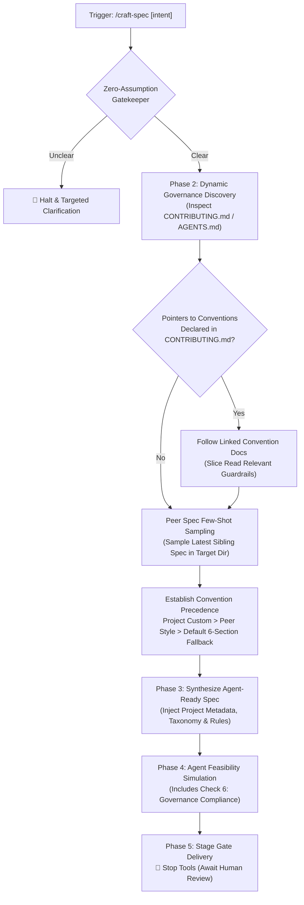
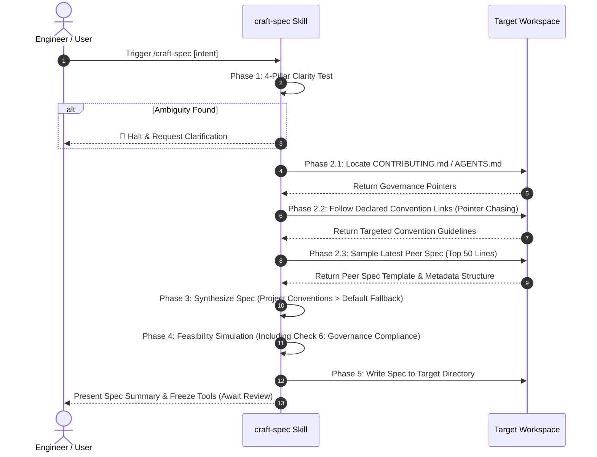

# Dynamic Governance & CONTRIBUTING.md Grounding for `craft-spec` (`1-feature-craft-spec-contributing-grounding`)

<!-- Ref: docs/blueprint/1.1_workflow-governance.md -->
<!-- Invariant: All paths must be repository-relative or enclosed in inline code backticks. NEVER use file:// or workstation-absolute paths (/Users/*, /home/*). -->

## 1. Overview & Rationale



### 1.1 Context & Problem Statement
- **Cross-Project Blindness**: When `craft-spec` is invoked across diverse repositories, it currently assumes a rigid, one-size-fits-all 6-section template and only inspects `docs/blueprint/` and `docs/reference/` (BDD mode) or generic package manifests (Universal mode).
- **Ignoring Project Conventions**: Real-world projects maintain specific workflow conventions (e.g. metadata header fields such as `Target Apps` and `Target Libs`, spec taxonomy such as `data-type` vs `contract` vs `feature` vertical slices, specific schema validation libraries such as TypeBox, and error code conventions). `craft-spec` lacks an automated mechanism to discover and assimilate these project-level rules.
- **Portability Constraint**: Hardcoding specific convention paths (e.g. `docs/convention/*`) violates universal portability, as different projects organize rules in `CONTRIBUTING.md`, `.github/CONTRIBUTING.md`, `docs/guidelines/`, or `AGENTS.md`.

### 1.2 Target Objectives
- **Canonical Entrypoint Grounding**: Establish `CONTRIBUTING.md` (and `.github/CONTRIBUTING.md` / `AGENTS.md`) as the universal governance entrypoint without hardcoding downstream convention subdirectories.
- **Dynamic Pointer Chasing**: Instruct the agent to read governance sections in `CONTRIBUTING.md` and follow declared markdown hyperlinks to convention files on-demand (progressive context loading).
- **Peer Spec Few-Shot Sampling**: Sample the top $\le 50$ lines of the latest sibling specification in the target spec directory (`docs/progress/**` or `specs/**`) to mirror established metadata headers, naming schemes, and formatting conventions.
- **Convention Precedence Hierarchy**: Formulate an unambiguous priority hierarchy: Project Governance (`CONTRIBUTING.md` & referenced conventions) $\succ$ Existing Peer Specs $\succ$ Default Fallback Template.
- **Feasibility Simulation Check 6**: Add an explicit Governance & Convention Compliance audit check to Phase 4 before delivering the specification.

---

## 2. System Invariants & Guardrails

### 2.1 Core Invariants
- **Zero Hardcoded Paths**: The skill must not mandate or assume fixed convention directory paths (such as `docs/convention/00-spec-convention.md`). All convention discovery must dynamically resolve through `CONTRIBUTING.md`, `AGENTS.md`, or peer spec sampling.
- **Non-Negotiable Core Invariants**: Regardless of project-specific metadata or section variations, all generated specifications must strictly retain:
  1. The **File Mutation Matrix** (`CREATE`, `MODIFY`, `DELETE`, `FORBIDDEN`).
  2. The **Automated Verification Oracle** (deterministic executable CLI command).
  3. **Stage Gate Isolation** (read-only during Stage 1, immediate tool freeze upon spec creation).
  4. **Strict Path Portability** (repository-relative paths, zero `file://` or machine-absolute workstation paths).
- **Pure-Skill First (Zero-Runtime Dependency)**: Enhancements must be realized entirely as cognitive instructions and checklists within `skills/craft-spec/SKILL.md` and reference documents. No external shell script binaries or runtime packages are introduced.
- **English-Only Maintenance**: All specifications, skill documents, templates, and commit suggestions must be maintained strictly in English.

### 2.2 Boundary Guardrails & Out-of-Scope (Forbidden Scope)
- ❌ **Out-of-Scope 1**: Do NOT modify `build-spec`, `settle-spec`, or `adopt-blueprint-workflow` in this vertical slice.
- ❌ **Out-of-Scope 2**: Do NOT hardcode project-specific conventions (e.g., POS terms, TypeBox requirements, or specific monorepo paths) into `craft-spec`. The skill must remain 100% domain-agnostic and language-agnostic.
- ❌ **Out-of-Scope 3**: Do NOT execute Stage 2 code modifications during this turn.

---

## 3. Cognitive / Execution Workflow Protocol



### Phase 1: Zero-Assumption Gatekeeper
1. Evaluate user intent against the 4-Pillar Clarity Test.
2. In Pillar 3 (Architectural Invariants), explicitly include checking project governance invariants.

### Phase 2: Dynamic Governance Discovery & Archetype Grounding
1. **Locate Universal Governance Entrypoint**:
   - Inspect workspace root for `CONTRIBUTING.md`, `.github/CONTRIBUTING.md`, or `AGENTS.md`.
   - Read sections governing Specification Authoring, Stage 1 Lifecycles, Naming Conventions, and Architecture Boundaries.
2. **Dynamic Pointer Chasing (Progressive Loading)**:
   - If `CONTRIBUTING.md` links to specific convention documents (e.g. `docs/convention/...`, `guidelines/...`), use line-range viewing to extract relevant rules (naming, type system, error codes, UI rules) without reading entire directories.
3. **Archetype Detection**:
   - Mode A (BDD): `docs/progress/` or `docs/blueprint/` present. Target: `docs/progress/[blueprint-code]/[Index]-[type]-[slug].md`.
   - Mode B (Universal): Target: `specs/`, `docs/specs/`, or `.agents/specs/`.
4. **Peer Spec Few-Shot Sampling**:
   - Inspect the top $\le 50$ lines of the latest 1–2 sibling specifications in the resolved target directory.
   - Extract the project's real-world **Metadata Block**, **Title Style**, **Taxonomy**, and **Language Convention**.

### Phase 3: Agent-Ready Spec Synthesis
1. Apply the **Convention Precedence Rule**:
   $$\text{Project Governance (CONTRIBUTING.md / Linked Docs)} \succ \text{Peer Spec Patterns} \succ \text{Default 6-Section Fallback}$$
2. Inject project-specific metadata (e.g., `## 1. Metadata` with `Target Apps`, `Target Libs`, `Owner`, `Blueprint Code`) if mandated by project conventions.
3. Ensure Core Invariants (Mutation Matrix, Oracle, Boundaries, Path Portability) remain fully intact.

### Phase 4: Downstream Agent Feasibility Simulation
Execute cognitive simulation across 6 non-negotiable checks:
- *Check 1 (Zero-Guesswork)*: Can a fresh agent implement without assuming missing types or paths?
- *Check 2 (Quantitative Invariants)*: Are qualitative adjectives replaced with assertable thresholds?
- *Check 3 (Automated Oracle)*: Is there a deterministic terminal command?
- *Check 4 (Path Purity)*: Are all paths repository-relative with ZERO `file://` or absolute paths?
- *Check 5 (Workspace Containment)*: Do all declared paths reside 100% within the workspace root?
- *Check 6 (Governance Compliance)*: Does the specification strictly adhere to the lifecycle, naming taxonomy, and architecture layers declared in the project's `CONTRIBUTING.md` and sampled peer specs?

### Phase 5: Delivery & Stage Gate Isolation
1. Write specification to the resolved path.
2. Present execution summary and stop tools immediately.

---

## 4. File Mutation Matrix (Target Scope)

Downstream agents in Stage 2 must restrict file operations strictly to the following declared paths:

- `CREATE`:
  - `docs/progress/1.1/1-feature-craft-spec-contributing-grounding.md`: [This specification document]
- `MODIFY`:
  - `skills/craft-spec/SKILL.md`: [Update Phase 2 with Dynamic Governance Discovery, Pointer Chasing, Peer Spec Sampling, and Phase 4 with Check 6]
  - `skills/craft-spec/references/spec-template.md`: [Add Convention Precedence declaration and dynamic metadata header compatibility]
  - `skills/craft-spec/references/clarity-gatekeeper-checklist.md`: [Update Pillar 3 to mandate project governance grounding]
- `DELETE`:
  - None
- `FORBIDDEN`:
  - `skills/build-spec/**`: [Stage 2 implementation engine remains untouched]
  - `skills/settle-spec/**`: [Stage 3 settlement engine remains untouched]
  - `skills/adopt-blueprint-workflow/**`: [Workflow bootstrapper remains untouched]
  - `docs/blueprint/**`: [Blueprints are frozen intent archives]

---

## 5. Interface Contract & Schema Deltas

### 5.1 SKILL.md Execution Protocol Updates
In `skills/craft-spec/SKILL.md`, Section `Phase 2: Archetype Profiling & Read-Only Grounding` will be enhanced to:

```markdown
### Phase 2: Archetype Profiling & Dynamic Governance Grounding
1. **Enforce Workspace Anchor**: Grounding MUST strictly resolve relative to the current workspace root (`CWD`). Explicitly disregard open editor tabs that reside outside the active repository root.
2. **Dynamic Governance Discovery**:
   - Inspect `CONTRIBUTING.md`, `.github/CONTRIBUTING.md`, or `AGENTS.md` for project-specific workflow rules, spec lifecycles, and architecture boundaries.
   - Follow declared markdown links to specific convention documents on-demand (Pointer Chasing).
3. **Detect Mode**:
   - `docs/progress/` or `docs/blueprint/` present in current workspace ➔ **Mode A (BDD)**.
   - Otherwise ➔ **Mode B (Universal)**.
4. **Context Grounding & Peer Spec Sampling (Read-Only)**:
   - *Mode A*: Ground from upstream blueprint (`docs/blueprint/[code]_*.md`) and living references (`docs/reference/`). Sample the top 50 lines of the latest sibling spec in `docs/progress/[code]/` to extract established metadata blocks, naming conventions, and type library choices.
   - *Mode B*: Ground from repository `README.md`, package manifests, and latest spec in `specs/` or `.agents/specs/`.
```

### 5.2 Feasibility Simulation Check 6 Definition
In `skills/craft-spec/SKILL.md`, Section `Phase 4`:

```markdown
- *Check 6 (Governance & Convention Compliance)*: Verify that the drafted spec adheres to the lifecycle, naming taxonomy, and architecture layers declared in the project's `CONTRIBUTING.md` and sampled peer specs.
```

### 5.3 Convention Precedence Contract (`spec-template.md`)
In `skills/craft-spec/references/spec-template.md`:

```markdown
> [!IMPORTANT]
> **Convention Precedence Rule**:
> If the target workspace defines a specification schema, lifecycle, or metadata structure in `CONTRIBUTING.md` (or referenced convention guidelines), that project convention MUST take precedence over this default template.
> This template serves as the canonical baseline fallback, guaranteeing that the **File Mutation Matrix** and **Verification Oracle** are always present.
```

---

## 6. Verification Oracle & Quality Gate

Deterministic verification commands to assert completion without subjective human guessing:

### 6.1 Automated Verification Commands
```bash
# Verify skill discovery and syntax across the repository
npx skills add . -l

# Verify specific skill discovery
npx skills use . --skill craft-spec
```

### 6.2 Acceptance Test Scenarios
- **Scenario A (Cross-Project Universal Grounding)**:
  - *Input*: Run `/craft-spec` in a repository with custom `CONTRIBUTING.md` specifying `## 1. Metadata` and TypeBox schemas.
  - *Expected Result*: Agent locates `CONTRIBUTING.md`, follows links if present, samples latest sibling spec, and outputs a spec matching the repository's metadata and type conventions while preserving the File Mutation Matrix and Verification Oracle.
- **Scenario B (Fallback on Generic Repo)**:
  - *Input*: Run `/craft-spec` in a generic repository with no `CONTRIBUTING.md` or convention files.
  - *Expected Result*: Agent gracefully falls back to the canonical 6-section template without errors or stalling.
