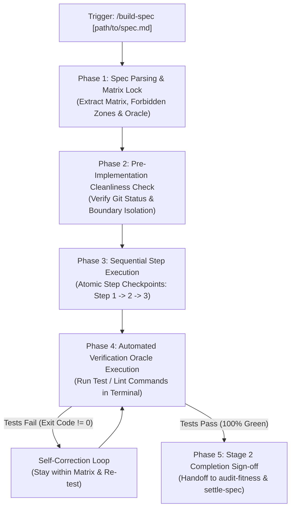
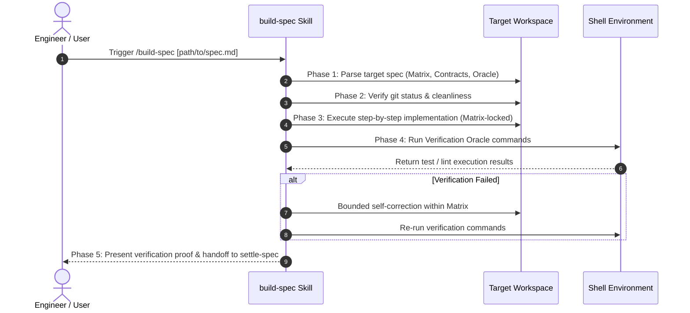

# Feature Specification: Build Specification Skill (`10-feature-build-spec-skill`)

<!-- Ref: [Blueprint 1.1] §2, §4, §5 (Workflow Governance) -->

## 1. Overview & Rationale

This specification defines the vertical slice for the **`build-spec`** skill as a **Pure `SKILL.md`** cognitive workflow, directly anchoring to [Blueprint 1.1: Workflow Governance](../../blueprint/1.1_workflow-governance.md) within [Domain 1: Agentic Engineering Governance](../../blueprint/1.0_agentic-engineering-governance.md).

It formalizes and automates **Stage 2: Implementation & Verification** of the Blueprint-Driven Development (BDD) lifecycle. Functioning as the execution engine between `craft-spec` (Stage 1 Specification Authoring) and `settle-spec` (Stage 3 Specification Settlement), `build-spec` takes an approved specification, locks implementation boundaries strictly to the declared **File Mutation Matrix**, advances through deterministic implementation steps with checkpointing, and mandates passing the **Verification Oracle** before declaring Stage 2 complete.



### 1.1 Context & Problem Statement
In agentic AI-assisted software development, downstream implementation agents frequently fail during Stage 2 execution due to three primary operational hazards:
1. **Scope Creep & Matrix Breach**: Given a task, an agent often modifies files outside the intended scope, introduces unvetted helper libraries, or touches `FORBIDDEN` architectural boundaries.
2. **Untracked / Chaotic Implementation Sequence**: Agents often jump directly to writing complex logic before setting up interfaces, types, or baseline mocks, resulting in cascaded compilation errors and confused debugging loops.
3. **Premature Hand-off (The "LGTM Without Running Tests" Anti-Pattern)**: Agents frequently write code, claim "implementation complete," and stop without actually running the project's automated test suite or build commands in the terminal.
4. **Disconnection Between Lifecycle Stages**: Developers lack a unified slash command to tell the agent: *"Take this spec, do the work, test it, and prove it works."*

### 1.2 Target Objectives
- Provide a standardized, portable cognitive workflow (`/build-spec [path]`) to govern Stage 2 implementation.
- Support **Spec Resolution**:
  - Direct path input (e.g., `/build-spec docs/progress/1.1/9-feature-craft-spec-skill.md`).
  - Zero-argument interactive discovery: Scans active specs in `docs/progress/` or `.agents/specs/` and presents candidates for selection.
- Enforce the **File Mutation Matrix Lock**:
  - Parse the target spec's Section 4 (`File Mutation Matrix`).
  - Strictly prohibit editing any file marked as `FORBIDDEN` or unlisted in the matrix.
- Enforce **Checkpoint-Driven Step Execution**:
  - Follow the sequential steps declared in Section 3 of the target spec.
- Enforce the **Verification Oracle Mandate**:
  - Autonomously execute the exact CLI test and lint commands declared in Section 6 of the spec.
  - Forbid declaring completion until all verification commands exit with code 0.
- Provide seamless handoff recommendations to `audit-workflow-fitness`, `gen-commit-message`, and `settle-spec`.

---

## 2. System Invariants & Guardrails

All operations within the `build-spec` skill must strictly adhere to the following invariants:

### 2.1 File Mutation Matrix Boundary Invariant
- The agent is **strictly locked** to the paths declared in the target specification's `File Mutation Matrix`.
- If an agent discovers during implementation that an unlisted file *must* be modified:
  - The agent **MUST NOT** silently edit the undeclared file.
  - It must pause, alert the user to the scope discrepancy, and propose an upstream amendment to the specification.
- Editing any path explicitly listed under `FORBIDDEN` is a fatal governance violation.

### 2.2 Verification Oracle Non-Negotiable Pass Invariant
- Stage 2 cannot be declared complete based on model self-assessment alone.
- The agent **MUST execute the terminal commands** specified under `Verification Oracle / Quality Gate` in the specification.
- If any command fails (exit code $\ne 0$):
  - The agent must enter a bounded self-correction loop (maximum 3 attempts).
  - If tests still fail after 3 attempts, the agent must halt and present the raw error logs to the user for human guidance.

### 2.3 Pre-Implementation Cleanliness Guardrail
- Before modifying any file on disk, `build-spec` must run `git status --short`.
- If there are uncommitted changes that collide with the files in the target File Mutation Matrix, `build-spec` must warn the user and seek confirmation before proceeding, preventing accidental overwrite of human scratch work.

### 2.4 Pure-Skill First Architecture
- Implemented strictly as a pure cognitive Markdown workflow (`skills/build-spec/SKILL.md`) without auxiliary script binaries, ensuring zero-runtime dependency and maximum cross-platform portability.

### 2.5 English-Only Maintenance Standard
- All generated code comments, test assertions, error descriptions, and commit message suggestions must be authored exclusively in English.

---

## 3. Five-Phase Cognitive Execution Protocol



### Phase 1: Spec Parsing & Target Resolution
1. **Target Specification Resolution**:
   - If path is provided (e.g., `/build-spec docs/progress/1.1/9-feature-craft-spec-skill.md`), verify file exists.
   - If invoked without arguments:
     - Scan `docs/progress/` (Mode A: BDD) or `.agents/specs/` / `specs/` (Mode B: Universal).
     - Present an enumerated list of candidate active specifications for user selection.
2. **Contract Extraction**:
   - Parse and lock the **File Mutation Matrix** (`CREATE`, `MODIFY`, `DELETE`, `FORBIDDEN`).
   - Extract the **Sequential Execution Steps**.
   - Extract the **Verification Oracle** commands and acceptance assertions.

### Phase 2: Pre-Implementation Cleanliness Check
1. Execute `git status --short`.
2. Cross-reference dirty files with the declared File Mutation Matrix.
3. If collision exists, prompt user:
   - Option A: Proceed and incorporate existing changes.
   - Option B: Abort and allow user to stash/commit first.

### Phase 3: Sequential Implementation Execution
1. Follow the target spec's sequential execution plan step-by-step:
   - **Step 1: Types & Interfaces First**: Establish data models, schemas, and error types before logic.
   - **Step 2: Core Logic & Boundary Enforcement**: Implement handlers, utilities, or skill workflows.
   - **Step 3: Automated Tests**: Write corresponding unit, contract, or integration tests alongside code.
2. **Boundary Enforcement**:
   - Verify every tool call (`write_to_file`, `replace_file_content`) targets only paths declared in the Matrix.

### Phase 4: Automated Verification Oracle Execution
1. Execute all verification commands declared in Section 6 of the target specification via `run_command` (e.g., `npm test`, `cargo test`, `npm run type-check`).
2. Evaluate exit codes and terminal outputs:
   - If exit code $== 0$: Verification PASSED.
   - If exit code $\ne 0$: Parse failure stack trace, formulate a localized patch strictly within the Matrix, and re-execute (max 3 loops).

### Phase 5: Stage 2 Completion Sign-off & Next-Stage Handoff
1. Display the **Stage 2 Completion Proof**:
   - List of modified/created files matching the Matrix.
   - Verification Oracle terminal output confirming passing tests.
2. Present the next-stage lifecycle commands:
   - `audit-workflow-fitness` (Workflow and spec linting)
   - `gen-commit-message` (Angular-style commit generation)
   - `settle-spec [path]` (Stage 3 reference settlement and WIP spec retirement)

---

## 4. File Mutation Matrix (Stage 2 Target Scope)

When this specification is approved and handed off to Stage 2 implementation, the following files represent the exact boundary:

| Operation | Target Path | Responsibility / Purpose |
| :--- | :--- | :--- |
| `CREATE` | `skills/build-spec/SKILL.md` | Primary pure cognitive skill definition containing YAML frontmatter, Matrix-lock rules, and 5-phase execution protocol. |
| `CREATE` | `skills/build-spec/references/execution-checklist.md` | Checkpointed execution checklist for parsing specs and enforcing verification oracles. |
| `MODIFY` | `README.md` | Register `build-spec` in the skill bulleted list and usage examples. |
| `MODIFY` | `CONTRIBUTING.md` | Reference `build-spec` as the canonical tool for Stage 2 implementation in the 5-step lifecycle. |
| `FORBIDDEN` | `src/**`, `lib/**`, `apps/**` | Application code and external binaries are strictly prohibited. |

---

## 5. Interface Contract & Output Formats

### 5.1 Skill Manifest Frontmatter (`skills/build-spec/SKILL.md`)
```yaml
---
name: build-spec
description: Execute Stage 2 Implementation in Blueprint-Driven Development. Parses approved specifications, enforces strict File Mutation Matrix boundaries, advances through checkpointed execution steps, and mandates passing automated Verification Oracles.
---
```

### 5.2 Completion Proof Output Format
When Stage 2 is successfully completed, `build-spec` outputs this structured summary:
```markdown
> [!TIP]
> **Stage 2 Implementation Complete & Verified**
> All files strictly adhered to the File Mutation Matrix and passed the Verification Oracle.

### 📦 Implemented Files:
- `CREATE`: [path/to/file]
- `MODIFY`: [path/to/file]

### 🧪 Verification Oracle Results:
- Command: `[command]` ➔ Exit Code 0 (Passed)
- Command: `[command]` ➔ Exit Code 0 (Passed)

### 🚀 Next Steps:
1. Run `audit-workflow-fitness` to verify governance compliance.
2. Run `gen-commit-message` to stage and commit changes.
3. Run `/settle-spec [spec-path]` to settle living references and retire this progress spec.
```

---

## 6. Verification Criteria & Acceptance Tests

Stage 2 implementation of `build-spec` will be verified against the following deterministic criteria:

### 6.1 Automated Workflow Fitness Verification
- Run `audit-workflow-fitness` to verify repository governance compliance:
  - `consistency/no-manual-status-header`: Verify no `Status: Draft` tags exist.
  - `consistency/no-broken-relative-links`: Verify all markdown links in `skills/build-spec/` resolve cleanly.
  - `friction/max-token-overhead`: Verify `SKILL.md` is $\le 250$ lines ($\le 2,500$ tokens).

### 6.2 Matrix Boundary Guard Test (Simulation)
- **Scenario A (Matrix Adherence)**:
  - Input: Target spec declaring `CREATE skills/example/SKILL.md`.
  - Expected Output: Agent creates declared file, executes verification commands, and reports success.
- **Scenario B (Matrix Violation Attempt)**:
  - Input: Agent attempts to modify an unlisted file (e.g., `packages/unrelated/index.ts`).
  - Expected Output: Execution halts immediately; agent raises a boundary alert and refuses unauthorized disk modification.

### 6.3 Oracle Pass Gate Test (Simulation)
- **Scenario C (Failing Tests)**:
  - Input: Verification command exits with code 1.
  - Expected Output: Agent DOES NOT report success; attempts self-correction or flags failure for human intervention.
