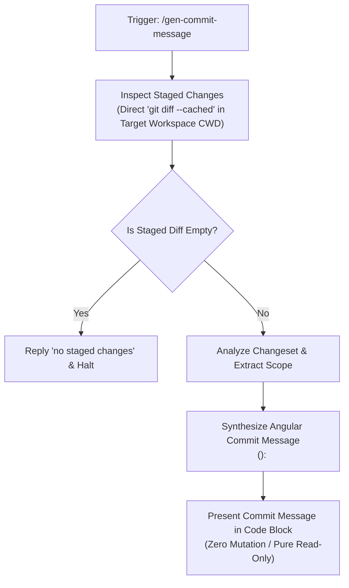
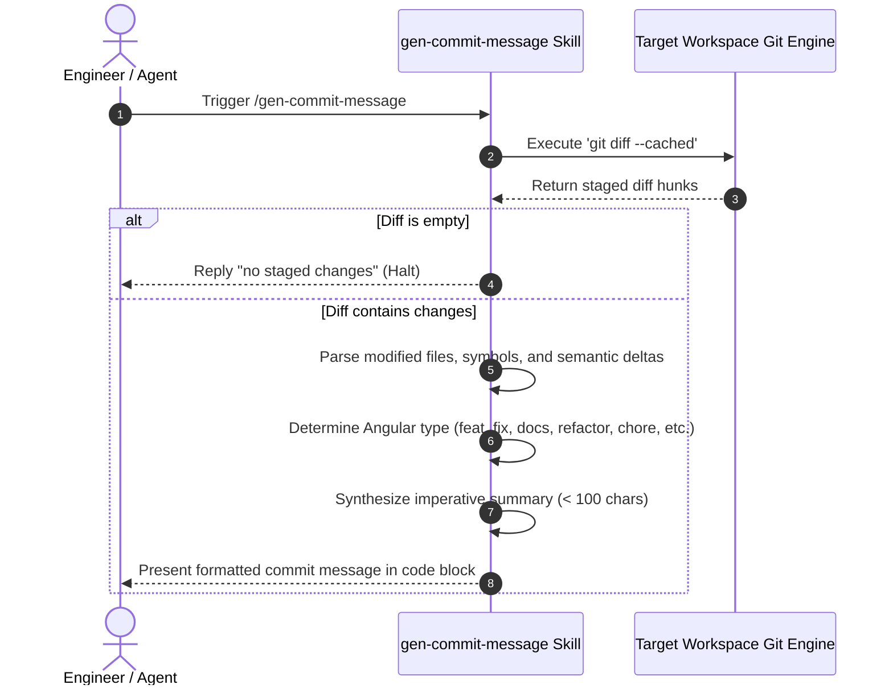

# Gen Commit Message CWD Portability & Pure-Skill First (`11-feature-gen-commit-message-cwd-portability`)

<!-- Ref: [Blueprint 1.1: Workflow Governance](../../blueprint/1.1_workflow-governance.md) §2, §4 & [Blueprint 1.0](../../blueprint/1.0_agentic-engineering-governance.md) §4.4 -->

## 1. Overview & Rationale

This specification formalizes the modernization of the `gen-commit-message` skill to achieve **Universal Portability (Zero-Runtime)** across arbitrary target workspaces and execution directories.



### 1.1 Context & Problem Statement
- In `skills/gen-commit-message/SKILL.md`, the instructions mandate executing `./scripts/get-staged-diff.sh` via relative path.
- When an AI agent executes within an external target repository (e.g., `omni-pos`), the process Current Working Directory (`CWD`) is the root of the target project, where `./scripts/get-staged-diff.sh` does not exist. This triggers a fatal `No such file or directory` shell error.
- The auxiliary script `get-staged-diff.sh` merely executes `git diff --cached`. Forcing execution through an external shell script violates the **Pure-Skill First (Zero-Runtime)** principle defined in [.agents/rules/skills-repository.md](../../../.agents/rules/skills-repository.md).

### 1.2 Target Objectives
- Modernize `skills/gen-commit-message/SKILL.md` to instruct agents to directly execute `git diff --cached` (or the equivalent Git tool call) within the target repository workspace.
- Retain `./scripts/get-staged-diff.sh` strictly as an optional local fast-path wrapper, ensuring zero runtime barriers.
- Maintain 100% compliance with the Angular Commit Convention and read-only safety invariants.

---

## 2. System Invariants & Guardrails

### 2.1 Core Invariants
- **Universal Portability (Zero-Runtime)**: The skill must operate in bare environments without requiring auxiliary script paths to be resolved relative to the target project root.
- **Strict Read-Only Git Operations**: The skill must inspect staged changes only. Proactively executing state-mutating Git commands (`git add`, `git commit`, `git reset`, `git checkout`) remains strictly prohibited.
- **English-Only Maintenance**: Generated commit messages, documentation, and skill definitions must be maintained exclusively in English.
- **Angular Convention Compliance**: All generated messages must follow `<type>(<scope>): <subject>` with lowercase subjects, imperative mood, no ending period, and $\le 100$ characters.

### 2.2 Boundary Guardrails & Out-of-Scope (Forbidden Scope)
- ❌ **Out-of-Scope 1**: Do NOT remove `skills/gen-commit-message/scripts/get-staged-diff.sh` (retain for backward compatibility with CLI wrappers).
- ❌ **Out-of-Scope 2**: Do NOT introduce new commit types beyond standard Angular conventions.
- ❌ **Out-of-Scope 3**: Do NOT execute `git commit` automatically under any circumstance.

---

## 3. Cognitive / Execution Workflow Protocol



### Phase 1: Staged Diff Inspection
1. Execute `git diff --cached` directly in the target repository shell (or invoke git diff tool).
2. If the command output is empty or whitespace-only:
   - Immediately reply with "no staged changes" and terminate execution.
   - Do not prompt for further action or stage unstaged files.

### Phase 2: Changeset Semantic Analysis
1. Analyze the staged file paths and diff hunks to identify the primary architectural scope.
2. Select the most precise Angular commit type:
   - `feat`: User-facing features or system capabilities.
   - `fix`: Bug fixes and error resolutions.
   - `docs`: Documentation, README, or markdown specification changes.
   - `style`: Formatting, whitespace, or missing semicolon adjustments.
   - `refactor`: Structural code changes without functional or API modification.
   - `perf`: Performance improvements.
   - `test`: Adding or correcting automated tests.
   - `build`: Build system or external package dependency changes.
   - `ci`: CI workflow configurations and automation scripts.
   - `chore`: Governance updates, rules, or auxiliary tasks.

### Phase 3: Message Synthesis & Presentation
1. Craft the message header adhering to `<type>(<scope>): <subject>`.
2. Output the commit message clearly in an isolated code block.
3. Freeze tools immediately without executing or prompting to execute `git commit`.

---

## 4. File Mutation Matrix (Target Scope)

| Operation | Target Path | Responsibility / Purpose |
| :--- | :--- | :--- |
| `MODIFY` | `skills/gen-commit-message/SKILL.md` | Update staged change inspection instructions to prioritize direct `git diff --cached` execution over relative script paths. |
| `FORBIDDEN` | `skills/gen-commit-message/scripts/get-staged-diff.sh` | Retain existing auxiliary script without mutation. |
| `FORBIDDEN` | `src/**`, `apps/**`, `libs/**` | Production application code remains untouched. |

---

## 5. Interface Contract & Schema Deltas

### 5.1 Modified Instruction Contract in `SKILL.md`

```markdown
## Guidelines

1. **Analyze Staged Changes**:
   - Inspect the currently staged changes by running `git diff --cached` directly in the active repository terminal (or use the auxiliary script `./scripts/get-staged-diff.sh` if running from within the skill directory).
   - If there are no staged changes (i.e., the diff output is empty), reply directly with "no staged changes" and stop immediately.
   - **Important**: DO NOT proactively run any Git commands that modify the repository state (such as `git add`, `git commit`, `git reset`, `git checkout`). Only inspect and analyze what is already staged. Always re-run `git diff --cached` to re-analyze files whenever this skill is triggered.
```

### 5.2 Error & Boundary Handling

| Condition | Observed Output | Skill Action |
| :--- | :--- | :--- |
| No staged changes | Exit code 0, empty stdout | Output `no staged changes` and halt |
| Not a Git repository | `fatal: not a git repository` | Alert user that directory is not a Git repository |
| Merge conflict in index | `U <file>` markers in diff | Highlight conflict resolution required before commit |

---

## 6. Verification Oracle & Quality Gate

Deterministic verification commands to assert completion without subjective human guessing:

### 6.1 Automated Verification Commands
```bash
# 1. Verify SKILL.md contains direct git diff --cached instructions
grep -F "git diff --cached" skills/gen-commit-message/SKILL.md

# 2. Verify audit-workflow-fitness passes with 0 errors
# (Evaluated via cognitive audit or local inspection)
```

### 6.2 Acceptance Test Scenarios
- **Scenario A (Direct Git Diff Execution in External Repo)**:
  - *Context*: Invoked from an external directory where `./scripts/get-staged-diff.sh` does not exist.
  - *Expected Result*: Agent executes `git diff --cached` directly without error, successfully parses staged diff, and outputs valid Angular commit message.
- **Scenario B (Empty Staging Area)**:
  - *Context*: `git diff --cached` returns empty string.
  - *Expected Result*: Agent replies with "no staged changes" and halts immediately with zero additional tool calls.
