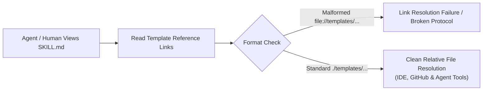
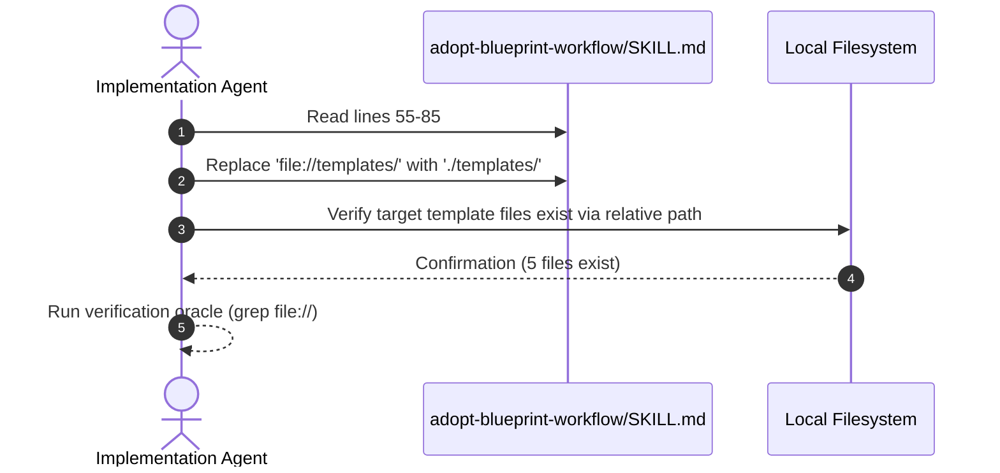

# Adopt Blueprint Workflow Template Relative Links (`12-feature-adopt-blueprint-workflow-template-links`)

<!-- Ref: [Blueprint 1.1: Workflow Governance](../../blueprint/1.1_workflow-governance.md) §2, §4 & [.agents/rules/skills-repository.md](../../../.agents/rules/skills-repository.md) -->

## 1. Overview & Rationale

This specification formalizes correcting the template reference links in `skills/adopt-blueprint-workflow/SKILL.md` from malformed pseudo-URIs (`file://templates/...`) to standard repository-relative links (`./templates/...`), ensuring universal link portability across markdown previewers, IDEs, and autonomous agent toolchains.



### 1.1 Context & Problem Statement
- In `skills/adopt-blueprint-workflow/SKILL.md` (lines 60, 61, 62, 71, and 81), links to template files are formatted as `[path](file://templates/...)`.
- The `file://` scheme requires an absolute filesystem path (e.g., `file:///path/to/file`). Writing `file://templates/...` constitutes a malformed URI scheme that fails in standard markdown renderers, breaks IDE clickability, and confuses AI agent tool resolvers.
- This violates the **Path Portability & Standards** directive in [.agents/rules/skills-repository.md](../../../.agents/rules/skills-repository.md), which mandates strict relative paths (`./` or `../`) and zero absolute or pseudo-absolute URI schemes.

### 1.2 Target Objectives
- Normalize all 5 template reference links in `skills/adopt-blueprint-workflow/SKILL.md` to standard relative links (`./templates/...`).
- Ensure all template links physically resolve to existing files on disk.
- Prevent link-parsing errors during cross-project adoption workflows.

---

## 2. System Invariants & Guardrails

### 2.1 Core Invariants
- **Strict Relative Paths**: All documentation links and template references within skill directories must use valid repository-relative paths (`./templates/...`).
- **Zero Invalid URI Schemes**: The pseudo-scheme `file://templates/` is strictly prohibited.
- **Template Content Immutability**: The actual template files under `skills/adopt-blueprint-workflow/templates/` must remain untouched.
- **English-Only Maintenance**: All markdown instructions and documentation must be maintained exclusively in English.

### 2.2 Boundary Guardrails & Out-of-Scope (Forbidden Scope)
- ❌ **Out-of-Scope 1**: Do NOT modify the content of `skills/adopt-blueprint-workflow/templates/CONTRIBUTING.md`, `AGENTS.md`, or `templates/docs/**/README.md`.
- ❌ **Out-of-Scope 2**: Do NOT alter the 5-phase execution protocol in `skills/adopt-blueprint-workflow/SKILL.md`.

---

## 3. Cognitive / Execution Workflow Protocol



### Phase 1: Targeted Link Replacement
1. Locate lines 60, 61, 62, 71, and 81 in `skills/adopt-blueprint-workflow/SKILL.md`.
2. Replace each `file://templates/` prefix with `./templates/`.

### Phase 2: Relative Resolution Verification
1. Validate that each resolved relative path exists in the filesystem:
   - `./templates/docs/blueprint/README.md`
   - `./templates/docs/progress/README.md`
   - `./templates/docs/reference/README.md`
   - `./templates/CONTRIBUTING.md`
   - `./templates/AGENTS.md`

---

## 4. File Mutation Matrix (Target Scope)

| Operation | Target Path | Responsibility / Purpose |
| :--- | :--- | :--- |
| `MODIFY` | `skills/adopt-blueprint-workflow/SKILL.md` | Replace malformed `file://templates/...` links with valid `./templates/...` relative links. |
| `FORBIDDEN` | `skills/adopt-blueprint-workflow/templates/**` | Template contents are strictly protected. |
| `FORBIDDEN` | `skills/adopt-blueprint-workflow/references/**` | Reference whitepaper is strictly protected. |

---

## 5. Interface Contract & Schema Deltas

### 5.1 Exact Line Replacements in `SKILL.md`

```diff
- - `docs/blueprint/README.md`: Sourced from [templates/docs/blueprint/README.md](file://templates/docs/blueprint/README.md).
- - `docs/progress/README.md`: Sourced from [templates/docs/progress/README.md](file://templates/docs/progress/README.md).
- - `docs/reference/README.md`: Sourced from [templates/docs/reference/README.md](file://templates/docs/reference/README.md).
+ - `docs/blueprint/README.md`: Sourced from [templates/docs/blueprint/README.md](./templates/docs/blueprint/README.md).
+ - `docs/progress/README.md`: Sourced from [templates/docs/progress/README.md](./templates/docs/progress/README.md).
+ - `docs/reference/README.md`: Sourced from [templates/docs/reference/README.md](./templates/docs/reference/README.md).

- - `CONTRIBUTING.md`: Sourced from [templates/CONTRIBUTING.md](file://templates/CONTRIBUTING.md).
+ - `CONTRIBUTING.md`: Sourced from [templates/CONTRIBUTING.md](./templates/CONTRIBUTING.md).

- - Copy [templates/AGENTS.md](file://templates/AGENTS.md) directly to the project root `AGENTS.md`.
+ - Copy [templates/AGENTS.md](./templates/AGENTS.md) directly to the project root `AGENTS.md`.
```

---

## 6. Verification Oracle & Quality Gate

Deterministic verification commands to assert completion without subjective human guessing:

### 6.1 Automated Verification Commands
```bash
# 1. Assert zero occurrences of file://templates in adopt-blueprint-workflow
! grep -F "file://templates" skills/adopt-blueprint-workflow/SKILL.md

# 2. Assert exactly 5 occurrences of ./templates in adopt-blueprint-workflow
test $(grep -c "\./templates/" skills/adopt-blueprint-workflow/SKILL.md) -ge 5
```

### 6.2 Acceptance Test Scenarios
- **Scenario A (Clean Relative Links)**:
  - *Input*: Read `skills/adopt-blueprint-workflow/SKILL.md` link targets.
  - *Expected Result*: All 5 links resolve to existing physical files in `skills/adopt-blueprint-workflow/templates/` without `file://` pseudo-protocol errors.
