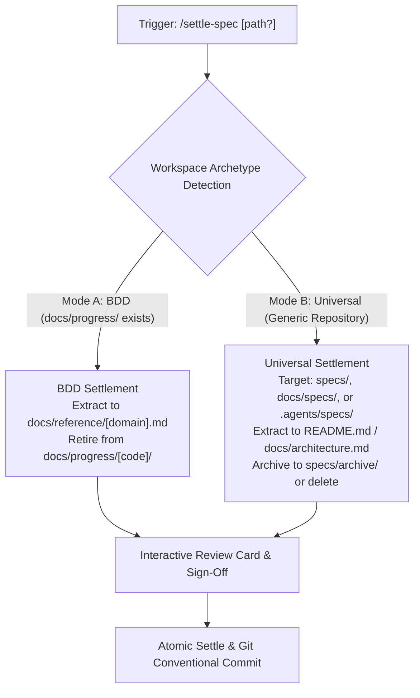
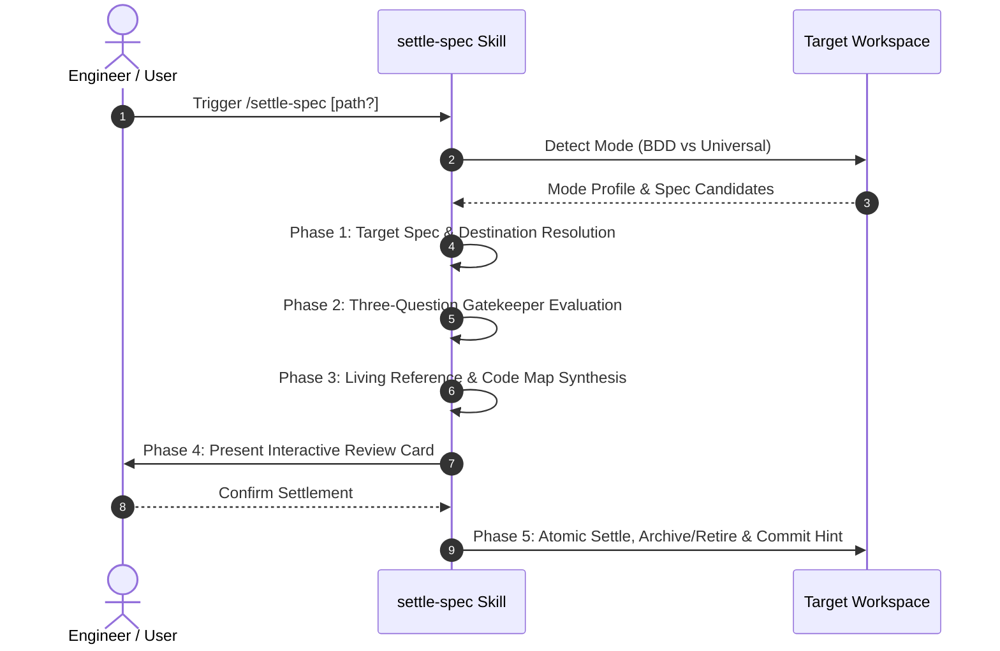

# Settle Spec Universal Mode Support (`13-feature-settle-spec-universal-mode`)

<!-- Ref: [Blueprint 1.1: Workflow Governance](../../blueprint/1.1_workflow-governance.md) §2, §4 & [Blueprint 1.0](../../blueprint/1.0_agentic-engineering-governance.md) §4.1 -->

## 1. Overview & Rationale

This specification formalizes extending the `settle-spec` skill with **Dual-Mode Archetype Support (Mode A: BDD Mode & Mode B: Universal Mode)**, establishing complete architectural parity across the three core BDD lifecycle skills (`craft-spec`, `build-spec`, and `settle-spec`) and enabling seamless Stage 3 Specification Settlement in generic, non-BDD repositories.



### 1.1 Context & Problem Statement
- While `craft-spec` and `build-spec` have dual-mode operation (supporting both Mode A: BDD and Mode B: Universal repositories using `specs/` or `.agents/specs/`), `settle-spec` was originally authored with hardcoded assumptions requiring `docs/progress/` and `docs/reference/`.
- When invoked in a generic repository that does not employ the BDD folder hierarchy, `settle-spec` fails in Phase 1 because `docs/progress/` does not exist, leaving users unable to settle specifications authored by `craft-spec` and verified by `build-spec`.
- This creates an architectural parity defect across the specification lifecycle.

### 1.2 Target Objectives
- Add **Adaptive Dual-Mode Operation** to `skills/settle-spec/SKILL.md` matching `craft-spec` and `build-spec`.
- Define **Mode B (Universal Mode)** settlement protocols:
  - Spec discovery across `specs/`, `docs/specs/`, `docs/plans/`, or `.agents/specs/`.
  - Invariant and architectural flow extraction targeting project `README.md`, `docs/architecture.md`, or discovered living references.
  - Safe retirement via archiving into `specs/archive/` (or `.agents/specs/archive/`) or user-confirmed deletion.
- Update `skills/settle-spec/references/settle-checklist.md` to reflect dual-mode resolution.

---

## 2. System Invariants & Guardrails

### 2.1 Core Invariants
- **Adaptive Dual-Mode Parity**:
  - **Mode A (BDD Mode)**: Detected if `docs/progress/` or `docs/blueprint/` exists. Targets `docs/progress/` and `docs/reference/`.
  - **Mode B (Universal Mode)**: Detected when BDD markers are absent. Discovers specs in `specs/`, `docs/specs/`, or `.agents/specs/`, settling into discovered reference docs or project `README.md` and archiving to `[spec-dir]/archive/`.
- **Strict Read-Only Source Code Boundary**: `settle-spec` operates exclusively on documentation and specification files. It **never** mutates application source code or tests during settlement.
- **Interactive Human Sign-Off**: Proposed settlements and file retirements must be presented via the Settle Review Card and approved by the user before executing disk mutations.
- **Code as Truth**: Never extract ephemeral CRUD DTO dictionaries, database tables, or duplicate route listings during settlement.
- **English-Only Maintenance**: All synthesized reference sections, commit messages, and checklists must be authored exclusively in English.

### 2.2 Boundary Guardrails & Out-of-Scope (Forbidden Scope)
- ❌ **Out-of-Scope 1**: Do NOT alter the core Three-Question Gatekeeper logic (Q1 State Machines, Q2 Invariants, Q3 Ephemeral DTOs).
- ❌ **Out-of-Scope 2**: Do NOT mutate `skills/settle-spec/references/code-map-patterns.md`.

---

## 3. Cognitive / Execution Workflow Protocol



### Phase 1: Mode Profiling & Target Spec Resolution
1. **Detect Archetype Mode**:
   - `docs/progress/` or `docs/blueprint/` exists ➔ **Mode A (BDD Mode)**.
   - Otherwise ➔ **Mode B (Universal Mode)**.
2. **Resolve Target Spec**:
   - If argument provided, verify path exists.
   - If zero arguments provided:
     - Mode A: List active markdown specs in `docs/progress/**/`.
     - Mode B: Scan discovered spec paths (`specs/`, `docs/specs/`, `.agents/specs/`).
     - Prompt user to pick active specification.
3. **Resolve Settlement Destination**:
   - Mode A: `docs/reference/[domain].md`.
   - Mode B: Existing architectural reference (e.g., `docs/architecture.md`, `docs/reference.md`) or append to project `README.md`.

### Phase 2: Three-Question Gatekeeper Evaluation
Evaluate the target specification against:
- **Q1**: State machines & Mermaid sequence diagrams $\to$ Extract.
- **Q2**: Fault-tolerance & boundary rules $\to$ Extract.
- **Q3**: Self-explanatory code & ephemeral details $\to$ Discard DTO tables and temporary checklists.

### Phase 3: Living Reference Synthesis
Synthesize extracted invariants, diagrams, and code maps into the target reference destination.

### Phase 4: Interactive Review Card & Confirmation
Present the Settle Gatekeeper Report card and await explicit human confirmation.

### Phase 5: Atomic Settle & Retirement
1. Write synthesized content to the destination document.
2. Retire the completed specification:
   - Mode A: Delete from `docs/progress/` and prune empty directory.
   - Mode B: Move to `specs/archive/` (or `.agents/specs/archive/`), or delete upon user request.
3. Output Conventional Commit suggestion.

---

## 4. File Mutation Matrix (Target Scope)

| Operation | Target Path | Responsibility / Purpose |
| :--- | :--- | :--- |
| `MODIFY` | `skills/settle-spec/SKILL.md` | Add Adaptive Dual-Mode Operation, Mode B Universal detection, and universal settlement/archiving protocols. |
| `MODIFY` | `skills/settle-spec/references/settle-checklist.md` | Update checklist with Mode A and Mode B resolution paths. |
| `FORBIDDEN` | `skills/settle-spec/references/code-map-patterns.md` | Code map patterns remain unchanged. |
| `FORBIDDEN` | `src/**`, `apps/**`, `libs/**` | Application source files remain strictly protected. |

---

## 5. Interface Contract & Schema Deltas

### 5.1 Modified Sections in `SKILL.md`

#### Addition to Invariants & Dual-Mode Description:
```markdown
- **Adaptive Dual-Mode Operation**:
  - **Mode A (BDD Mode)**: Detected via `docs/progress/` or `docs/blueprint/`. Spec target: `docs/progress/[blueprint-code]/[Index]-feature-[slug].md`. Reference target: `docs/reference/[domain].md`. Spec retirement: file deletion and empty directory pruning.
  - **Mode B (Universal Mode)**: Detected when BDD markers are absent. Spec candidates discovered in `specs/`, `docs/specs/`, `docs/plans/`, or `.agents/specs/`. Reference target: discovered reference file (`docs/architecture.md`, `docs/reference.md`) or project `README.md`. Spec retirement: relocate to `[spec-dir]/archive/` or delete upon user confirmation.
```

#### Update to Phase 1 in `SKILL.md`:
```markdown
### Phase 1: Pre-flight Verification & Target Resolution

1. **Detect Workspace Archetype**:
   - Check if `docs/progress/` or `docs/blueprint/` exists $\rightarrow$ **Mode A (BDD)**.
   - Otherwise $\rightarrow$ **Mode B (Universal)**.
2. **Resolve Target Specification**:
   - *Mode A*: Scan `docs/progress/` for active markdown specifications (`*.md`).
   - *Mode B*: Scan `specs/`, `docs/specs/`, `docs/plans/`, or `.agents/specs/` for active specs.
   - Present candidate list if no path argument was passed.
3. **Resolve Settlement Destination**:
   - *Mode A*: Map to `docs/reference/[domain].md`.
   - *Mode B*: Map to existing living spec, `docs/architecture.md`, or project `README.md`.
```

---

## 6. Verification Oracle & Quality Gate

Deterministic verification commands to assert completion without subjective human guessing:

### 6.1 Automated Verification Commands
```bash
# 1. Assert Dual-Mode and Universal Mode keywords present in settle-spec/SKILL.md
grep -E "Mode A \(BDD Mode\)" skills/settle-spec/SKILL.md
grep -E "Mode B \(Universal Mode\)" skills/settle-spec/SKILL.md

# 2. Assert settle-checklist.md contains dual-mode resolution
grep -E "(Universal Mode|Mode B)" skills/settle-spec/references/settle-checklist.md
```

### 6.2 Acceptance Test Scenarios
- **Scenario A (Universal Repository Settle Execution)**:
  - *Context*: Workspace with `specs/1-feature-example.md` and no `docs/progress/`.
  - *Expected Result*: `settle-spec` correctly detects Mode B, reads the spec, extracts invariants, proposes settlement to project reference/README, and plans retirement to `specs/archive/`.
- **Scenario B (Standard BDD Repository Settle Execution)**:
  - *Context*: Workspace with `docs/progress/1.1/1-feature-example.md`.
  - *Expected Result*: `settle-spec` executes Mode A, updating `docs/reference/workflow-governance.md` and pruning the completed progress file.
