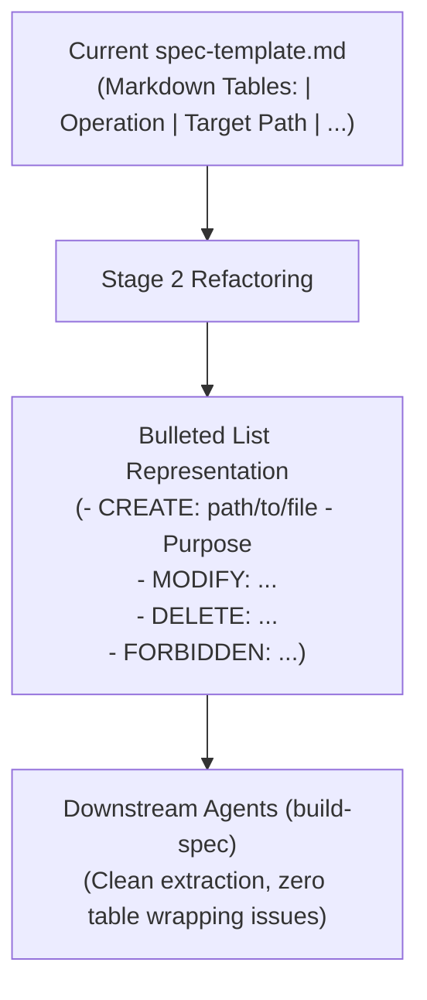
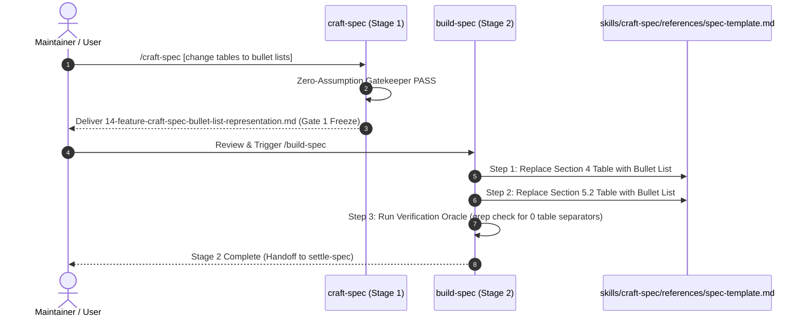

# Craft Spec Table to Bullet List Representation (`14-feature-craft-spec-bullet-list-representation`)

<!-- Ref: docs/blueprint/1.1_workflow-governance.md -->

## 1. Overview & Rationale

This specification refactors the template and guidance within the `craft-spec` skill to replace all Markdown tables with structured bulleted lists. 

In markdown-based agent workflows, Markdown tables introduce formatting friction:
1. Multi-line descriptions and backticks inside table cells frequently cause rendering bugs and column misalignment.
2. Markdown table parsing can be brittle across heterogeneous LLM architectures.
3. Repositories adhering to strict markdown standards (such as `.agents/rules/skills-repository.md`) discourage Markdown tables in favor of clear bulleted lists.

By converting the **File Mutation Matrix** (Section 4) and **Error Codes & Failure Modes** (Section 5.2) in `skills/craft-spec/references/spec-template.md` from tables into structured bullet lists, we improve agent readability, reduce token overhead, simplify programmatic extraction, and maintain clean diff ergonomics.



### 1.1 Context & Problem Statement
- In `skills/craft-spec/references/spec-template.md`, Section 4 (`File Mutation Matrix`) and Section 5.2 (`Error Codes & Failure Modes`) are formatted using Markdown pipe tables (`| ... |`).
- Piping syntax leads to cramped column boundaries when describing complex file responsibilities or error remediation instructions.
- Converting these sections to hierarchical bulleted lists provides superior readability and aligns with project-wide markdown design rules.

### 1.2 Target Objectives
- Convert the table in Section 4 (`File Mutation Matrix`) of `skills/craft-spec/references/spec-template.md` into a structured bullet list format.
- Convert the table in Section 5.2 (`Error Codes & Failure Modes`) of `skills/craft-spec/references/spec-template.md` into a structured bullet list format.
- Preserve 100% semantic information (Operations, Target Paths, Responsibilities/Purposes, Error Codes, Status/Exit Codes, Trigger Conditions, Remediation).
- Ensure zero breaking changes for downstream consumption by `build-spec`.

---

## 2. System Invariants & Guardrails

### 2.1 Core Invariants
- **Semantic Field Equivalence**: All fields previously captured in table columns must remain present as explicit labels in bullet items.
- **Pure-Skill First (Zero-Runtime Dependency)**: Changes remain strictly within Markdown template definitions without introducing runtime scripts.
- **English-Only Maintenance**: All template text, instructions, and examples must strictly remain in English.
- **Stage Gate Isolation**: Stage 1 deliverable is strictly this specification document in `docs/progress/1.1/`. Implementation edits to `skills/craft-spec/` are strictly deferred to Stage 2 after human review.

### 2.2 Boundary Guardrails & Out-of-Scope (Forbidden Scope)
- ❌ **Out-of-Scope 1**: Modifying other skills (such as `build-spec`, `settle-spec`, or `audit-workflow-fitness`).
- ❌ **Out-of-Scope 2**: Altering the standard 6-section schema hierarchy (Sections 1 through 6 remain intact).
- ❌ **Out-of-Scope 3**: Modifying application source code or installing runtime package dependencies.

---

## 3. Cognitive / Execution Workflow Protocol



### Phase 1: Review & Stage 1 Approval
1. Human reviews this specification document (`docs/progress/1.1/14-feature-craft-spec-bullet-list-representation.md`).
2. Verify that the proposed bullet list structure retains all necessary metadata for downstream agents.

### Phase 2: Sequential Implementation Execution (Stage 2)
1. **Step 1: Update Section 4 in `spec-template.md`**:
   - Replace Markdown pipe table with structured bullet list grouped by operation category (`CREATE`, `MODIFY`, `DELETE`, `FORBIDDEN`).
2. **Step 2: Update Section 5.2 in `spec-template.md`**:
   - Replace Markdown pipe table with structured bullet items detailing Error Code, Status/Exit Code, Trigger Condition, and Remediation.
3. **Step 3: Align `skills/craft-spec/SKILL.md` (if applicable)**:
   - Check if any references in `SKILL.md` require adjustment to reflect the bullet list schema.

### Phase 3: Verification & Settlement
1. Execute the automated Verification Oracle command.
2. Settle the update via `settle-spec` into `docs/reference/workflow-governance.md`.

---

## 4. File Mutation Matrix (Target Scope)

Downstream agents executing Stage 2 must restrict file operations strictly to the following declared paths:

- `MODIFY`:
  - `skills/craft-spec/references/spec-template.md`: Replace Section 4 and Section 5.2 tables with bullet lists.
- `FORBIDDEN`:
  - `skills/build-spec/**`: Do not alter build-spec logic.
  - `skills/settle-spec/**`: Do not alter settle-spec logic.
  - `src/**`, `lib/**`, `apps/**`: Application code remains strictly protected.

---

## 5. Interface Contract & Schema Deltas

### 5.1 Section 4: File Mutation Scope Delta (`spec-template.md`)

#### Before (Markdown Table):
```markdown
## 4. File Mutation Matrix (Target Scope)

Downstream agents must restrict file operations strictly to the following declared paths:

| Operation | Target Path | Responsibility / Purpose |
| :--- | :--- | :--- |
| `CREATE` | `path/to/new-file.ext` | [Purpose and exported symbols] |
| `MODIFY` | `path/to/existing-file.ext` | [Targeted modification slice] |
| `DELETE` | `path/to/deprecated-file.ext` | [Removal justification] |
| `FORBIDDEN` | `path/to/protected/**` | [Explicitly protected areas] |
```

#### After (Structured Bullet List):
```markdown
## 4. File Mutation Matrix (Target Scope)

Downstream agents must restrict file operations strictly to the following declared paths:

- `CREATE`:
  - `path/to/new-file.ext`: [Purpose and exported symbols]
- `MODIFY`:
  - `path/to/existing-file.ext`: [Targeted modification slice]
- `DELETE`:
  - `path/to/deprecated-file.ext`: [Removal justification]
- `FORBIDDEN`:
  - `path/to/protected/**`: [Explicitly protected areas]
```

### 5.2 Section 5.2: Error Codes & Failure Modes Delta (`spec-template.md`)

#### Before (Markdown Table):
```markdown
### 5.2 Error Codes & Failure Modes
| Error Code | HTTP / Exit Code | Trigger Condition | Remediation |
| :--- | :--- | :--- | :--- |
| `ERR_INVALID_INPUT` | 400 / 1 | Validation schema failure | Check required fields |
```

#### After (Structured Bullet List):
```markdown
### 5.2 Error Codes & Failure Modes
- **`ERR_INVALID_INPUT`**:
  - *Exit / Status Code*: `400` / `1`
  - *Trigger Condition*: Validation schema failure
  - *Remediation*: Check required fields
```

---

## 6. Verification Oracle & Quality Gate

Deterministic verification commands to assert completion without subjective human guessing:

### 6.1 Automated Verification Commands

```bash
# 1. Assert zero markdown table separator lines exist in spec-template.md
! grep -E "^\| :?---" skills/craft-spec/references/spec-template.md

# 2. Assert all 4 mutation operations exist in bullet form in spec-template.md
grep -E -- "- \`CREATE\`:" skills/craft-spec/references/spec-template.md
grep -E -- "- \`MODIFY\`:" skills/craft-spec/references/spec-template.md
grep -E -- "- \`DELETE\`:" skills/craft-spec/references/spec-template.md
grep -E -- "- \`FORBIDDEN\`:" skills/craft-spec/references/spec-template.md

# 3. Assert error code exists in bullet form in spec-template.md
grep -E -- "- \*\*\\\`ERR_INVALID_INPUT\\\`\*\*:" skills/craft-spec/references/spec-template.md
```

### 6.2 Acceptance Test Scenarios

- **Scenario A (Clean Elimination of Markdown Tables)**:
  - *Input*: Run `grep -E "^\| :?---" skills/craft-spec/references/spec-template.md`.
  - *Expected Result*: Exit code `1` (no matches found), indicating complete removal of pipe tables.
- **Scenario B (Preservation of Structural Data)**:
  - *Input*: Parse `skills/craft-spec/references/spec-template.md` Section 4 and 5.2.
  - *Expected Result*: All keys (`CREATE`, `MODIFY`, `DELETE`, `FORBIDDEN`, `ERR_INVALID_INPUT`, Exit Code, Trigger Condition, Remediation) are present and cleanly formatted as hierarchical bullet points.
