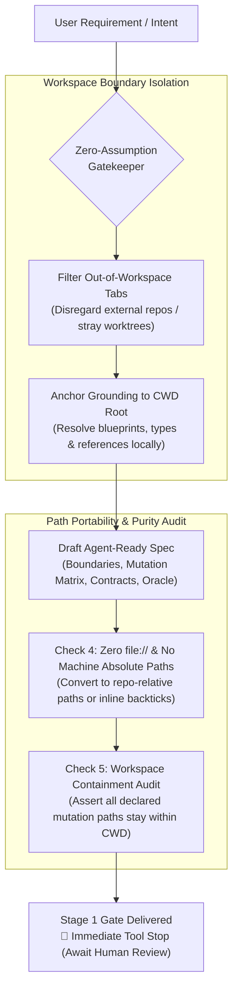
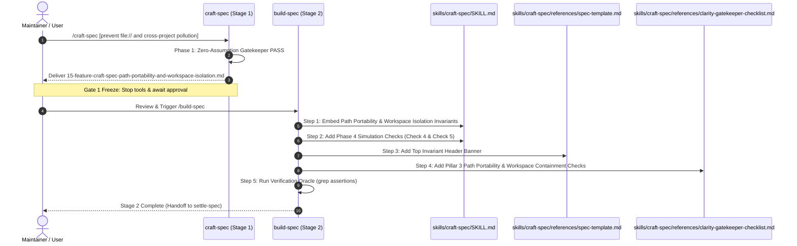

# Craft-Spec Path Portability & Workspace Isolation (`15-feature-craft-spec-path-portability-and-workspace-isolation`)

<!-- Ref: docs/blueprint/1.1_workflow-governance.md §2, §4 & docs/reference/workflow-governance.md §3.15, §3.16 -->

## 1. Overview & Rationale

This specification formalizes two critical governance guardrails for the `craft-spec` skill: **Path Portability (Zero-`file://` Invariant)** and **Workspace Boundary & Context Isolation**.



### 1.1 Context & Problem Statement
- **Path Portability Leakage (`file://` and Local Workstation Roots)**:
  - IDE base system instructions mandate clickable links using the `file://` scheme in chat dialogues.
  - When AI agents draft Stage 1 specifications via `write_to_file`, they often conflate conversational UI styling with persistent repository documentation, leaking machine-specific paths (e.g., `file:///Users/<username>/...` or `file:///home/<username>/...`) into `docs/progress/` files.
  - This breaks documentation portability across different machines, fails on web markdown viewers (GitHub/GitLab block `file://` under Same-Origin Policy), and causes downstream tools (`build-spec`, `audit-stale-ref`) to fail relative path resolution.
- **Cross-Project Context Contamination**:
  - IDE metadata (`<ADDITIONAL_METADATA>`) automatically passes currently open editor tabs (`Active Document` and `Other open documents`) and recent conversation history summaries (`<conversation_summaries>`) to the agent.
  - In multi-workspace setups, worktree workflows, or when switching between projects, active tabs often belong to an external repository.
  - Without an explicit workspace isolation guardrail, agents executing `/craft-spec` erroneously anchor grounding to external files, resulting in cross-project specifications, mixed domain concepts, and invalid File Mutation Matrices.

### 1.2 Target Objectives
1. **Codify Path Portability & Zero-`file://` Invariant**:
   - Formally declare that generated specification documents must strictly use repository-relative paths (`./`, `../`, `docs/...`) or plain inline code spans (`` `filename.ext` ``).
   - Strictly prohibit `file://` URIs and machine-specific absolute workstation paths (`/Users/*`, `/home/*`, `C:\*`) in all committed specification files.
2. **Codify Workspace Boundary & Context Isolation Invariant**:
   - Strictly anchor specification drafting and context grounding to the active target workspace root (`CWD`).
   - Mandate that agents ignore out-of-workspace editor tabs and external conversation summaries during grounding.
3. **Embed Path Purity & Workspace Containment Checks in Phase 4**:
   - Add automated self-audit checks before writing to disk, ensuring zero occurrences of `file://` and verifying that all File Mutation Matrix paths reside 100% within the target repository workspace.
4. **Update Supporting References**:
   - Embed anti-`file://` reminders in `skills/craft-spec/references/spec-template.md`.
   - Add path portability and workspace isolation criteria to `skills/craft-spec/references/clarity-gatekeeper-checklist.md`.

---

## 2. System Invariants & Guardrails

### 2.1 Core Invariants
- **Path Portability Invariant (Zero-`file://` & Zero-Machine-Absolute-Path)**:
  - All file references, interface paths, and markdown links within generated specification documents must use repository-relative paths or inline code backticks.
  - The `file://` scheme and workstation-specific prefixes (`/Users/`, `/home/`, `C:\`) are strictly forbidden inside any committed specification file.
- **Workspace Boundary & Context Isolation Invariant**:
  - All context grounding (blueprints, living references, package manifests, git status) must originate exclusively from the current target workspace root (`CWD`).
  - Open tabs (`Active Document`, `Other open documents`) that reside outside the active repository root must be explicitly ignored.
  - If a user prompt is ambiguous and the active document belongs to an external project, the agent must trigger a Gatekeeper halt rather than guessing or borrowing foreign domain context.
- **Pure-Skill First (Zero-Runtime Dependency)**:
  - Changes are strictly confined to Markdown instructions and checklists (`SKILL.md`, `spec-template.md`, `clarity-gatekeeper-checklist.md`) without introducing external scripts or binaries.
- **English-Only Maintenance**:
  - All documentation updates and checklist items must strictly remain in English.
- **Stage Gate Isolation**:
  - The Stage 1 deliverable is strictly this specification document in `docs/progress/1.1/`. Implementation modifications to `skills/craft-spec/` are strictly deferred to Stage 2 after human review.

### 2.2 Boundary Guardrails & Out-of-Scope (Forbidden Scope)
- ❌ **Out-of-Scope 1**: Modifying IDE base system prompts (such as `<communication_style>`), which are controlled by the host IDE runtime.
- ❌ **Out-of-Scope 2**: Modifying other skills (`build-spec`, `settle-spec`, `audit-workflow-fitness`).
- ❌ **Out-of-Scope 3**: Restricting `file://` links in conversational chat messages (where `file://` remains useful for IDE editor line jumps).

---

## 3. Cognitive / Execution Workflow Protocol



### Phase 1: Review & Stage 1 Approval
1. Human reviews this specification document (`docs/progress/1.1/15-feature-craft-spec-path-portability-and-workspace-isolation.md`).
2. Verify that the proposed invariant text, Phase 4 checks, and template notices address both `file://` leakage and cross-project contamination.

### Phase 2: Sequential Implementation Execution (Stage 2)
1. **Step 1: Update `skills/craft-spec/SKILL.md` Invariants**:
   - Add `Path Portability & Zero-file:// Invariant` under `## System Invariants & Guardrails`.
   - Add `Workspace Boundary & Context Isolation Invariant` under `## System Invariants & Guardrails`.
2. **Step 2: Update `skills/craft-spec/SKILL.md` Execution Protocol**:
   - In `Phase 1`, add instructions to reject external open tabs if ambiguous.
   - In `Phase 2`, mandate grounding strictly from `CWD` root and filtering out foreign workspace tabs.
   - In `Phase 4`, add `Check 4 (Path Purity Check)` and `Check 5 (Workspace Containment Check)`.
3. **Step 3: Update `skills/craft-spec/references/spec-template.md`**:
   - Add an invariant HTML comment at the top of the template reinforcing repository-relative links and forbidding `file://` or machine-absolute paths.
4. **Step 4: Update `skills/craft-spec/references/clarity-gatekeeper-checklist.md`**:
   - In Pillar 3 (Architectural Invariants), add explicit checklist verification items for path portability and workspace boundary containment.

### Phase 3: Automated Verification & Settlement
1. Execute the automated Verification Oracle command.
2. Settle the specification via `settle-spec` into `docs/reference/workflow-governance.md`.
3. Sync the updated skill to `~/.gemini/config/skills/craft-spec/`.

---

## 4. File Mutation Matrix (Target Scope)

Downstream agents executing Stage 2 must restrict file operations strictly to the following declared paths:

- `MODIFY`:
  - `skills/craft-spec/SKILL.md`: Add Path Portability and Workspace Boundary invariants, update Phase 1, Phase 2, and Phase 4 protocols.
  - `skills/craft-spec/references/spec-template.md`: Add path portability reminder header banner.
  - `skills/craft-spec/references/clarity-gatekeeper-checklist.md`: Add Pillar 3 path portability and workspace containment checklist items.
- `FORBIDDEN`:
  - `skills/build-spec/**`: Do not alter build-spec logic.
  - `skills/settle-spec/**`: Do not alter settle-spec logic.
  - `src/**`, `lib/**`, `apps/**`: Application code remains strictly protected.

---

## 5. Interface Contract & Schema Deltas

### 5.1 System Invariants Delta (`skills/craft-spec/SKILL.md`)

Add the following invariants under `## System Invariants & Guardrails`:

```markdown
- **Path Portability & Zero-`file://` Invariant**:
  All file paths, symbol references, and markdown links inside the generated specification document MUST strictly use repository-relative paths (e.g., `docs/reference/...`, `libs/...`) or plain inline code backticks (e.g., `StartupChecklistItemView.tsx`).
  The `file://` URI scheme and machine-specific absolute workstation paths (e.g., `/Users/*`, `/home/*`, `C:\*`) are **STRICTLY FORBIDDEN** within any repository documents. `file://` links are exclusively reserved for interactive chat dialogue, never repository files.

- **Workspace Boundary & Context Isolation Invariant**:
  The specification MUST be anchored strictly within the active target repository workspace (`CWD` / Workspace Root).
  The agent MUST ignore any open editor documents or conversation history belonging to external directories or different repositories. All analyzed blueprints, living references, and File Mutation Matrix paths must reside 100% within the current workspace boundary.
```

### 5.2 Execution Protocol Deltas (`skills/craft-spec/SKILL.md`)

#### Phase 2 Delta:
```markdown
### Phase 2: Archetype Profiling & Read-Only Grounding
1. **Enforce Workspace Anchor**: Grounding MUST strictly resolve relative to the current workspace root (`CWD`). Explicitly disregard open editor tabs (`Active Document`, `Other open documents`) that reside outside the active repository root.
2. **Detect Mode**:
   - `docs/progress/` or `docs/blueprint/` present in current workspace ➔ **Mode A (BDD)**.
   - Otherwise ➔ **Mode B (Universal)**.
3. **Context Grounding (Read-Only)**:
...
```

#### Phase 4 Delta:
```markdown
### Phase 4: Downstream Agent Feasibility Simulation
Execute a cognitive simulation before writing:
- *Check 1*: Can a fresh AI agent execute Stage 2 without guessing any file path or type signature?
- *Check 2*: Are all qualitative adjectives replaced with measurable invariants?
- *Check 3*: Is the Verification Oracle fully automated and executable in terminal?
- *Check 4 (Path Purity Check)*: Verify that the drafted specification markdown contains **ZERO occurrences** of `file://`, `/Users/`, `/home/`, or OS-specific absolute roots before invoking `write_to_file`. If found, convert them to repository-relative paths or inline backticks immediately.
- *Check 5 (Workspace Containment Check)*: Verify that all declared paths in the File Mutation Matrix reside 100% within the current target repository workspace.
```

### 5.3 Template Notice Delta (`skills/craft-spec/references/spec-template.md`)

Insert at line 8, right before Section 1:

```markdown
<!-- Invariant: All paths must be repository-relative or enclosed in inline code backticks. NEVER use file:// or workstation-absolute paths (/Users/*, /home/*). -->
```

### 5.4 Checklist Delta (`skills/craft-spec/references/clarity-gatekeeper-checklist.md`)

Insert under `### Pillar 3: Architectural Invariants (CONSTRAINTS)`:

```markdown
- [ ] Are path portability rules respected (strictly repository-relative or backticked, zero file:// or local absolute workstation paths)?
- [ ] Is grounding strictly isolated to the current repository workspace (disregarding out-of-workspace tabs and external conversation history)?
```

---

## 6. Verification Oracle & Quality Gate

Deterministic verification commands to assert completion without subjective human guessing:

### 6.1 Automated Verification Commands

```bash
# 1. Assert Path Portability Invariant is codified in SKILL.md
grep -E "Path Portability & Zero-\`file://\` Invariant" skills/craft-spec/SKILL.md

# 2. Assert Workspace Boundary Invariant is codified in SKILL.md
grep -E "Workspace Boundary & Context Isolation Invariant" skills/craft-spec/SKILL.md

# 3. Assert Check 4 and Check 5 exist in Phase 4 of SKILL.md
grep -E "Check 4 \(Path Purity Check\)" skills/craft-spec/SKILL.md
grep -E "Check 5 \(Workspace Containment Check\)" skills/craft-spec/SKILL.md

# 4. Assert template notice is present in spec-template.md
grep -F "NEVER use file:// or workstation-absolute paths" skills/craft-spec/references/spec-template.md

# 5. Assert checklist items exist in clarity-gatekeeper-checklist.md
grep -F "Are path portability rules respected" skills/craft-spec/references/clarity-gatekeeper-checklist.md
grep -F "Is grounding strictly isolated to the current repository workspace" skills/craft-spec/references/clarity-gatekeeper-checklist.md
```

### 6.2 Acceptance Test Scenarios

- **Scenario A (Path Portability & Purity Enforcement)**:
  - *Input*: Verify `skills/craft-spec/SKILL.md` lines for `file://` prohibition.
  - *Expected Result*: `SKILL.md` explicitly forbids `file://` in generated markdown files and mandates Check 4 self-audit before calling `write_to_file`.
- **Scenario B (Workspace Boundary Isolation)**:
  - *Input*: Verify `skills/craft-spec/SKILL.md` Phase 2 and Phase 4.
  - *Expected Result*: Phase 2 instructs agents to filter out external open tabs, and Check 5 validates that all File Mutation Matrix paths belong to the active workspace.
