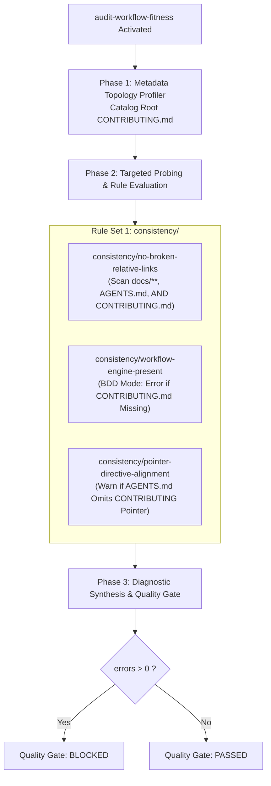
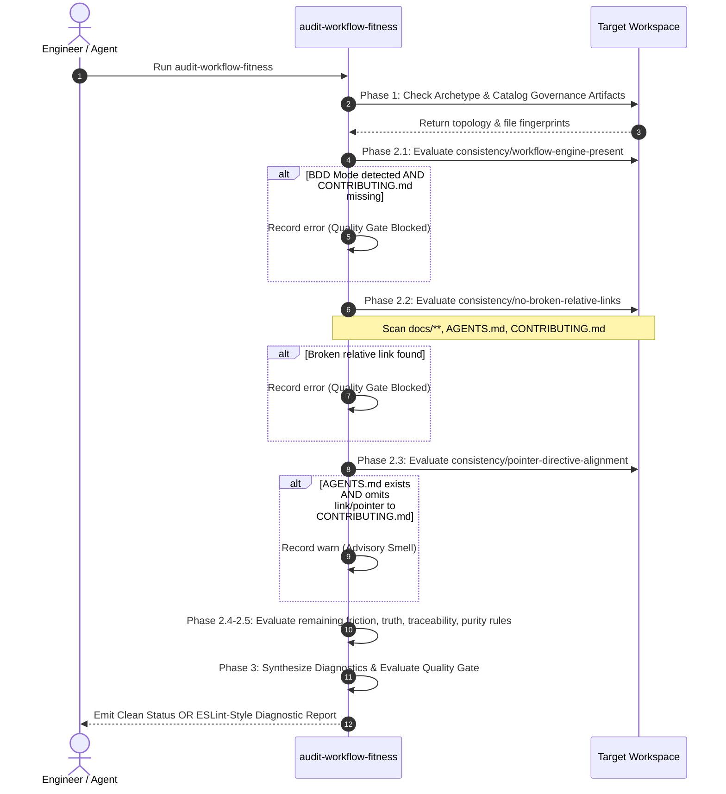

# Feature: Audit Workflow CONTRIBUTING.md Governance (`2-feature-audit-workflow-contributing-governance`)

<!-- Ref: [Blueprint 1.1] §2, §4, §5 -->
<!-- Invariant: All paths must be repository-relative or enclosed in inline code backticks. NEVER use file:// or workstation-absolute paths (/Users/*, /home/*). -->

## 1. Overview & Rationale

This specification formalizes the extension of `audit-workflow-fitness` to inspect and govern `CONTRIBUTING.md` and its pointer linkage across repositories.



### 1.1 Context & Problem Statement
- **Auditing Blindspot for Workflow Engine**:
  Although `CONTRIBUTING.md` was elevated to the canonical human/agent contributor workflow engine (per Living Reference §2.5 and §3.5), `audit-workflow-fitness` currently only records its file size in Phase 1 metadata profiling. In Phase 2, none of the diagnostic rules evaluate `CONTRIBUTING.md`.
- **Silent Broken Links**:
  `consistency/no-broken-relative-links` currently inspects only `docs/**` and `AGENTS.md`. Broken relative links inside `CONTRIBUTING.md` (e.g. invalid links to `docs/progress/`, `docs/reference/`, or internal tooling) pass without error.
- **BDD Archetype Invariant Gap**:
  When a project adopts Blueprint-Driven Development (BDD mode, signaled by `docs/blueprint/` or `docs/progress/`), the presence of `CONTRIBUTING.md` is mandatory for human and agent alignment. Without this rule, repositories with incomplete BDD scaffolding pass the Quality Gate.
- **Pointer Misalignment Drift**:
  Under the Two-Tier Pointer Architecture, `AGENTS.md` is expected to point to `CONTRIBUTING.md` (via bounded marker `<!-- blueprint-workflow:start -->` or explicit link), keeping agent instructions lean while establishing authoritative governance. Currently, broken or missing pointers in `AGENTS.md` are not audited.

### 1.2 Target Objectives
- **Link Integrity Coverage**:
  Expand `consistency/no-broken-relative-links` to scan markdown links within root `CONTRIBUTING.md`.
- **BDD Workflow Engine Gatekeeper**:
  Introduce `consistency/workflow-engine-present` (`error`) to enforce that BDD repositories maintain a root `CONTRIBUTING.md`.
- **Agent Pointer Alignment Verification**:
  Introduce `consistency/pointer-directive-alignment` (`warn`) to ensure `AGENTS.md` points downstream AI agents to `CONTRIBUTING.md`.
- **Pure-Skill Invariant**:
  Maintain a zero-runtime, zero-script cognitive implementation in `skills/audit-workflow-fitness/SKILL.md` consuming $< 2,000$ tokens of diagnostic context overhead.

---

## 2. System Invariants & Guardrails

### 2.1 Core Invariants
- **Non-Invasive Safety Guardrail**:
  The audit skill operates strictly in **read-only mode**. It never creates, edits, or deletes application source code, tests, or documentation during an audit run.
- **Binary Quality Gate Invariant**:
  Any `error` immediately triggers `Quality Gate: BLOCKED`. Warnings (`warn`) alert maintainers to governance smell without blocking CI or merge gates:
  $$\text{Quality Gate} = \begin{cases} \mathbf{PASSED}, & \text{if } \sum \text{errors} = 0 \\ \mathbf{BLOCKED}, & \text{if } \sum \text{errors} > 0 \end{cases}$$
- **Token-Guarded Inspection Protocol**:
  Inspections must leverage targeted pattern matching (`grep_search` / line-range slicing) instead of wholesale document ingestion, keeping total execution overhead $< 2,000$ tokens.
- **Language Invariant (English-Only Maintenance)**:
  All diagnostic messages, remediation tips, and rule documentation must be authored exclusively in English.
- **Path Portability & Zero-`file://` Invariant**:
  All file paths, pointers, and diagnostics within repository files must use repository-relative paths or inline backticks. Machine-specific absolute workstation paths (`/Users/*`, `/home/*`) and `file://` URIs are strictly forbidden.

### 2.2 Boundary Guardrails & Out-of-Scope (Forbidden Scope)
- ❌ **No File Mutation**:
  The skill must never auto-generate or patch `CONTRIBUTING.md` or `AGENTS.md` automatically; remediation must be presented for developer/agent execution.
- ❌ **No Modification to Core Workflow Skills**:
  Modifications are strictly limited to `skills/audit-workflow-fitness/SKILL.md`. Other skills (`craft-spec`, `build-spec`, `settle-spec`, `adopt-blueprint-workflow`) are out of scope.
- ❌ **No Blueprint Modification**:
  `docs/blueprint/**` files are frozen historical design records and must not be altered.
- ❌ **No Heavy Runtime Dependencies**:
  No npm packages, python scripts, or CLI binaries may be added to execute the audit.

---

## 3. Cognitive / Execution Workflow Protocol



### Phase 1: Metadata Topology Profiler Enhancement
1. When profiling governance artifacts, search for root workflow engine:
   - Root `CONTRIBUTING.md`
2. Record existence flag (`has_contributing`), line count, and byte count for token footprint computation.
3. Detect project mode:
   - If `docs/blueprint/` or `docs/progress/` is present ➔ `is_bdd_mode = true`.

### Phase 2: Probing & Rule Evaluation Updates
1. **Rule `consistency/workflow-engine-present` (`error`)**:
   - Condition: `is_bdd_mode == true` AND `has_contributing == false`.
   - Diagnostic: "BDD workflow detected (presence of docs/blueprint/ or docs/progress/), but CONTRIBUTING.md is missing from repository root."
   - Remediation: "Deploy canonical workflow specification using adopt-blueprint-workflow or create root CONTRIBUTING.md."
2. **Rule `consistency/no-broken-relative-links` (`error`)**:
   - Expanded Scope: In addition to `docs/**` and `AGENTS.md`, parse all relative markdown links (`[text](./path)` or `[text](../path)`) inside root `CONTRIBUTING.md`.
   - Verification: For each link target, check file/directory existence relative to the document location.
   - Diagnostic: "Broken relative link '[path]' in CONTRIBUTING.md does not resolve to an existing file or directory."
   - Remediation: "Update relative path '[broken/path]' to existing file, or prune obsolete link."
3. **Rule `consistency/pointer-directive-alignment` (`warn`)**:
   - Condition: `AGENTS.md` exists AND does not contain a markdown link or bounded pointer targeting `CONTRIBUTING.md` (e.g. `[CONTRIBUTING.md](...)` or `<!-- blueprint-workflow:start -->`).
   - Diagnostic: "AGENTS.md exists but lacks a pointer directive referencing CONTRIBUTING.md, risking agent context drift."
   - Remediation: "Inject two-tier pointer in AGENTS.md pointing to CONTRIBUTING.md, or run adopt-blueprint-workflow in brownfield mode."

### Phase 3: Diagnostic Synthesis & Gate Determination
- Aggregate errors and warnings.
- If errors = 0 and warnings = 0: Output Mode A (UNIX Silence status line).
- If errors > 0 or warnings > 0: Output Mode B (ESLint-style report with actionable remediation lines).

---

## 4. File Mutation Matrix (Target Scope)

Downstream agents in Stage 2 must restrict file operations strictly to the following declared paths:

- `CREATE`:
  - `docs/progress/1.1/2-feature-audit-workflow-contributing-governance.md`: [This specification document]
- `MODIFY`:
  - `skills/audit-workflow-fitness/SKILL.md`: [Update Phase 1 cataloging, Phase 2 Rule Set 1 consistency checks, and remediation guidelines]
- `DELETE`:
  - None
- `FORBIDDEN`:
  - `skills/craft-spec/**`: [Specification authoring engine untouched]
  - `skills/build-spec/**`: [Implementation engine untouched]
  - `skills/settle-spec/**`: [Settlement engine untouched]
  - `skills/adopt-blueprint-workflow/**`: [Workflow bootstrapper untouched]
  - `docs/blueprint/**`: [Blueprints are frozen intent archives]
  - `docs/reference/**`: [Living references are modified only during Stage 3 settlement]

---

## 5. Interface Contract & Schema Deltas

### 5.1 Updated Rule Definitions (`SKILL.md`)
In `skills/audit-workflow-fitness/SKILL.md`, under `#### Rule Set 1: consistency`:

```markdown
#### Rule Set 1: `consistency` (Governance Consistency & Anti-Pattern Rules)

- **`consistency/no-manual-status-header` (`error`)**:
  - Scan `docs/progress/**` for prohibited manual lifecycle status fields (`Status: Draft`, `Status: In Progress`, `Status: Completed`, etc.).
  - Lifecycle status must be strictly inferred from the directory path (Path-as-Status).
- **`consistency/no-broken-relative-links` (`error`)**:
  - Scan markdown links inside `docs/`, `AGENTS.md`, and root `CONTRIBUTING.md` targeting local workspace files using relative paths (e.g., `[text](./path)` or `[text](../path)`).
  - Verify every referenced relative path resolves to an existing file or directory.
- **`consistency/workflow-engine-present` (`error`)**:
  - In repositories adopting BDD (presence of `docs/blueprint/` or `docs/progress/`), verify that root `CONTRIBUTING.md` exists.
  - Prevents headless BDD repositories lacking an authoritative contributor contract.
- **`consistency/pointer-directive-alignment` (`warn`)**:
  - When `AGENTS.md` exists, verify it contains a reference or pointer link to `CONTRIBUTING.md` (e.g., `[CONTRIBUTING.md](CONTRIBUTING.md)` or `<!-- blueprint-workflow:start -->`).
  - Warns on decoupled root agent instructions that omit workflow governance grounding.
```

### 5.2 Updated Remediation Guidelines (`SKILL.md`)
In `skills/audit-workflow-fitness/SKILL.md`, under `## Actionable Remediation Guidelines`:

```markdown
9. **Missing Workflow Engine**: "Deploy canonical workflow specification using `adopt-blueprint-workflow` or create root `CONTRIBUTING.md` to define the 3-stage lifecycle."
10. **Pointer Directive Alignment**: "Add a pointer link to `CONTRIBUTING.md` in `AGENTS.md` to guide AI agents to canonical project governance, or adopt bounded markers via `adopt-blueprint-workflow`."
```

### 5.3 Diagnostic JSON Schema Delta
When Mode C (Structured JSON Output) is requested, diagnostics support the new rule IDs:

```json
{
  "gate": "BLOCKED",
  "archetype": "skills-repository",
  "summary": {
    "filesChecked": 15,
    "errors": 1,
    "warnings": 1
  },
  "diagnostics": [
    {
      "rule": "consistency/workflow-engine-present",
      "severity": "error",
      "file": "CONTRIBUTING.md",
      "line": 1,
      "message": "BDD workflow detected (presence of docs/blueprint/), but CONTRIBUTING.md is missing.",
      "suggestedFix": "Deploy root CONTRIBUTING.md using adopt-blueprint-workflow."
    },
    {
      "rule": "consistency/pointer-directive-alignment",
      "severity": "warn",
      "file": "AGENTS.md",
      "line": 1,
      "message": "AGENTS.md lacks pointer directive referencing CONTRIBUTING.md.",
      "suggestedFix": "Add reference link [CONTRIBUTING.md](CONTRIBUTING.md) to AGENTS.md."
    }
  ]
}
```

---

## 6. Verification Oracle & Quality Gate

Deterministic verification commands and scenario-based acceptance criteria:

### 6.1 Automated Verification Commands
```bash
# Verify skill discovery and syntax across repository
npx skills add . -l

# Test skill invocation
npx skills use . --skill audit-workflow-fitness
```

### 6.2 Acceptance Test Scenarios
- **Scenario A (Broken Link in CONTRIBUTING.md)**:
  - *Setup*: Introduce a broken relative link `[nonexistent](./docs/nonexistent.md)` inside `CONTRIBUTING.md`.
  - *Execution*: Run `audit-workflow-fitness`.
  - *Expected Result*: Emits `consistency/no-broken-relative-links` (`error`), `Quality Gate: BLOCKED`.
- **Scenario B (Missing CONTRIBUTING.md in BDD Repo)**:
  - *Setup*: Run audit on a workspace containing `docs/blueprint/` but lacking `CONTRIBUTING.md`.
  - *Execution*: Run `audit-workflow-fitness`.
  - *Expected Result*: Emits `consistency/workflow-engine-present` (`error`), `Quality Gate: BLOCKED`.
- **Scenario C (Missing Pointer in AGENTS.md)**:
  - *Setup*: Target repository has `AGENTS.md` with arbitrary instructions without any mention or link to `CONTRIBUTING.md`.
  - *Execution*: Run `audit-workflow-fitness`.
  - *Expected Result*: Emits `consistency/pointer-directive-alignment` (`warn`), `Quality Gate: PASSED` (advisory smell).
- **Scenario D (Clean Pass)**:
  - *Setup*: Run audit on clean `josudoey/skills` repository.
  - *Execution*: Run `audit-workflow-fitness`.
  - *Expected Result*: `0 errors, 0 warnings. Quality Gate: PASSED`.
