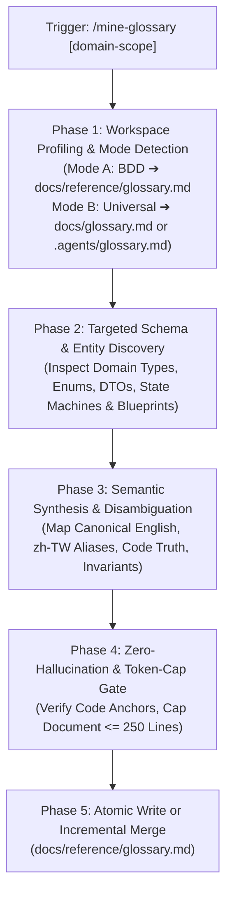
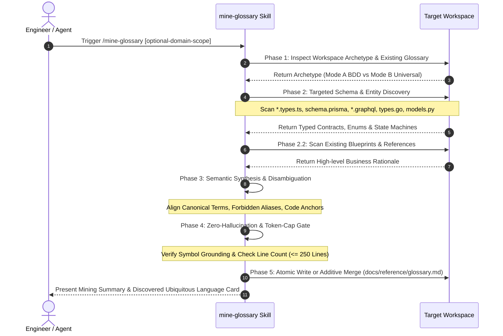

# Feature: Mine Glossary Skill (`3-feature-mine-glossary-skill`)

<!-- Ref: [Blueprint 1.1] §2, §4, §5 -->
<!-- Invariant: All paths must be repository-relative or enclosed in inline code backticks. NEVER use file:// or workstation-absolute paths (/Users/*, /home/*). -->

## 1. Overview & Rationale

This specification formalizes the creation of the `mine-glossary` skill—a portable, cognitive, pure-skill workflow that extracts, synthesizes, and maintains an authoritative **Ubiquitous Language Glossary (`docs/reference/glossary.md`)** across polyglot and multi-package software repositories.



### 1.1 Context & Problem Statement
- **Terminology Drift & Synonym Pollution**:
  In AI agent pair-programming across repositories, agents frequently hallucinate non-existent domain terms, invent arbitrary synonyms (e.g. mixing `void`, `cancel`, `abandon`, and `refund`), or confuse multilingual concepts (e.g. translating colloquial Traditional Chinese requirements like「作廢」vs「退款」into improper code symbols).
- **Manual Glossary Maintenance Fatigue**:
  Human engineering teams rarely maintain a dedicated `glossary.md`, or once created during initial architecture design, it quickly falls out of sync with production code reality.
- **Search Overhead & Token Waste**:
  Without an authoritative glossary anchoring concepts to code symbols, upstream context loading tools (such as `progressive-context-loader`) must guess query strings for `grep_search`. This causes agents to load dozens of irrelevant files, triggering the "Lost in the Middle" attention degradation.
- **Specification Naming Friction**:
  When authoring Stage 1 specifications via `craft-spec`, missing domain terminology leads to ghost nouns in interface contracts (§5) and invariant guardrails (§2), polluting downstream implementation in Stage 2 (`build-spec`).

### 1.2 Target Objectives
- **Pure-Skill Ubiquitous Language Miner**:
  Build `mine-glossary` as a zero-dependency, cognitive-first agent workflow in `skills/mine-glossary/SKILL.md` that analyzes codebase schemas and produces structured domain terminology.
- **Dual-Mode Architectural Adaptability**:
  - *Mode A (BDD Workspaces)*: Target `docs/reference/glossary.md`, integrating cleanly with Blueprint-Driven Development living specifications.
  - *Mode B (Universal Workspaces)*: Target `.agents/glossary.md` or `docs/glossary.md` for repositories without BDD scaffolding.
- **Token Discipline & Agentic Formatting**:
  Enforce strict hierarchical bullet lists (`- **Key**: ...`) over Markdown tables, capping glossary documents at $\le 250$ lines ($\le 2,500$ tokens) with support for scoped domain slices (e.g., `/mine-glossary billing`).
- **Code as Truth & Zero-Hallucination Anchoring**:
  Every mined glossary entry must cite its verified code symbol (`Code Anchor`) and package/file location, eliminating fictitious models.

---

## 2. System Invariants & Guardrails

### 2.1 Core Invariants
- **Non-Invasive Safety Guardrail**:
  The `mine-glossary` skill operates in **strictly read-only mode** on application source code (`src/**`, `libs/**`, `packages/**`, `apps/**`). It is strictly forbidden from editing, renaming, or refactoring business code or test files.
- **Single Permitted Output Target**:
  The only permitted file modifications are to the living glossary document (`docs/reference/glossary.md` in Mode A, or `.agents/glossary.md` / `docs/glossary.md` in Mode B).
- **Code as Truth (Symbol Grounding Invariant)**:
  All declared terms must anchor directly to existing code symbols (interfaces, enums, DTOs, schemas, or state machine transitions). Inventing unverified domain entities is strictly prohibited.
- **Incremental Preservation Rule**:
  When updating an existing glossary, the skill must perform an **additive merge**. It must never overwrite or delete human-authored business context, custom descriptions, or existing disambiguation notes unless explicitly flagged as obsolete by missing code symbols.
- **Agentic Documentation Formatting**:
  In accordance with repository governance, glossary documents must use hierarchical bullet lists with bold keys rather than Markdown pipe tables to ensure low parsing friction for AI agents.
- **Language Invariant (English-Only Maintenance)**:
  The canonical term, context definition, domain invariants, and code anchors must be in English. Localized terms (e.g., Traditional Chinese / `zh-TW`) are recorded strictly under dedicated mapping keys (`- **Localized Synonyms (zh-TW)**: ...`).
- **Path Portability & Zero-`file://` Invariant**:
  All file paths, pointers, and code symbols inside the generated glossary must use repository-relative paths (e.g., `libs/pos/types/order.ts`) or inline backticks. Machine-absolute paths (`/Users/*`, `/home/*`) and `file://` URIs are strictly forbidden.

### 2.2 Boundary Guardrails & Out-of-Scope (Forbidden Scope)
- ❌ **No Source Code Mutation**:
  The skill must never auto-rename variables, refactor types, or edit code to match glossary recommendations.
- ❌ **No Heavy AST Transpiler or Runtime Script Binaries**:
  Must remain a Pure Skill (`SKILL.md`) without requiring Python AST libraries, Node CLI wrappers, or external npm packages. Parsing relies on agent cognitive evaluation guided by targeted POSIX/ripgrep pattern searches.
- ❌ **No Blueprint Alterations**:
  `docs/blueprint/**` files are frozen historical designs and must never be altered during mining.
- ❌ **No Monolithic Bloat**:
  A single glossary file must not exceed 250 lines. If a repository has multiple large domains, `mine-glossary` must recommend decomposing into domain-scoped living specs (e.g., `docs/reference/glossary-[domain].md`).

---

## 3. Cognitive / Execution Workflow Protocol



### Phase 1: Workspace Profiling & Mode Resolution
1. **Detect Archetype**:
   - Check if `docs/blueprint/` or `docs/progress/` exists ➔ **Mode A (BDD Mode)**. Target output: `docs/reference/glossary.md`.
   - Otherwise ➔ **Mode B (Universal Mode)**. Target output: `.agents/glossary.md` (or `docs/glossary.md` if `docs/` exists).
2. **Resolve Domain Scope**:
   - If user provided a domain parameter (e.g. `/mine-glossary order`), filter file scanning to directories containing the keyword (e.g. `libs/order/`, `apps/station/order/`).
   - If no domain parameter was provided, inspect top-level workspace layout (`packages/*`, `apps/*`, `libs/*`, `internal/*`) to identify core domain modules.
3. **Inspect Existing Glossary**:
   - Check if target glossary file exists. If present, load existing terms to prepare for additive merging.

### Phase 2: Targeted Schema & Entity Discovery
1. **Type & Schema Inspection (Code as Truth)**:
   - Execute targeted `grep_search` across domain directories for exported types, models, schemas, and state machines:
     - TypeScript: `export enum `, `export interface `, `export type `, `z.object(`, `Type.Object(`
     - Database/GraphQL: `model ` in `schema.prisma`, `type ` in `*.graphql`
     - Go: `type .* struct`, `type .* interface`
     - Python: `class .*(BaseModel):`, `class .*(Enum):`
2. **State Machine & Lifecycle Enumeration**:
   - Extract string literals and enum values governing entity lifecycles (e.g., `PENDING`, `SUBMITTED`, `VOIDED`, `REFUNDED`).
3. **Intent & Blueprint Grounding**:
   - Slice read `docs/blueprint/*.md` or root `README.md` to extract high-level business capability descriptions and colloquial synonyms used by product stakeholders.

### Phase 3: Semantic Synthesis & Disambiguation
1. For each discovered domain concept, synthesize a structured entry adhering to the canonical schema:
   - **Canonical Term**: Standardized English name (PascalCase or Title Case).
   - **Bounded Context**: Owning subsystem, package, or business module.
   - **Code Anchor**: Exact type symbol and relative file location (`[Symbol]` in `[path]`).
   - **Localized Mapping**: Common non-English terms (e.g., Traditional Chinese `zh-TW`).
   - **Forbidden Aliases**: Deprecated, ambiguous, or colloquial terms that agents must avoid using in code/specs.
   - **Domain Invariant**: 1–2 sentences defining core business rules, permitted transitions, or boundary conditions.
2. **Disambiguation Pairing**:
   - If two commonly conflated terms exist (e.g. `Void` vs `Refund`, `Modifier` vs `Addon`, `Discount` vs `Round-off`), generate explicit contrasting invariants under both entries.

### Phase 4: Zero-Hallucination & Token-Cap Gate
1. **Symbol Grounding Assertion**:
   - Verify every declared `Code Anchor` points to a verified file and symbol in the workspace.
2. **Token Discipline & Line Count Check**:
   - Calculate projected line count.
   - If total lines $\le 250$ lines ($\approx 2,500$ tokens): Proceed.
   - If total lines $> 250$ lines: Group entries into domain slices, retain the most critical high-frequency terms, and advise the developer to run domain-specific mining.

### Phase 5: Delivery & Summary Card
1. Write or additively merge the formatted glossary to the target file.
2. Present a concise **Ubiquitous Language Summary Card** to the user:
   - Mined domain scope
   - Target file link
   - Total terms cataloged (with newly added vs existing counts)
   - Top disambiguated terms

---

## 4. File Mutation Matrix (Target Scope)

Downstream agents in Stage 2 must restrict file operations strictly to the following declared paths:

- `CREATE`:
  - `docs/progress/1.1/3-feature-mine-glossary-skill.md`: [This specification document]
  - `skills/mine-glossary/SKILL.md`: [Pure-skill cognitive workflow for ubiquitous language extraction]
  - `skills/mine-glossary/references/glossary-template.md`: [Standard agentic markdown template for domain glossaries]
  - `skills/mine-glossary/examples/glossary-example.md`: [Concrete reference example of an extracted domain glossary]
- `MODIFY`:
  - `README.md`: [Register mine-glossary in skills catalog with description and trigger command]
  - `skills/adopt-blueprint-workflow/templates/docs/reference/README.md`: [Reference docs/reference/glossary.md as a standard living reference artifact]
- `DELETE`:
  - None
- `FORBIDDEN`:
  - `src/**`, `apps/**`, `libs/**`, `packages/**`: [Application source code is strictly protected]
  - `skills/craft-spec/**`: [Specification authoring engine untouched in this slice]
  - `skills/build-spec/**`: [Implementation engine untouched in this slice]
  - `skills/settle-spec/**`: [Settlement engine untouched in this slice]
  - `docs/blueprint/**`: [Blueprints are frozen historical records]

---

## 5. Interface Contract & Schema Deltas

### 5.1 Skill Frontmatter Contract (`skills/mine-glossary/SKILL.md`)
```yaml
---
name: mine-glossary
description: Systematically inspect domain entities, DTO schemas, state enums, and blueprints across polyglot repositories to synthesize or enrich an agent-ready, token-disciplined Ubiquitous Language Glossary (docs/reference/glossary.md). Use when onboarding, exploring unfamiliar domains, or eliminating terminology drift.
---
```

### 5.2 Canonical Glossary Entry Schema (`docs/reference/glossary.md`)
The generated or updated glossary document must strictly conform to this structured hierarchical format:

```markdown
# [Domain / Workspace] Domain Glossary & Ubiquitous Language

<!-- Invariant: All paths must be repository-relative or enclosed in inline code backticks. NEVER use file:// or workstation-absolute paths (/Users/*, /home/*). -->

## 1. [Bounded Context / Subsystem Name]

- **[Canonical English Term]**:
  - **Bounded Context**: [Subsystem / domain package, e.g., Order Processing]
  - **Code Anchor**: `[Symbol / Interface / Enum]` in `[relative/path/to/types.ts]`
  - **Localized Synonyms (zh-TW)**: [Traditional Chinese terms, e.g., 作廢 / 註銷]
  - **Forbidden Aliases**: [Prohibited synonyms, e.g., cancel, delete, drop]
  - **Domain Invariant**: [1-2 sentences on core state machine or business rule]
```

### 5.3 Error Diagnostics & Handling Protocols
- **`ERR_NO_DOMAIN_SCHEMAS_FOUND`**:
  - *Trigger*: Scanning failed to discover any typed interfaces, enums, or schema files in the specified path.
  - *Action*: Prompt the user to provide a specific directory path or check repository language topology.
- **`ERR_GLOSSARY_TOKEN_OVERFLOW`**:
  - *Trigger*: Synthesized glossary exceeds 250 lines ($\approx 2,500$ tokens).
  - *Action*: Segment into domain-specific topic files (e.g. `docs/reference/glossary-[domain].md`) or prune low-frequency internal helper types.

---

## 6. Verification Oracle & Quality Gate

Deterministic verification commands to assert completion without subjective human guessing:

### 6.1 Automated Quality Gate
```bash
# Verify repository workflow fitness and markdown link integrity
# Must exit with Quality Gate: PASSED (0 errors)
# Run via audit-workflow-fitness skill or equivalent verification
```

### 6.2 Acceptance Test Scenarios
- **Scenario A (Greenfield Extraction in Mode A)**:
  - *Setup*: Target workspace has `docs/blueprint/` and TypeScript domain types under `libs/`.
  - *Input*: `/mine-glossary`
  - *Expected Result*: Generates `docs/reference/glossary.md` with $\le 250$ lines, hierarchical bullet formatting, valid repository-relative `Code Anchor` paths, and zero `file://` occurrences.
- **Scenario B (Additive Merge / Non-Destructive Update)**:
  - *Setup*: Existing `docs/reference/glossary.md` contains custom developer notes for `Void`. A new enum `Refund` is added to code.
  - *Input*: `/mine-glossary`
  - *Expected Result*: The `Void` entry and custom notes are preserved intact; the `Refund` entry is appended under the proper bounded context.
- **Scenario C (Code Immunity Invariant)**:
  - *Input*: Execute `/mine-glossary` across any test repository.
  - *Expected Result*: `git status` verifies that zero files outside the documentation hierarchy (`docs/reference/glossary.md` or `.agents/glossary.md`) are modified or staged.
