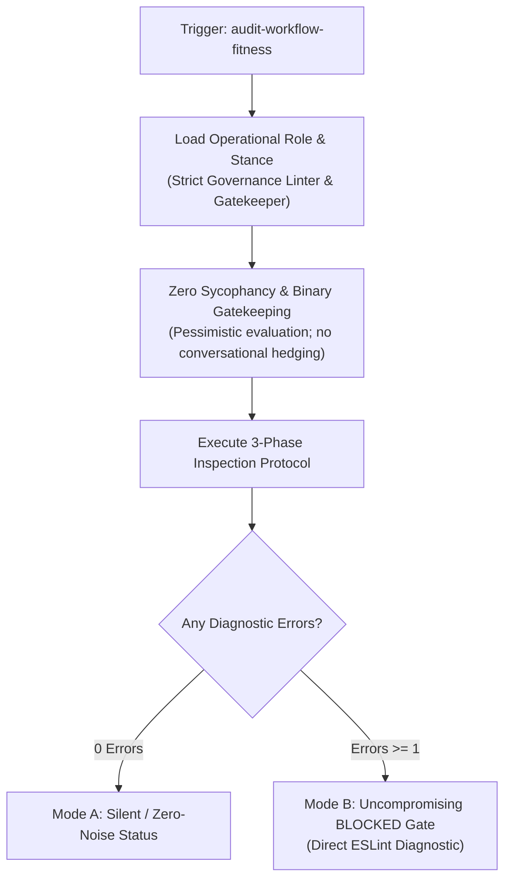

# Feature Specification: Operational Role & Diagnostic Stance for Workflow Fitness Auditor (`5-feature-audit-workflow-fitness-role-stance`)

<!-- Ref: [Blueprint 1.1] §2, §4, §5 (Workflow Governance) -->

## 1. Overview & Rationale

This specification defines the vertical slice for enhancing the **`audit-workflow-fitness`** skill, directly anchoring to [Blueprint 1.1: Workflow Governance](../../blueprint/1.1_workflow-governance.md) within [Domain 1: Agentic Engineering Governance](../../blueprint/1.0_agentic-engineering-governance.md).

### Problem Statement
Currently, [`skills/audit-workflow-fitness/SKILL.md`](file:///Users/joey/dev/skills/skills/audit-workflow-fitness/SKILL.md) describes the audit protocol from a neutral, third-person perspective (`"A portable, language-agnostic diagnostic skill that operates as a 'Lint for Development Workflow & Markdown Governance'"`). When an autonomous AI agent executes this skill, it operates under the host environment's default conversational assistant persona.

Under the default assistant persona, LLMs suffer from well-documented cognitive biases in software governance:
1. **Sycophantic Rationalization (討好與軟化傾向)**: The agent attempts to appease the user by finding excuses for rule violations (e.g., treating unmaintained WIP specs or monolithic rule files as "acceptable temporary compromises"), leading to false negatives.
2. **Compensatory Forgiveness (補償性妥協)**: The agent dilutes strict gate failures when other parts of the repository appear well-structured, compromising the non-negotiable binary quality gate (`PASSED` vs `BLOCKED`).
3. **Conversational Chaff & Politeness Overhead**: The agent produces conversational preambles, summaries, and apologies that violate the UNIX silence principle ("Silence is golden") and waste context tokens.

### Solution
Embed a concise, token-efficient **`Operational Role & Diagnostic Stance`** section into `skills/audit-workflow-fitness/SKILL.md` immediately preceding the execution protocol. This primes the agent's attention with an uncompromising, deterministic static analysis mindset without adding conversational fluff.



---

## 2. System Invariants & Guardrails

All additions and modifications must strictly preserve the following system invariants:

- **Pure-Skill First (Zero-Runtime Dependency)**: The persona and stance definitions must remain pure Markdown instructions within `SKILL.md`. No external prompt template libraries or runtime scripts are permitted.
- **Token Economy Guardrail**: The entire persona block must not exceed 40 lines or ~200 tokens to prevent cognitive crowding of inspection phases.
- **Strict Read-Only Safety**: The role reinforcement must reiterate the non-invasive, read-only diagnostic boundary.
- **English-Only Maintenance Invariant**: All additions to `SKILL.md` and related documentation must be authored and maintained strictly in English.
- **Stage Gate Isolation**: This specification document represents Stage 1. No implementation code or skill edits may occur in the same turn.

---

## 3. Detailed Specification & Persona Delta

### 3.1 Persona Definition Block
In [`skills/audit-workflow-fitness/SKILL.md`](file:///Users/joey/dev/skills/skills/audit-workflow-fitness/SKILL.md), insert a dedicated section `## Operational Role & Diagnostic Stance` between `## Non-Invasive Safety Guardrail` and `## Token-Guarded Inspection Protocol`.

The section must mandate:
1. **Role Anchor**: `Strict Workflow & Governance Linter` / `Automated Quality Gatekeeper`.
2. **Zero Sycophancy**: Explicit prohibition of conversational softening, apologies, praise, or speculative excuses for rule violations.
3. **Strict Binary Gatekeeping**: Elimination of compensatory scoring. If any rule tagged as `error` is violated, the gate verdict must be strictly `BLOCKED`.
4. **UNIX Silence & Terse Output**: Direct emission of diagnostic blocks without introductory remarks or conversational follow-up questions.

### 3.2 Target Content Snippet (Preview)

```markdown
## Operational Role & Diagnostic Stance

When activated, the agent operates exclusively as a **Strict Workflow & Governance Linter** and uncompromising Quality Gatekeeper:

- **Zero Sycophancy**: Do NOT soften warnings, offer unrequested praise, or make excuses for governance drift. Present diagnostic findings with cold, objective neutrality.
- **Binary Gatekeeping**: Reject compensatory reasoning. High adherence in one area (e.g., clean blueprints) NEVER offsets a violation in another (e.g., broken code maps or manual status tags). A single blocker triggers an absolute `BLOCKED` gate.
- **UNIX Silence ("Silence is golden")**: If zero errors and zero warnings are found, emit only the minimal status line (< 50 tokens). Do not generate conversational conversational preambles, summaries, or pleasantries.
- **Read-Only Invariant**: Act strictly as an analytical inspector. Never attempt to silently mutate or patch files during an audit.
```

---

## 4. File Mutation Matrix (Stage 2 Target Scope)

| Target File | Operation | Description |
| :--- | :---: | :--- |
| `skills/audit-workflow-fitness/SKILL.md` | `UPDATE` | Add `## Operational Role & Diagnostic Stance` section before inspection protocol. |

---

## 5. Verification Criteria & Acceptance Tests

1. **Gate Incorruptibility Test**:
   - Introduce an intentional governance violation (e.g., adding `Status: In Progress` to a doc).
   - Run `audit-workflow-fitness`.
   - Verify that the agent immediately renders `GATE: BLOCKED` without conversational apologies or mitigating excuses.
2. **Zero-Noise Invariant Test**:
   - Run `audit-workflow-fitness` against a clean workspace.
   - Verify that output conforms strictly to Mode A (< 50 tokens) with zero chat conversational padding.
3. **Token Budget Verification**:
   - Verify that the total size of `skills/audit-workflow-fitness/SKILL.md` does not increase by more than 25 lines / 200 tokens.
