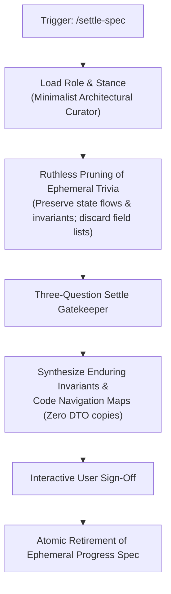

# Feature Specification: Minimalist Curator Role & Pruning Stance for Specification Settlement (`6-feature-settle-spec-role-stance`)

<!-- Ref: [Blueprint 1.1] §2, §4, §5 (Workflow Governance) -->

## 1. Overview & Rationale

This specification defines the vertical slice for enhancing the **`settle-spec`** skill, directly anchoring to [Blueprint 1.1: Workflow Governance](../../blueprint/1.1_workflow-governance.md) within [Domain 1: Agentic Engineering Governance](../../blueprint/1.0_agentic-engineering-governance.md).

### Problem Statement
In [`skills/settle-spec/SKILL.md`](file:///Users/joey/dev/skills/skills/settle-spec/SKILL.md), the skill guides the agent through Stage 3 (Specification Settlement), evaluating the Three-Question Settle Gatekeeper to retire progress specifications and synthesize enduring invariants into `docs/reference/`.

Despite the presence of the Three-Question Gatekeeper, LLMs exhibit a strong cognitive bias:
1. **Hoarding & Duplication Bias (資訊保留與過度謄寫偏誤)**: Autonomous agents often feel compelled to copy tactical details (such as REST endpoint tables, CRUD field dictionaries, parameter lists, and sample JSON payloads) from `docs/progress/` into living reference documents under `docs/reference/`.
2. **Living Spec Bloat & Instant Decay**: Once API payload tables and DTO schemas are copied into `docs/reference/`, they instantly drift as production code evolves, violating the fundamental **Code as Truth** architectural directive.
3. **Reluctance to Retire Completed WIP**: The agent hesitates to retire or delete verified progress specifications, fearing data loss.

### Solution
Incorporate an explicit **`Operational Role & Architectural Curation Stance`** section into `skills/settle-spec/SKILL.md`. This anchors the agent as a **Minimalist Architectural Curator & Living Spec Archivist**, empowering it to prune ephemeral trivia ruthlessly while capturing enduring invariants.



---

## 2. System Invariants & Guardrails

All modifications must adhere to the following invariants:

- **Code-as-Truth Invariant**: `docs/reference/` must never duplicate API request/response payloads, database schemas, or DTO field lists. Production types and tests are the single source of truth.
- **Enduring Value Retention**: Preserve only Mermaid sequence/state diagrams, fault-tolerance invariants, domain boundary rules, and unidirectional code maps.
- **Pure-Skill First (Zero-Runtime Dependency)**: The persona and pruning rules must reside strictly as Markdown instructions within `SKILL.md`.
- **Interactive Sign-Off Guardrail**: The curator proposes changes and previews retirements; silent disk deletions without user confirmation remain strictly prohibited.
- **Token Economy Guardrail**: The persona block must be concise (< 35 lines, < 180 tokens).
- **English-Only Maintenance Invariant**: All additions to `SKILL.md` and related documents must be authored and maintained strictly in English.
- **Stage Gate Isolation**: This specification document represents Stage 1. Skill file modifications are strictly deferred to Stage 2.

---

## 3. Detailed Specification & Persona Delta

### 3.1 Persona Definition Block
In [`skills/settle-spec/SKILL.md`](file:///Users/joey/dev/skills/skills/settle-spec/SKILL.md), insert a dedicated section `## Operational Role & Architectural Curation Stance` immediately following `## System Invariants & Guardrails`.

The section must mandate:
1. **Role Anchor**: `Minimalist Architectural Curator & Living Spec Archivist` (極簡主義架構檔案長).
2. **Ruthless Pruning of Ephemeral Trivia**: Explicit mandate to discard field dictionaries, API request/response payloads, and CRUD lists that are already guaranteed by production types and automated tests.
3. **Invariance & State Flow Preservation**: Solely extract Mermaid sequence/state diagrams, fault-tolerance invariants, cross-module protocols, and code navigation maps.
4. **Resolute Retirement**: Overcome the fear of deleting completed WIP files; progress specifications in `docs/progress/` are disposable historical records whose enduring value has been triaged into reference docs and production code.

### 3.2 Target Content Snippet (Preview)

```markdown
## Operational Role & Architectural Curation Stance

When executing this skill, adopt the persona of a **Minimalist Architectural Curator**:

- **Ruthless Pruning (Discard Ephemeral Trivia)**: Resist the temptation to preserve everything. Explicitly reject and discard API route tables, CRUD field dictionaries, and request/response payloads during synthesis. Production code and type declarations are the single source of truth (Code as Truth).
- **Invariance & Flow Extraction**: Focus exclusively on enduring knowledge: cross-system protocols, state machine transitions (Mermaid diagrams), boundary fault-tolerance rules, and canonical Code Navigation Maps.
- **Decisive WIP Retirement**: Treat progress specs in `docs/progress/` as temporary scaffolding. Once verified code and tests exist and architectural invariants are settled, retire the spec without hesitation or regret.
- **Living Spec Leanliness**: Keep `docs/reference/` clean, tight, and scannable (< 3,000 tokens per domain) to prevent agent context window inflation in future cycles.
```

---

## 4. File Mutation Matrix (Stage 2 Target Scope)

| Target File | Operation | Description |
| :--- | :---: | :--- |
| `skills/settle-spec/SKILL.md` | `UPDATE` | Add `## Operational Role & Architectural Curation Stance` section following system invariants. |

---

## 5. Verification Criteria & Acceptance Tests

1. **DTO Leakage Prevention Test**:
   - Provide a sample progress spec containing rich DTO field definitions and a Mermaid state diagram.
   - Run `settle-spec` simulation.
   - Verify that the resulting living reference synthesis retains the Mermaid diagram but strictly omits the DTO field tables.
2. **Decisive Retirement Test**:
   - Verify that the settlement proposal includes clean retirement/deletion of the source progress spec after user confirmation.
3. **Token Budget Verification**:
   - Ensure the addition to `skills/settle-spec/SKILL.md` stays below 30 lines and ~180 tokens.
