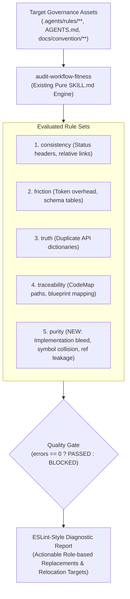

# Feature Specification: Convention Purity & Decoupling Rule Set (`7-feature-convention-purity-rules`)

<!-- Ref: [Blueprint 1.1] §2, §4, §5 (Workflow Governance) -->

## 1. Overview & Rationale

This specification defines the vertical slice for expanding the **`audit-workflow-fitness`** skill with convention purity and architectural decoupling checks, anchoring directly to [Blueprint 1.1: Workflow Governance](../../blueprint/1.1_workflow-governance.md) within [Domain 1: Agentic Engineering Governance](../../blueprint/1.0_agentic-engineering-governance.md).

### Problem Statement
In software development assisted by autonomous AI agents, architectural guidelines, coding conventions, and rules files (e.g., `.agents/rules/**`, `AGENTS.md`, `docs/convention/**`) serve as high-level mental models and pattern blueprints. However, they frequently suffer from three critical architectural defects:
1. **Concrete Implementation Bleed**: Authors write concrete business workflows, component implementations, or state machine transitions directly inside convention documents. This creates duplicate sources of truth that quickly drift from production code, violating the Code as Truth invariant.
2. **Search Collision & Query Pollution**: Conventions and rules often cite concrete production symbols (e.g., `CashCloseSection`, `CFDOrderPage`, `useCartStore`) as examples or narrative references. When developers or AI agents subsequently perform global symbol searches across the workspace to refactor business code, non-authoritative convention files pollute search results, breaking focused exploration and causing cognitive friction.
3. **Reference Inversion & Boundary Leakage**: When concrete implementations are extracted, conventions often attempt to retain reverse links pointing to specific domain reference files (`docs/reference/*.md`), violating the architectural principle that conventions must remain pure, extensible macro-patterns decoupled from specific domain assets.

### Solution
Instead of creating a redundant standalone skill that fractures workflow governance and causes tool proliferation, expand the existing **`audit-workflow-fitness`** skill by integrating a dedicated 5th diagnostic rule set: **`purity` (Convention Purity & Decoupling Rules)**.

This maintains a single unified linter entrypoint for repository governance, leveraging the existing 3-Phase Cognitive Evaluation Procedure and uncompromising Quality Gatekeeper stance.



---

## 2. System Invariants & Guardrails

All additions to the audit engine must adhere to the following invariants:

- **Unified Single-Entrypoint Governance**:
  Convention purity checks must be integrated directly into `audit-workflow-fitness`. Creating separate one-off audit skills for rule purity is strictly prohibited to prevent agent tool bloat.
- **Conventions as Extensible Macro-like Patterns**:
  A convention is an extensible mental model and structural pattern—not a concrete function, nor a domain-specific implementation rule. Conventions govern *how to structure patterns*, not *what a specific business component does*.
- **Zero Search Collision Principle**:
  Convention files must avoid concrete production symbols (class names, component names, hook names) that exist in the active codebase. Illustrative references must use semantic Role-based abstractions.
- **Zero Reference Leakage in Conventions**:
  When concrete logic is extracted from a convention, it must be relocated to `docs/reference/<domain>.md`, and the section in the convention must be **completely removed without leaving reverse reference links**.
- **Role-Based Abstraction Standard**:
  Remediation hints for concrete symbols must recommend semantic architectural roles (e.g., `CashCloseSection` $\to$ `SecondarySettlementPanel`, `CFDOrderPage` $\to$ `CustomerFacingDisplayView`), avoiding generic placeholders or arbitrary dummy names.
- **Strict Read-Only Non-Invasive Safety**:
  The auditor operates strictly in read-only diagnostic mode. It never mutates files, extracts references, or modifies source code autonomously.
- **Token-Guarded Grounding Inspection**:
  Verification of symbols must execute via targeted zero-context pattern checks (`grep_search` / file existence) rather than loading entire source codebases into agent context.
- **English-Only Maintenance Invariant**:
  All diagnostic rule codes, error messages, and documentation must be maintained exclusively in English.
- **Stage Gate Isolation**:
  This document represents Stage 1. No implementation code or modifications to `skills/` may occur during this turn.

---

## 3. Detailed Specification: The 5th Rule Set (`purity`)

In [`skills/audit-workflow-fitness/SKILL.md`](file:///Users/joey/dev/skills/skills/audit-workflow-fitness/SKILL.md), expand Section 2 (Targeted Probing Across Rule Sets) with **Rule Set 5: `purity` (Convention Purity & Decoupling Rules)**:

### 3.1 `purity/no-concrete-implementation-leak` (`error`)
- **Scope**: `.agents/rules/**`, `docs/convention/**`, `AGENTS.md`
- **Definition**: The convention or rule file contains actual business logic, state reducers, API DTO handling, or domain component implementations verified to exist in active production code.
- **Severity**: 🔴 `error` (blocks Quality Gate).
- **Remediation Requirement**:
  1. Identify candidate relocation target in `docs/reference/<domain>.md`.
  2. Propose complete deletion of the implementation block from the convention document without leaving reverse links.

### 3.2 `purity/no-search-collision-symbol` (`warn`)
- **Scope**: `.agents/rules/**`, `docs/convention/**`, `AGENTS.md`
- **Definition**: An illustrative example, heading, or narrative sentence inside a convention file cites a concrete production symbol (component name, class name, specific store/hook) that exists in active workspace code, introducing search collision during refactoring.
- **Severity**: 🟡 `warn` (advisory smell; does not block gate unless strict mode enabled).
- **Remediation Requirement**:
  1. Recommend replacing the concrete symbol with an equivalent **Role-based** abstraction (e.g., replace `CashCloseSection` with `SecondarySettlementPanel`).
  2. Ensure the replacement is domain-agnostic and will not collide with active workspace symbol searches.

### 3.3 `purity/no-reference-pointer-leak` (`warn`)
- **Scope**: `.agents/rules/**`, `docs/convention/**`
- **Definition**: The convention explicitly links to specific business reference documents (`docs/reference/*.md`) or internal business endpoints.
- **Severity**: 🟡 `warn` (advisory smell).
- **Remediation Requirement**:
  1. Recommend removing the domain reference link to keep convention patterns pure and decoupled from volatile domain documents.

---

## 4. Diagnostic Output Format Integration

When violations in the `purity/` rule set are encountered, the diagnostic output seamlessly formats into the existing Mode B report:

```text
.agents/rules/ui-guidelines.md:24
  [purity/no-concrete-implementation-leak] Found concrete business logic matching active component. (error)
  💡 Snippet: `export const CashCloseSection = () => { const { balance } = useCash(); ... }`
  💡 Suggestion: Relocate implementation to docs/reference/cash.md and delete from convention without reverse links.

.agents/rules/ui-guidelines.md:52
  [purity/no-search-collision-symbol] Symbol 'CashCloseSection' exists in active codebase (causes search collision). (warn)
  💡 Suggestion: Replace concrete symbol with Role-based abstraction: 'SecondarySettlementPanel'.

.agents/rules/ui-guidelines.md:80
  [purity/no-reference-pointer-leak] Convention explicitly links to domain reference 'docs/reference/cash.md'. (warn)
  💡 Suggestion: Remove domain reference link to preserve convention pattern purity.
```

---

## 5. File Mutation Matrix (Stage 2 Target Scope)

*Note: In accordance with Stage Gate Isolation, NO files in `skills/` or `docs/reference/` are modified during Stage 1. This matrix defines the approved scope for Stage 2.*

| Target File | Operation | Description |
| :--- | :---: | :--- |
| `skills/audit-workflow-fitness/SKILL.md` | `UPDATE` | Incorporate Rule Set 5 (`purity`) definitions, grounding probing steps, and role-based remediation instructions. |

---

## 6. Verification Criteria & Acceptance Tests

1. **Concrete Implementation Detection Test**:
   - Create a test convention file containing a 15-line component verified to exist in workspace code.
   - Run `audit-workflow-fitness`.
   - Verify that `purity/no-concrete-implementation-leak` is emitted as an `error` and triggers `Quality Gate: BLOCKED`.
2. **Search Collision Detection Test**:
   - Create a test convention file mentioning a known production symbol in prose (e.g. `CashCloseSection`).
   - Run `audit-workflow-fitness`.
   - Verify that `purity/no-search-collision-symbol` is emitted as a `warn` with a Role-based suggestion.
3. **Reference Link Pruning Test**:
   - Create a test convention file linking to `docs/reference/cash.md`.
   - Verify that `purity/no-reference-pointer-leak` is emitted as a `warn`.
4. **Single-Entrypoint & Zero-Noise Test**:
   - Run `audit-workflow-fitness` on clean convention files.
   - Verify that Mode A emits clean PASSED status (< 50 tokens) with zero noise.
5. **Pure-Skill & Read-Only Safety Test**:
   - Verify that executing the purity evaluation performs zero disk mutations.
