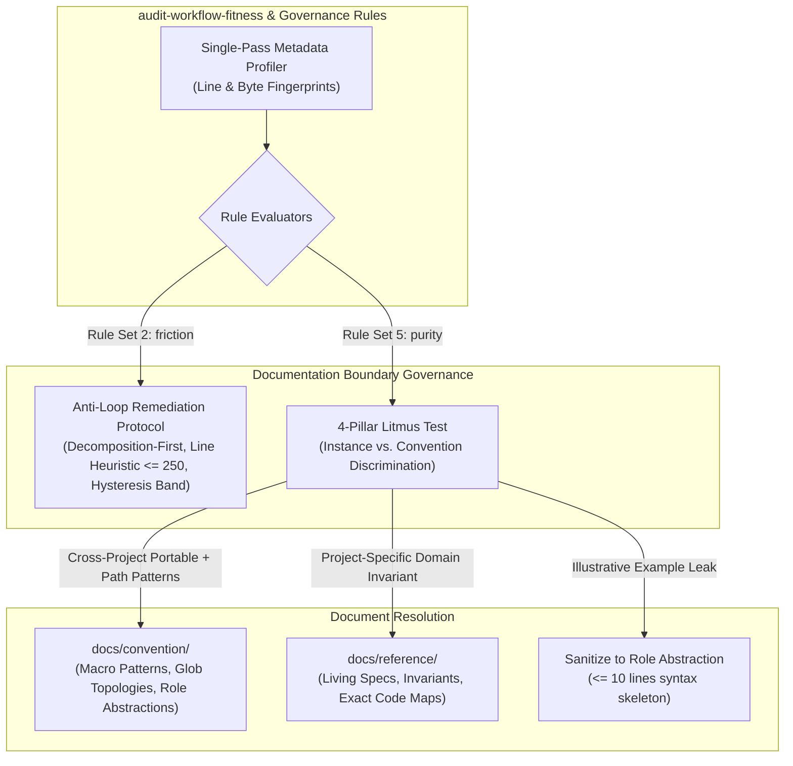
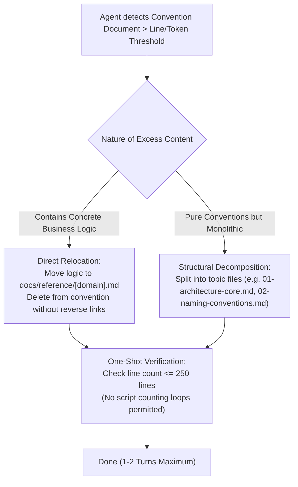

# Specification: Convention Boundary, Instance vs. Convention Discrimination, and Anti-Loop Governance

This specification defines Blueprint 1.1 Slice 8, establishing deterministic boundaries between cross-project portable conventions (`docs/convention/`) and project-specific living references (`docs/reference/`), introducing the **4-Pillar Litmus Test** for Instance vs. Convention discrimination, and codifying the **Anti-Loop Remediation Protocol** to eliminate repetitive token-trimming iterations by AI agents.

---

## 1. Problem Statement & Motivation

During recent agentic workflows and governance audits, two systemic points of friction were observed:

1. **Repetitive Token-Trimming Loops (Micro-trimming Trap)**:
   - When convention documents exceed the `~3,000` token guideline, AI coding agents frequently enter an iterative micro-trimming loop (generating text $\to$ running Python byte/token counter scripts $\to$ deleting sentences $\to$ recalculating), cycling up to 15–20 tool operations for marginal token adjustments.
   - The lack of a visible, static physical gauge (such as line count or file byte threshold) and the absence of a hysteresis band force agents into trial-and-error optimization.
2. **Boundary Blur Between `convention` and `reference`**:
   - Without an objective demarcation between "general convention" and "domain reference", project-specific business details, real component symbols, and concrete file paths inadvertently leak into `docs/convention/`.
   - This causes convention documents to bloat into monolithic files, pollutes global symbol searches, and degrades portability across repositories.

---

## 2. Invariants & Governance Directives

All implementations and governance checks resulting from this specification must adhere to these immutable rules:

1. **Convention Portability Invariant**:
   - Content in `docs/convention/` must remain **cross-project portable**. If an architectural guideline or mental model cannot be reused in an entirely different domain project, it is not a convention.
2. **Path-Pattern Topology Permission**:
   - `docs/convention/` is explicitly permitted and encouraged to use **Path Patterns / Glob Patterns** (e.g., `skills/*/scripts/**/*.sh`, `packages/*/src/**/*.ts`, `docs/convention/*.md`) to describe structural layouts. Exact, single-instance production file paths are strictly prohibited.
3. **Reference Domain Ownership Invariant**:
   - Content in `docs/reference/` is strictly **project-specific**. It anchors this repository's living domain invariants, system state machines, architecture trade-offs, and exact source file pointers in Code Navigation Maps.
4. **Decomposition-First Anti-Loop Invariant**:
   - When a convention exceeds recommended size limits, agents are **strictly prohibited** from performing iterative micro-trimming loops (editing sentences to shave tokens).
   - Agents must immediately execute structural remediation:
     - Relocate domain-specific sections to `docs/reference/<domain>.md`.
     - Decompose bloated monolithic files into topical sibling documents (e.g., `01-architecture-core.md`, `02-naming-conventions.md`).
5. **Static Physical Gauge Heuristic**:
   - Agents and linters must gauge document fitness using direct physical line counts:
     - **Safe**: $\le 250$ lines ($\approx 1,800 - 2,500$ tokens in mixed CJK/ASCII environments).
     - **Advisory Warning (`warn`)**: $251 - 400$ lines ($2,500 - 4,000$ tokens).
     - **Blocker (`error` / Split Required)**: $> 400$ lines ($> 4,000$ tokens or $> 12\text{ KB}$).
6. **Stage Gate Isolation**:
   - This specification is Stage 1. No skill definitions or documentation files outside `docs/progress/` may be edited until this specification is reviewed and approved.

---

## 3. The 4-Pillar Litmus Test: Instance vs. Convention

To provide a deterministic decision protocol for both human engineers and AI agents, the following 4-pillar test is established:

| Pillar | Convention (`docs/convention/`) | Instance / Reference (`docs/reference/`) | Litmus Test Question |
| :--- | :--- | :--- | :--- |
| **1. Portability** | **Cross-Project Portable**: Remains 100% valid and actionable if copied to an unrelated project in another domain. | **Project-Specific**: Coupled to this specific repository's concrete domain implementations, toolchains, or local workflows. | *"If transplanted into an unrelated repository, does this still serve as a valid rule?"* |
| **2. Naming Abstraction** | Uses **Semantic Roles** or generic archetypes (`[Role]Executor`, `BaseHandler`, `DiagnosticReporter`). | Uses **Production Symbols** matching real classes, tools, or scripts in this codebase (`AuditStaleRefExecutor`, `GitCommitRunner`). | *"Can this identifier be matched identically in production code or skills via global search?"* |
| **3. Path Expression** | Uses **Path Patterns / Globs** (`skills/*/scripts/*.sh`, `packages/*/src/**`). | Uses **Exact, Specific File Paths** (`skills/audit-stale-ref/SKILL.md`, `scripts/run-tests.sh`). | *"Is this a structural folder rule, or an exact pointer to a single living file?"* |
| **4. Lifecycle Trigger** | Modified only during **system-wide architecture, design system, or style convention shifts**. | Modified during **regular product feature iterations, schema expansions, or UI screen changes**. | *"Would a normal product feature PR touch this document?"* |

### Code Snippet Hygiene in Conventions
When conventions require illustrative code snippets:
- Must use semantic **Role-based abstractions** (never active production components).
- Must remain a minimal syntax skeleton of **$\le 10$ lines**.
- Prohibited from containing concrete state management, API queries, or business reducers.

---

## 4. Anti-Loop Remediation Protocol

To eliminate repetitive token recalculation loops:

1. **Forbidden Action**: Never run consecutive edit-and-count script loops adjusting prose.
2. **One-Shot Action**: Apply structural decomposition or reference extraction in a single pass.
3. **Validation**: Check file line count via standard view/diff. If line count $\le 250$, token safety is guaranteed.

---

## 5. Detailed Rule Set Updates in `skills/audit-workflow-fitness`

### 5.1 Update to Rule Set 2: `friction/max-token-overhead`
- **Updated Severity**:
  - $\le 250$ lines ($\le 2,500$ tokens): **Clean**.
  - $251 - 400$ lines ($2,500 - 4,000$ tokens): 🟡 `warn` (Advisory smell; recommend topical split, does not block gate).
  - $> 400$ lines ($> 4,000$ tokens or $> 12\text{ KB}$): 🔴 `error` (Blocker; mandatory decomposition).
- **Remediation Instruction**:
  - Enforce "Decomposition-First": Split file by topic or extract domain logic into `docs/reference/`. Prohibit iterative text micro-trimming.

### 5.2 Expansion to Rule Set 5: `purity/convention-portability-leak`
- **Scope**: `docs/convention/**`, `.agents/rules/**`
- **Severity**: 🔴 `error`
- **Rule Definition**: Detects project-specific domain narratives, exact non-glob production file paths, or non-portable business logic in convention files based on the 4-Pillar Litmus Test.
- **Allowed Exception**: Path patterns and globs (`skills/*/...`, `packages/**`) are explicitly allowed.

---

## 6. Target Mutation Matrix (Stage 2 Target Scope)

*Note: In accordance with Stage Gate Isolation, no files are modified during Stage 1. This matrix defines the authorized scope for Stage 2.*

| Target File | Operation | Description |
| :--- | :---: | :--- |
| `skills/audit-workflow-fitness/SKILL.md` | `UPDATE` | Add Anti-Loop Remediation Protocol, line-count heuristics ($\le 250$), hysteresis band, and 4-Pillar Litmus Test to Rule Set 2 and 5. |
| `CONTRIBUTING.md` | `UPDATE` | Formally define the boundary between `docs/convention/` (cross-project portable + path patterns) and `docs/reference/` (project-specific living specs + exact Code Maps). |
| `docs/reference/workflow-governance.md` | `UPDATE` | Update living invariants with the 4-Pillar Litmus Test, Anti-Loop Remediation Invariant, and Path-Pattern Convention Invariant. |

---

## 7. Verification Criteria & Acceptance Tests

1. **Line-Count Heuristic Verification**:
   - Verify that `audit-workflow-fitness` flags files $> 400$ lines as blocking errors requiring decomposition, while files $\le 250$ lines pass without warning.
2. **Path Pattern Permissibility Test**:
   - Run audit against a convention file containing path patterns (e.g., `skills/*/scripts/**/*.sh`).
   - Verify that no relative link or path violation is reported for valid glob patterns.
3. **Exact Production Path Detection in Convention**:
   - Run audit against a convention containing an exact workspace path (e.g., `skills/audit-stale-ref/SKILL.md`).
   - Verify that `purity/no-concrete-implementation-leak` or `purity/convention-portability-leak` is triggered with instructions to relocate to `docs/reference/`.
4. **Anti-Loop Actionable Remediation Test**:
   - Verify that diagnostic messages for oversized conventions explicitly instruct structural decomposition rather than text trimming.
