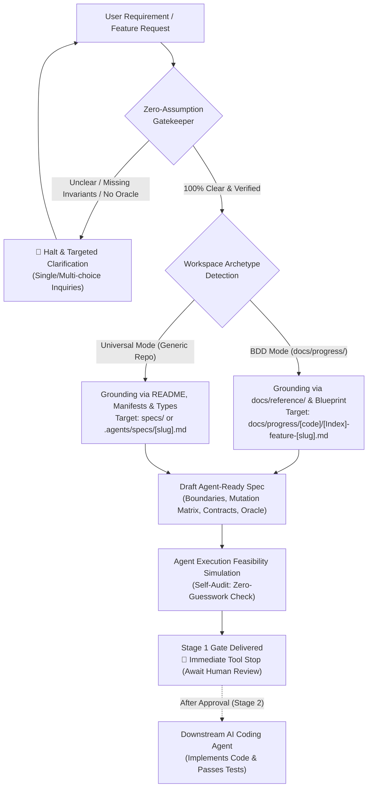
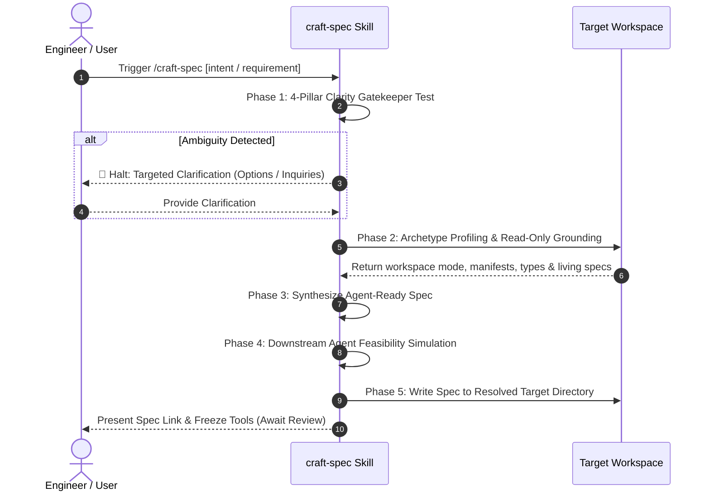

# Feature Specification: Craft Specification Skill (`9-feature-craft-spec-skill`)

<!-- Ref: [Blueprint 1.1] §2, §4, §5 (Workflow Governance) -->

## 1. Overview & Rationale

This specification defines the vertical slice for the **`craft-spec`** skill as a **Pure `SKILL.md`** cognitive workflow, directly anchoring to [Blueprint 1.1: Workflow Governance](../../blueprint/1.1_workflow-governance.md) within [Domain 1: Agentic Engineering Governance](../../blueprint/1.0_agentic-engineering-governance.md).

It formalizes and automates **Stage 1: Specification Authoring** with **Universal Cross-Project Adaptability**. Acting as the upstream complement to `settle-spec` (Stage 3 in BDD repositories) while remaining portable to any foreign software repository, `craft-spec` introduces the **Zero-Assumption Gatekeeper** to fail-fast against ambiguous requirements, strictly preserves **Code Immunity** (zero changes to application code), and authors high-density, contract-driven specifications optimized for downstream autonomous AI coding agents to implement during Stage 2 without architectural drift or hallucination.



### 1.1 Context & Problem Statement
In agentic AI-assisted software development, downstream implementation agents fail disproportionately not because of coding syntax limitations, but because of upstream specification breakdown:
1. **Premature Coding & Hallucinatory Implementation**: When tasked with features, standard coding agents rush into modifying code files before system boundaries, state flows, or failure modes are established.
2. **"Garbage In, Hallucination Out" (The Assumption Anti-Pattern)**: When user requests are ambiguous, underspecified, or lack concrete acceptance criteria, standard agents assume default behaviors or invent ghost fields instead of stopping to clarify.
3. **Prose-Heavy Narrative Specs (Ineffective for LLM Developers)**: Human-oriented product specs often rely on vague adjectives ("fast", "intuitive", "clean UI") rather than machine-executable contracts (exact file paths, forbidden change boundaries, typed interfaces, and executable test commands).
4. **Lack of Cross-Project Portability in Governance Skills**: Many specification workflows are tightly coupled to a single repository structure. A truly enterprise-grade skill must gracefully serve structured BDD repositories as well as generic open-source or commercial repositories without imposing artificial folder pollution.
5. **Stage Gate Breach**: Agents frequently mix specification drafting and code implementation in the same turn, bypassing human architectural review.

### 1.2 Target Objectives
- Provide a standardized, portable cognitive workflow (`craft-spec`) to formulate Stage 1 specifications without touching production code.
- Enforce the **Zero-Assumption Gatekeeper (The 4-Pillar Clarity Test)**: If any requirement, boundary, or verification oracle is ambiguous, the agent MUST immediately halt and initiate the **Targeted Clarification Protocol** rather than starting to draft.
- Support **Adaptive Dual-Mode Operation**:
  - **BDD Mode**: When running in a Blueprint-Driven repository (`docs/progress/` present), seamlessly anchor to Blueprints and append-only indexed paths (`docs/progress/[code]/[Index]-feature-[slug].md`).
  - **Universal Mode**: When running in a standard or foreign repository without BDD scaffolding, adaptively locate or initialize the project's specification directory (e.g., `specs/`, `docs/specs/`, or `.agents/specs/[slug].md`) and ground context from `README.md`, package manifests, and typed contracts.
- Structure specifications specifically for downstream AI coding agents:
  - **Boundary Guardrails & Forbidden Zones**: Explicitly declare files and packages downstream agents must NOT touch.
  - **File Mutation Matrix**: Exact declared file paths and operations (`CREATE`, `MODIFY`, `DELETE`, `FORBIDDEN`).
  - **Interface & Schema Contracts**: Typed interfaces, DTOs, and error codes adhering to Code as Truth.
  - **Deterministic Sequential Execution Plan**: Micro-stepped implementation instructions.
  - **Verification Oracle**: Exact CLI commands and assertable acceptance criteria.
- Maintain strict **Stage Gate Isolation**: Deliver the specification, present summary to human maintainers, and freeze tool usage immediately.

---

## 2. System Invariants & Guardrails

All operations within the `craft-spec` skill must strictly adhere to the following invariants:

### 2.1 Code Immunity Guardrail (Strict Read-Only Stance)
- The `craft-spec` skill operates exclusively in **read-only mode** on codebase implementation files.
- It is **strictly forbidden** from creating, updating, or deleting application code, test implementations, package manifests, or tool configs (`src/**`, `lib/**`, `apps/**`, `packages/**`, etc.).
- The **only permitted persistent artifact** is the Stage 1 specification markdown file in the resolved specification directory.

### 2.2 The Zero-Assumption Gatekeeper Invariant
The agent must **never** extrapolate, invent business logic, or assume default technical choices when requirements are underspecified. Before creating any specification file on disk, the agent must evaluate the **4-Pillar Clarity Test**:

1. **Scope & Intent (WHY)**: Is the core user problem, business goal, and boundary well-defined? Is there an explicit Out-of-Scope boundary?
2. **Inputs & Dependencies (WHAT)**: Are all required data models, configurations, environmental prerequisites, and upstream APIs declared and verified?
3. **Architectural Invariants (CONSTRAINTS)**: Are project-specific invariants (e.g., framework conventions, design systems, English-only maintenance, unidirectional code maps) explicitly acknowledged?
4. **Verification Oracle (ACCEPTANCE)**: Is there a deterministic, automated command (linter, unit test, build command) that can definitively prove success with zero human subjectivity?

> [!CRITICAL]
> **Halt-and-Clarify Rule**:
> If the answer to any of the 4 pillars is "NO" or "AMBIGUOUS", the agent **MUST NOT** proceed or write a spec file. It must immediately halt execution, format a targeted inquiry (using multiple-choice or crisp structured questions), and await user clarification.

### 2.3 Adaptive Workspace Archetype Invariant (Dual-Mode Portability)
`craft-spec` must gracefully adapt to target repositories without forcing foreign folder structures:
- **Mode A: Blueprint-Driven Development (BDD)**:
  - *Trigger*: Presence of `docs/progress/` or `docs/blueprint/`.
  - *Target Spec Path*: `docs/progress/[blueprint-code]/[Index]-feature-[slug].md`.
  - *Context Source*: Upstream product blueprint (`docs/blueprint/`) and living domain references (`docs/reference/`).
- **Mode B: Universal / Generic Repository**:
  - *Trigger*: Absence of `docs/progress/`.
  - *Target Spec Path*: Discovered project spec folder (e.g., `specs/`, `docs/specs/`, `docs/plans/`), or fallback to `.agents/specs/[feature-slug].md`.
  - *Context Source*: Repository `README.md`, package manifests (`package.json`, `Cargo.toml`, `go.mod`, `pyproject.toml`), public exported types, and existing automated test suites.

### 2.4 Stage Gate Isolation (Zero Premature Implementation)
- In accordance with repository governance, drafting a Stage 1 specification is an isolated checkpoint.
- After writing the specification document to the resolved spec directory, the agent **MUST NOT** proceed to implement code, run migration scripts, or mutate catalogs in the same turn.
- The agent must stop calling tools and await explicit human approval before any Stage 2 implementation can commence.

### 2.5 Pure-Skill First Architecture
- Implemented strictly as a pure cognitive Markdown workflow (`skills/craft-spec/SKILL.md`) without auxiliary script binaries, ensuring zero-runtime dependency and maximum cross-platform portability.

### 2.6 English-Only Maintenance Standard
- All specification files, YAML frontmatter, headers, architectural diagrams, and code snippets must be authored exclusively in English, regardless of the conversation language used by the user.

---

## 3. Five-Phase Cognitive Execution Protocol



### Phase 1: Zero-Assumption Gatekeeper & Clarity Evaluation
1. Parse user prompt, issue description, or target blueprint reference.
2. Evaluate against the 4-Pillar Clarity Test:
   - Identify missing technical choices (e.g., library choices, storage targets, error handling protocols).
   - Identify missing boundary conditions (e.g., offline mode, performance SLAs, edge cases).
3. **Decision Fork**:
   - **FAIL**: Stop immediately. Output a structured clarification block containing:
     - 🔴 **Blocking Ambiguity**: What specific information is missing.
     - ❓ **Targeted Clarification Options**: 2–4 crisp options or direct questions.
   - **PASS**: Record validated parameters and proceed to Phase 2.

### Phase 2: Archetype Profiling & Read-Only Grounding
1. **Detect Workspace Archetype**:
   - Inspect workspace root for BDD markers (`docs/progress/`, `docs/blueprint/`).
   - If present ➔ Select **Mode A (BDD Mode)**.
   - If absent ➔ Select **Mode B (Universal Mode)**.
2. **Context Grounding (Read-Only)**:
   - **In Mode A (BDD)**:
     - Read upstream Blueprint (`docs/blueprint/[code]_*.md`) and living references (`docs/reference/`).
     - Inspect existing code maps and type contracts.
     - Resolve next sequential index under `docs/progress/[blueprint-code]/` (e.g., `[NextIndex]-feature-[slug].md`).
   - **In Mode B (Universal)**:
     - Read repository `README.md`, package manifests (`package.json`, `Cargo.toml`, `go.mod`, etc.), and public exported interfaces.
     - Inspect existing test frameworks to identify the test runner and assertion patterns.
     - Resolve spec destination: Scan for existing specification paths (`specs/`, `docs/specs/`, `docs/plans/`). If none exist, default to `.agents/specs/[feature-slug].md`.

### Phase 3: Agent-Ready Spec Synthesis
Draft the specification using the mandatory 6-section structure tailored for downstream LLM execution:
- **Section 1: Overview & Rationale**: Context, problem, and architectural sequence diagram.
- **Section 2: System Invariants & Guardrails**: Strict Out-of-Scope list and architectural boundaries.
- **Section 3: Execution Protocol / Workflow Steps**: Step-by-step logic.
- **Section 4: File Mutation Matrix**: Declared file paths, operation types (`CREATE`, `MODIFY`, `DELETE`, `FORBIDDEN`), and rationale.
- **Section 5: Interface & Contract Deltas**: Exact schemas, interfaces, function signatures, and error codes (Code as Truth).
- **Section 6: Verification Oracle & Acceptance Criteria**: Deterministic test commands and pass/fail criteria.

### Phase 4: Downstream Agent Feasibility Simulation
Before committing the file to disk, the agent executes a cognitive simulation:
- *Question 1*: "If a completely new AI coding agent with clean context is given ONLY this spec and the codebase, can it complete Stage 2 without guessing any file path or type signature?"
- *Question 2*: "Does the spec contain non-verifiable adjectives (e.g., 'robust', 'clean') that should be replaced with explicit invariants?"
- *Question 3*: "Is the Verification Oracle fully automated and executable in terminal?"
Refine any ambiguous phrasing until all checks pass.

### Phase 5: Delivery & Stage Gate Isolation
1. Write the completed specification to the resolved target path:
   - Mode A: `docs/progress/[blueprint-code]/[Index]-feature-[slug].md`
   - Mode B: `[resolved-spec-dir]/[feature-slug].md`
2. Present a concise summary to the user:
   - Active Mode (BDD vs Universal).
   - Specification file link.
   - Declared File Mutation Matrix summary.
   - Verification command preview.
3. **STOP TOOLS IMMEDIATELY**: Do not write implementation code or modify indexes in this turn.

---

## 4. File Mutation Matrix (Stage 2 Target Scope)

When this specification is approved and handed off to Stage 2 implementation, the following files represent the exact boundary:

| Operation | Target Path | Responsibility / Purpose |
| :--- | :--- | :--- |
| `CREATE` | `skills/craft-spec/SKILL.md` | Primary pure cognitive skill definition containing YAML frontmatter, Zero-Assumption Gatekeeper, Dual-Mode detection, and 5-phase execution protocol. |
| `CREATE` | `skills/craft-spec/references/spec-template.md` | Reusable Markdown template for Stage 1 specifications optimized for downstream AI agents across both BDD and Universal modes. |
| `CREATE` | `skills/craft-spec/references/clarity-gatekeeper-checklist.md` | Standard checklist for evaluating the 4-Pillar Clarity Test and formulating targeted clarification questions. |
| `MODIFY` | `README.md` | Register `craft-spec` in the skill bulleted list and usage examples. |
| `MODIFY` | `CONTRIBUTING.md` | Reference `craft-spec` as the standard tool for Stage 1 specification drafting in the 5-step lifecycle. |
| `FORBIDDEN` | `src/**`, `lib/**`, `apps/**` | Application code and external binaries are strictly prohibited. |

---

## 5. Interface Contract & Output Formats

### 5.1 Skill Manifest Frontmatter (`skills/craft-spec/SKILL.md`)
```yaml
---
name: craft-spec
description: Formalize Stage 1 Specification Authoring across BDD and Universal repositories. Evaluates the Zero-Assumption Gatekeeper, strictly maintains Code Immunity, and crafts high-density, contract-driven specifications optimized for downstream AI coding agents.
---
```

### 5.2 Clarification Output Format (When Gatekeeper Halts)
When requirements are ambiguous or incomplete, `craft-spec` must output this exact structure:
```markdown
> [!CAUTION]
> **Stage 1 Gatekeeper Blocker: Requirement Ambiguity Detected**
> Specification authoring has been halted to prevent architectural hallucination.

### 🔴 Blocking Ambiguities:
1. **[Dimension Name]**: [Explanation of why this cannot be drafted without user input]

### ❓ Clarification Needed:
- **Question 1**: [Specific question with 2-4 mutually exclusive options (A/B/C) or direct answer requirement]
- **Question 2**: [Scope / Out-of-Scope boundary confirmation]
```

### 5.3 Downstream Agent Spec Structure Contract
All specifications produced by `craft-spec` must strictly implement the standard 6-section schema:
1. `## 1. Overview & Rationale` (with Mermaid flowchart)
2. `## 2. System Invariants & Guardrails` (with Out-of-Scope list)
3. `## 3. Cognitive / Execution Workflow Protocol`
4. `## 4. File Mutation Matrix` (Table of `CREATE`, `MODIFY`, `DELETE`, `FORBIDDEN`)
5. `## 5. Interface Contract & Schema Deltas` (Code as Truth)
6. `## 6. Verification Oracle & Quality Gate` (Automated CLI verification commands)

---

## 6. Verification Criteria & Acceptance Tests

Stage 2 implementation of `craft-spec` will be verified against the following deterministic criteria:

### 6.1 Automated Workflow Fitness Verification
- Run `audit-workflow-fitness` to verify repository governance compliance:
  ```bash
  # Must exit with PASSED and zero errors
  ```
- **Rule Verification**:
  - `consistency/no-manual-status-header`: Verify no `Status: Draft` tags exist.
  - `consistency/no-broken-relative-links`: Verify all markdown links in `skills/craft-spec/` resolve cleanly.
  - `friction/max-token-overhead`: Verify `SKILL.md` is $\le 250$ lines ($\le 2,500$ tokens).

### 6.2 Zero-Assumption Gatekeeper Test (Dry Run Simulation)
- **Scenario A (Vague Prompt)**:
  - Input: `"Add some caching to the system"`
  - Expected Output: **Zero disk writes**. Immediate Halt alert with 4-Pillar blocking breakdown and targeted clarification questions.
- **Scenario B (Complete Scope in BDD Mode)**:
  - Input: Concrete requirement in a BDD repository specifying blueprint code, invariant constraints, and target behaviors.
  - Expected Output: Successful creation of `docs/progress/[code]/[Index]-feature-[slug].md` with all 6 mandatory sections populated. Immediate tool stop after creation.
- **Scenario C (Complete Scope in Universal Mode)**:
  - Input: Concrete requirement in a standard repository (no `docs/progress/`).
  - Expected Output: Detection of Universal Mode, creation of specification at `.agents/specs/[feature-slug].md` (or detected `specs/` directory) with zero application code changes, and immediate tool stop.

### 6.3 Code Immunity Verification
- Git status check after execution of `craft-spec`:
  - Zero unstaged or staged modifications in `src/`, `lib/`, or any non-documentation directories.

