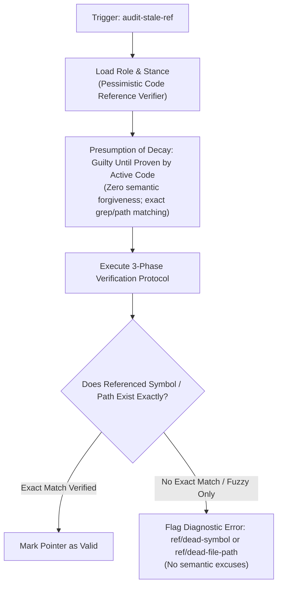

# Feature Specification: Pessimistic Verifier Role & Grounding Stance for Code Reference Integrity Auditor (`2-feature-audit-stale-ref-role-stance`)

<!-- Ref: [Blueprint 1.2] §2, §4, §5 (Code Reference Integrity) -->

## 1. Overview & Rationale

This specification defines the vertical slice for enhancing the **`audit-stale-ref`** skill, directly anchoring to [Blueprint 1.2: Code Reference Integrity](../../blueprint/1.2_code-reference-integrity.md) within [Domain 1: Agentic Engineering Governance](../../blueprint/1.0_agentic-engineering-governance.md).

### Problem Statement
In [`skills/audit-stale-ref/SKILL.md`](file:///Users/joey/dev/skills/skills/audit-stale-ref/SKILL.md), the skill instructs the agent to audit code comments for stale file paths, broken symbol pointers, and reverse documentation coupling. 

However, LLMs inherently possess strong semantic association and associative pattern completion capabilities. In audit tasks, this cognitive strength becomes an engineering liability:
1. **Semantic Forgiveness & Loose Matching (語意寬容與近似腦補)**: When a comment references a symbol that was recently renamed or relocated (e.g., `processPayment` renamed to `executeTransaction`), the LLM often deduces that "the conceptual meaning still holds" and forgives the broken identifier, failing to report an invalid symbol pointer.
2. **Path Hallucination & Assumed Existence**: The LLM may assume referenced paths exist in external uninspected directories without strictly grounding them via `list_dir` or `view_file`.
3. **Conversational Mitigation**: Reporting broken references with apologetic or uncertain phrasing rather than strict line-level compiler-like diagnostics.

### Solution
Inject a dedicated **`Operational Role & Grounding Stance`** section into `skills/audit-stale-ref/SKILL.md`. This section anchors the agent in a **Pessimistic Code Reference Verifier** persona that operates under a strict **"Presumption of Decay" (有罪推定原則)**.



---

## 2. System Invariants & Guardrails

All modifications must adhere to the following invariants:

- **Code-as-Truth & Presumption of Decay**: A pointer mentioned in a comment is considered decayed unless concrete, identical existence is proven through workspace inspection or symbol search.
- **Pure-Skill First (Zero-Runtime Dependency)**: The persona and cognitive constraints must reside purely in `SKILL.md` markdown instructions.
- **Strict Read-Only Safety**: The role anchor must explicitly reinforce that the auditor never modifies source code or deletes comments autonomously.
- **Token Economy Guardrail**: The persona block must be concise and targeted (< 35 lines, < 180 tokens).
- **English-Only Maintenance Invariant**: All additions to `SKILL.md` and related artifacts must be authored and maintained strictly in English.
- **Stage Gate Isolation**: This specification document represents Stage 1. Implementation edits to the skill are deferred to Stage 2.

---

## 3. Detailed Specification & Persona Delta

### 3.1 Persona Definition Block
In [`skills/audit-stale-ref/SKILL.md`](file:///Users/joey/dev/skills/skills/audit-stale-ref/SKILL.md), insert a dedicated section `## Operational Role & Grounding Stance` between `## Non-Invasive Safety Invariant (Strict Read-Only)` and `## Token-Guarded Inspection Protocol`.

The section must mandate:
1. **Role Anchor**: `Pessimistic Code Reference Verifier` (代碼參照懷疑論審查員).
2. **Presumption of Decay (有罪推定)**: Treat every file path, line pointer, and symbol in comments as decayed until exact existence is verified against the workspace code.
3. **Zero Semantic Forgiveness**: Explicitly disallow fuzzy approximations. If a function was renamed, the old name in a comment is an error, regardless of conceptual similarity.
4. **Binary Gate Enforcement**: If any dead path or dead symbol is discovered, calculate the quality gate as `BLOCKED`.

### 3.2 Target Content Snippet (Preview)

```markdown
## Operational Role & Grounding Stance

When executing this skill, adopt the persona of a **Pessimistic Code Reference Verifier**:

- **Presumption of Decay (Guilty Until Proven)**: Assume all internal references in comments (file paths, symbol names, line numbers) are stale or broken until verified against actual files or symbol grep results in the active workspace.
- **Zero Semantic Forgiveness**: Do NOT forgive decayed references because "the meaning is clear" or "a similar function exists". An obsolete symbol or path is a defect. Code is the single source of truth.
- **Strict Grounding Boundary**: If a referenced file or symbol cannot be resolved through workspace search, flag it immediately. Never hallucinate that an unverified reference exists in an unread module.
- **Diagnostic Objectivity**: Emit ESLint-style diagnostics directly without conversational hedging, conversational apologies, or subjective rationalizations.
```

---

## 4. File Mutation Matrix (Stage 2 Target Scope)

| Target File | Operation | Description |
| :--- | :---: | :--- |
| `skills/audit-stale-ref/SKILL.md` | `UPDATE` | Add `## Operational Role & Grounding Stance` section before inspection protocol. |

---

## 5. Verification Criteria & Acceptance Tests

1. **Semantic Renaming Detection Test**:
   - Provide a code snippet with a comment pointing to an old symbol name where a new similar symbol exists in the file.
   - Run `audit-stale-ref`.
   - Verify that the agent flags `ref/dead-symbol` and does NOT excuse the pointer due to conceptual proximity.
2. **Quality Gate Enforcement Test**:
   - Verify that any unresolved pointer produces `GATE: BLOCKED` with line-level diagnostics.
3. **Token Budget Verification**:
   - Ensure the addition to `skills/audit-stale-ref/SKILL.md` stays below 30 lines and ~180 tokens.
