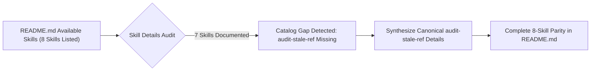
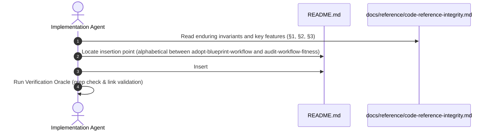

# Audit Stale Ref Catalog Documentation Alignment (`3-feature-audit-stale-ref-catalog-documentation`)

<!-- Ref: [Blueprint 1.2: Code Reference Integrity](../../blueprint/1.2_code-reference-integrity.md) §2, §4, §5 & [Living Spec: Code Reference Integrity](../../reference/code-reference-integrity.md) §1, §5 -->

## 1. Overview & Rationale

This specification formalizes the alignment of the repository catalog (`README.md`) by authoring the missing `audit-stale-ref` capability section under `## Skill Details`, establishing complete documentation parity across all 8 published skills.



### 1.1 Context & Problem Statement
- In `README.md`, line 10 lists `audit-stale-ref` under `## Available Skills`.
- However, under `## Skill Details`, detailed subsections exist for 7 skills (`adopt-blueprint-workflow`, `audit-workflow-fitness`, `build-spec`, `craft-spec`, `gen-commit-message`, `progressive-context-loader`, and `settle-spec`), while `audit-stale-ref` was inadvertently omitted.
- This creates an inconsistency in the repository catalog, depriving users, automated scanners, and AI coding agents of essential documentation regarding the `audit-stale-ref` diagnostic rules, operational role, and usage patterns.

### 1.2 Target Objectives
- Add a standardized, high-density `### audit-stale-ref` subsection to `README.md` under `## Skill Details`.
- Mirror the structure, tone, and formatting conventions established by sibling skills in `README.md`.
- Ensure zero regression in markdown link integrity and zero broken references.

---

## 2. System Invariants & Guardrails

### 2.1 Core Invariants
- **Documentation Parity**: Every skill listed in `## Available Skills` must have a corresponding detailed subsection in `## Skill Details`.
- **Pure-Skill Documentation Standards**: Document the skill as a pure cognitive Markdown engine (`SKILL.md`) with zero runtime dependencies.
- **English-Only Maintenance**: All added markdown headings, descriptions, bullet points, and rule IDs must be authored exclusively in English.
- **No Markdown Tables for Catalog**: Maintain hierarchical bulleted lists with bold keys (`- **Key**: ...`) rather than tables, adhering to [.agents/rules/skills-repository.md](../../../.agents/rules/skills-repository.md).

### 2.2 Boundary Guardrails & Out-of-Scope (Forbidden Scope)
- ❌ **Out-of-Scope 1**: Do NOT mutate `skills/audit-stale-ref/**` (the skill itself is fully implemented and tested).
- ❌ **Out-of-Scope 2**: Do NOT modify other sections of `README.md` beyond inserting the missing subsection under `## Skill Details`.

---

## 3. Cognitive / Execution Workflow Protocol



### Phase 1: Reference Extraction & Sizing
1. Ground feature summary and key invariants from `docs/reference/code-reference-integrity.md` and `skills/audit-stale-ref/SKILL.md`.
2. Format as a concise, token-efficient subsection matching the standard schema:
   - `- **Description**: ...`
   - `- **Key Features**: ...`

### Phase 2: Catalog Insertion
1. Insert the subsection under `## Skill Details` in alphabetical order (immediately following `adopt-blueprint-workflow` and preceding `audit-workflow-fitness`).
2. Maintain clean 2-space indentation on sub-bullets.

---

## 4. File Mutation Matrix (Target Scope)

| Operation | Target Path | Responsibility / Purpose |
| :--- | :--- | :--- |
| `MODIFY` | `README.md` | Add `### audit-stale-ref` detailed subsection under `## Skill Details`. |
| `FORBIDDEN` | `skills/audit-stale-ref/**` | Skill implementation files remain strictly protected. |
| `FORBIDDEN` | `docs/reference/code-reference-integrity.md` | Reference spec remains protected in Stage 2. |

---

## 5. Interface Contract & Schema Deltas

### 5.1 Exact Content Addition to `README.md`

```markdown
### `audit-stale-ref`

- **Description**: Inspects internal references in code comments (file paths, symbol names, line numbers, and documentation links) across target codebases, flags stale or decayed pointers, and produces actionable ESLint-style diagnostic reports with a binary **Quality Gate (`PASSED` vs `BLOCKED`)**.
- **Key Features**:
  - **4-Dimensional Rule Engine**: Covers `ref/dead-file-path` (broken file pointers), `ref/dead-symbol` (missing identifier declarations), `ref/reverse-doc-pointer` (prohibited reverse links to ephemeral progress specs), and `ref/stale-line-number` (fragile hardcoded line numbers).
  - **Pessimistic Verifier Stance**: Treats all comment references as decayed until proven by exact physical existence in the active workspace (`Code as Truth`).
  - **Token-Guarded Inspection Protocol**: Employs language-aware comment filtering and line-range slicing to keep diagnostic context overhead $< 2,500$ tokens across multi-file modules.
  - **Multi-Format Diagnostic Reporting**: Supports zero-noise UNIX silence for clean repositories, line-anchored ESLint-style diagnostic reports, and structured machine-readable JSON (`--json`).
  - **Pure-Skill Portability**: Built as a pure cognitive Markdown engine (`SKILL.md`) with zero scripts and zero runtime dependencies.
```

---

## 6. Verification Oracle & Quality Gate

Deterministic verification commands to assert completion without subjective human guessing:

### 6.1 Automated Verification Commands
```bash
# 1. Assert ### audit-stale-ref exists in README.md
grep -F "### \`audit-stale-ref\`" README.md

# 2. Assert key features of audit-stale-ref are present in README.md
grep -F "ref/dead-file-path" README.md
grep -F "Pessimistic Verifier Stance" README.md
```

### 6.2 Acceptance Test Scenarios
- **Scenario A (Catalog Completeness)**:
  - *Input*: Scan `README.md` for all 8 skill names listed under `## Available Skills`.
  - *Expected Result*: Each of the 8 skills has a matching `### \`<skill-name>\`` section under `## Skill Details`.
