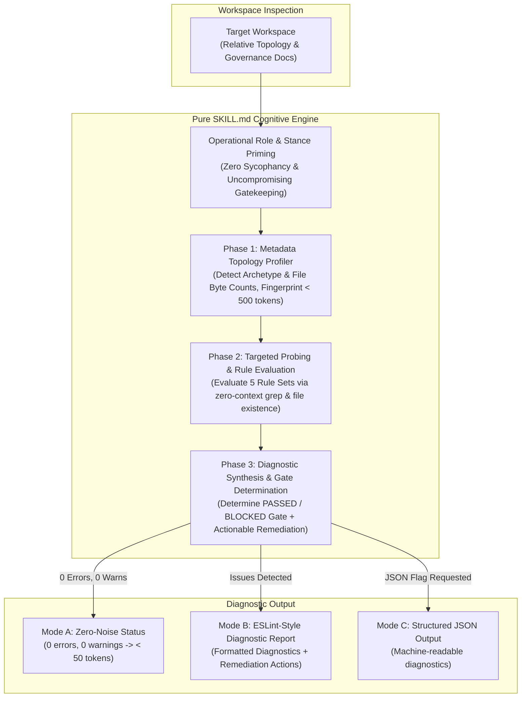
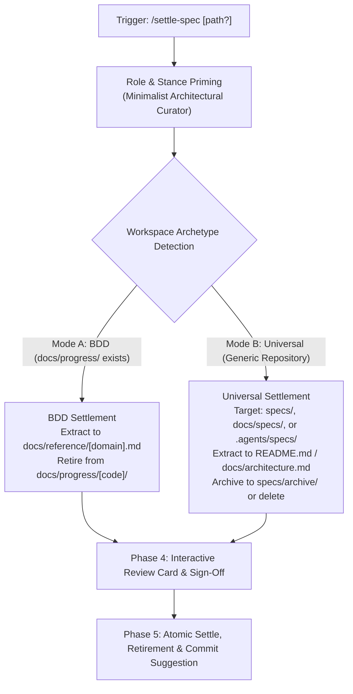
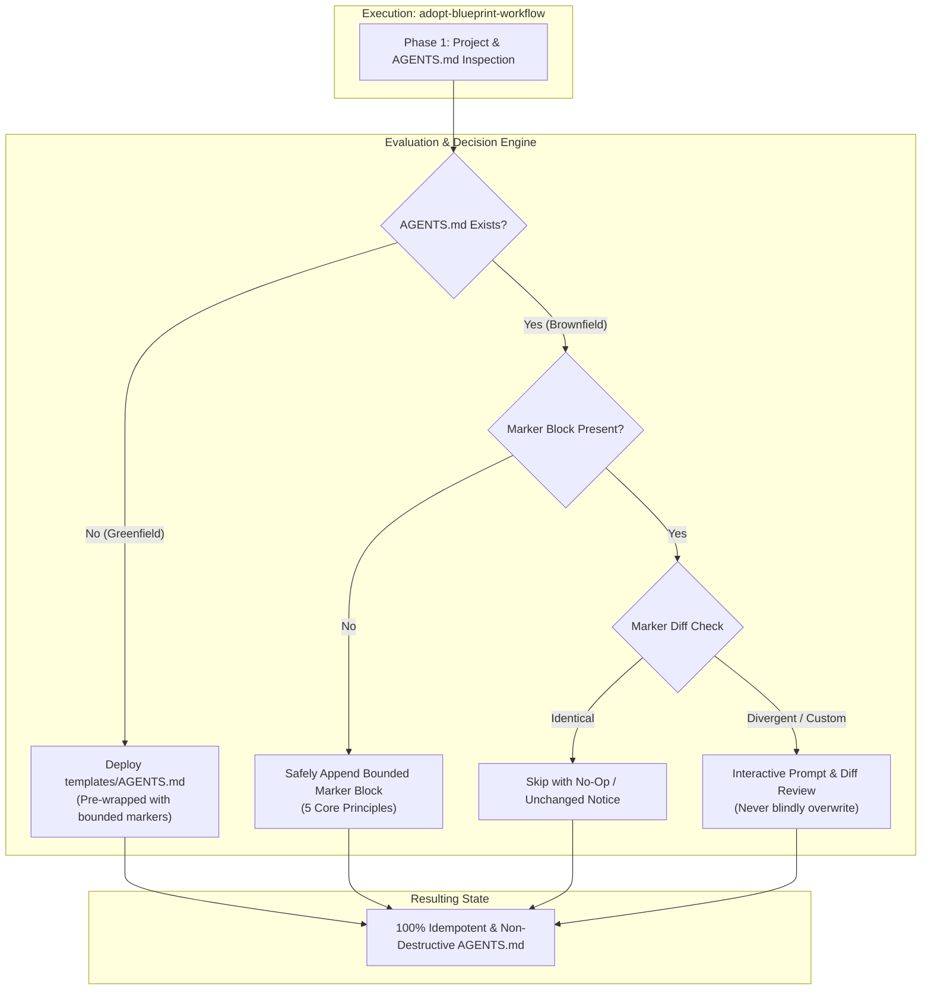
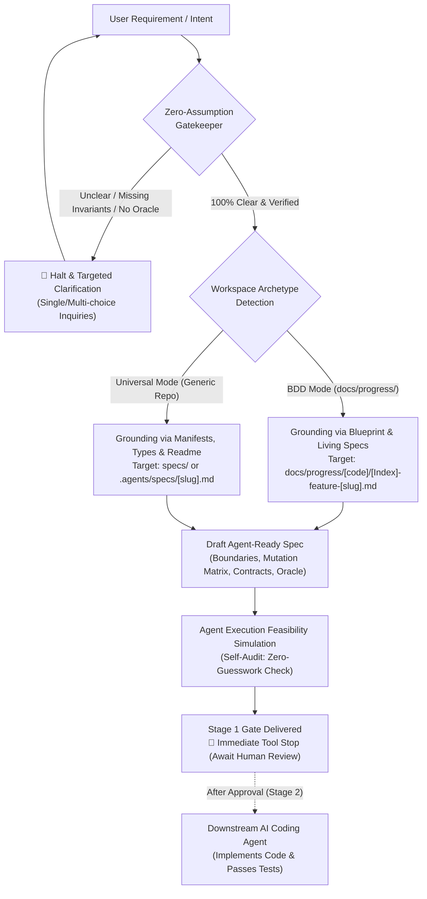
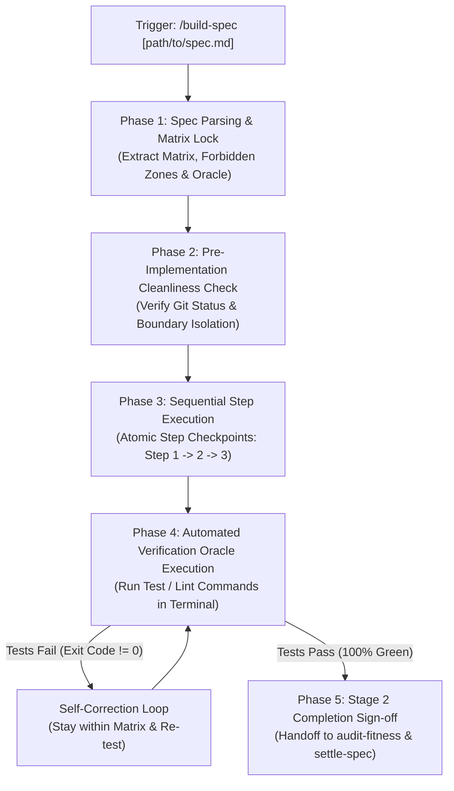
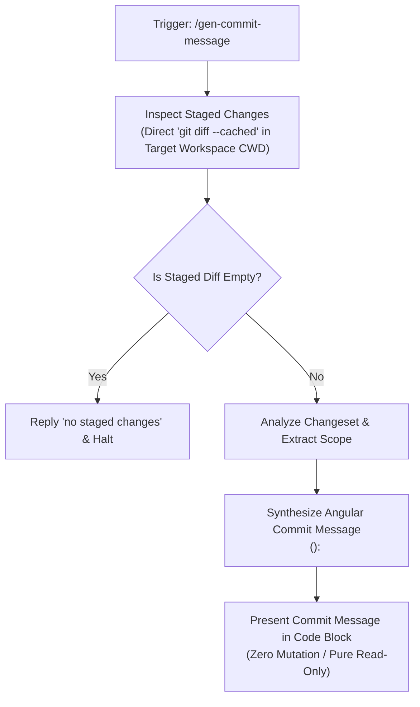

# Workflow Governance Living Specification (`workflow-governance`)

<!-- Ref: [Blueprint 1.1] §2, §4, §5 -->

## 1. Overview

This living specification documents the system invariants, architectural trade-offs, diagnostic rule sets, and navigation maps governing development workflow health across repositories, anchoring directly to [Blueprint 1.1: Workflow Governance](../blueprint/1.1_workflow-governance.md) within [Domain 1: Agentic Engineering Governance](../blueprint/1.0_agentic-engineering-governance.md).

It establishes an **"ESLint for Development Workflow & Markdown Governance"**, replacing arbitrary 100-point composite scoring with a binary **Quality Gate (`PASSED` vs `BLOCKED`)**, zero-noise UNIX silence for clean runs, and an actionable diagnostic engine.

---

## 2. Blueprint Trade-offs & Current Scope

1. **Pure-Skill First (Zero-Script / Zero-Runtime)**:
   - *Blueprint Ambition*: Explored potential auxiliary inspection scripts (`scripts/audit-workflow.py` or `.js`).
   - *Tactical Decision*: Implemented strictly as a Pure `SKILL.md` cognitive workflow without auxiliary scripts. This ensures 100% universal portability across environments lacking Node.js or Python runtimes and leverages LLM semantic evaluation over fragile, regex-based parsing.
2. **Binary Quality Gate vs Composite Scoring**:
   - *Trade-off*: Eliminated numeric composite scoring (e.g. "85/100") to avoid the *compensatory fallacy* where high scores in documentation volume mask critical broken Code Map navigation errors.
   - *Current Scope*: Binary gate where any `error` immediately blocks the gate, while `warn` flags advisories without blocking delivery.
3. **Token-Guarded Inspection Protocol**:
   - *Trade-off*: Imposes strict metadata-first listing and line-range slicing over full file reads, capping diagnostic context overhead at $< 2,000$ tokens.
4. **Unidirectional Navigation Convention**:
   - *Trade-off*: Eliminated bidirectional reverse reference comments (`// Ref: ...` or `<!-- Ref: ... -->`) in production code and skills.
   - *Current Scope*: All navigation pointers are maintained unilaterally in `docs/reference/[domain].md` (Code Navigation Map). Source code and skill definitions remain 100% decoupled and portable, eliminating redundant maintenance overhead when files move.
5. **Canonical Root Contributor Engine (`CONTRIBUTING.md`)**:
   - *Trade-off*: Workflow governance rules were previously housed internally at `docs/dev-workflow.md`, which was not auto-discovered by GitHub contributor onboarding or community health scanners.
   - *Current Scope*: Elevated the workflow governance engine to repository root `CONTRIBUTING.md` to serve as the unified human/agent contributor contract. The transitional forwarding stub at `docs/dev-workflow.md` has completed its sunset window and is retired, maintaining root `CONTRIBUTING.md` as the exclusive entrypoint.
6. **Two-Tier Pointer Architecture & Non-Destructive AGENTS.md Adoption**:
   - *Trade-off*: Balancing lean root agent context (< 45 lines / < 300 tokens) with deterministic, non-destructive workflow enforcement across greenfield and brownfield repositories.
   - *Current Scope*: Greenfield initialization and brownfield adoption enforce bounded comment markers (`<!-- blueprint-workflow:start -->` ... `<!-- blueprint-workflow:end -->`). Brownfield adoption detects existing marker blocks, performs diff checking, and forbids silent overwriting of customized directives, preserving project-specific standards outside the marker.
7. **Single-Entrypoint Convention Purity Governance**:
   - *Trade-off*: Evaluated creating a dedicated standalone blueprint and cognitive skill (`audit-convention-purity`).
   - *Current Scope*: Subsumed convention purity rules directly into `audit-workflow-fitness` as Rule Set 5 (`purity/`), preventing tool proliferation, avoiding WBS code collision with `progressive-context-loader` (1.3), and preserving a single unified governance entrypoint.
8. **Anti-Loop Remediation & Static Line-Count Heuristics**:
   - *Trade-off*: Balancing strict context token constraints with preventing repetitive edit-and-recalculate loops by AI coding agents.
   - *Current Scope*: Established the Anti-Loop Remediation Protocol in `audit-workflow-fitness` and `CONTRIBUTING.md`. Codified physical line-count heuristics ($\le 250$ safe, $251-400$ `warn`, $> 400$ `error`) and mandated Decomposition-First (modular file splits or domain logic relocation to `docs/reference/`) instead of sentence-level micro-trimming loops.
9. **Cross-Project Convention vs. Project-Specific Reference Demarcation**:
   - *Trade-off*: Defining explicit boundaries between cross-project reusable patterns and codebase-specific living reality.
   - *Current Scope*: Codified the 4-Pillar Litmus Test (Portability, Naming Abstraction, Path Expression, Lifecycle Trigger). `docs/convention/` is restricted to cross-project portable patterns and explicitly permitted to use Path Patterns / Globs, while `docs/reference/` houses project-specific domain invariants, state machines, and exact Code Navigation Maps.
10. **Structured Bullet-List vs Pipe Table Representation (`craft-spec`)**:
    - *Trade-off*: Pipe tables in markdown specifications frequently break across LLMs due to multi-line cell formatting, column truncation, or backtick syntax friction.
    - *Current Scope*: Replaced Markdown pipe tables in `spec-template.md` (File Mutation Matrix and Error Codes) with structured hierarchical bullet lists, preserving 100% semantic equivalence while ensuring robust downstream parsing and clean diff ergonomics.

---

## 3. Business Rules & Invariants

### 3.1 Non-Invasive Safety Guardrail
- The audit engine operates strictly in **read-only mode** on repository governance artifacts (`AGENTS.md`, `.agents/`, `docs/`).
- It **never** mutates, deletes, or modifies application source code or documentation during an audit run.

### 3.2 The Five Diagnostic Rule Sets

| Rule ID | Severity | Scope | Invariant Requirement |
| :--- | :--- | :--- | :--- |
| `consistency/no-manual-status-header` | 🔴 `error` | `docs/progress/**` | Documents must never contain manual status headers (`Status: Draft`, `Status: In Progress`). Status is strictly derived from directory path (**Path-as-Status**). |
| `consistency/no-broken-relative-links` | 🔴 `error` | `docs/**`, `AGENTS.md` | All local relative markdown links must resolve to existing files or directories. |
| `friction/max-token-overhead` | 🟡 `warn` / 🔴 `error` | `docs/convention/**`, `.agents/rules/**` | Flag files $251 - 400$ lines as advisory smell (`warn`). Flag $> 400$ lines as monolithic blockers (`error`) requiring mandatory decomposition. Enforces **Decomposition-First Anti-Loop**. |
| `friction/no-bloated-schema-tables` | 🟡 `warn` | `docs/convention/**` | Tables in convention files must not contain $> 8$ rows of type/field DTO definitions. |
| `truth/no-duplicate-api-dictionaries` | 🟡 `warn` | `docs/reference/**` | Living specifications must never duplicate API payload tables or database schema dictionaries (**Code as Truth**). |
| `traceability/valid-codemap-paths` | 🔴 `error` | `docs/reference/*.md` | All file paths declared in Code Navigation Maps must exist in the workspace. |
| `traceability/valid-blueprint-mapping` | 🔴 `error` | `docs/progress/[code]/` | Active slice directories must map to an existing Blueprint under `docs/blueprint/`. For `skills-repository`, skills must follow `skills/<name>/SKILL.md`. |
| `purity/convention-portability-leak` | 🔴 `error` | `docs/convention/**`, `.agents/rules/**` | Conventions must be cross-project portable per the 4-Pillar Litmus Test. Path Patterns / Globs are explicitly allowed; exact production paths and domain narratives are prohibited. |
| `purity/no-concrete-implementation-leak` | 🔴 `error` | `.agents/rules/**`, `docs/convention/**`, `AGENTS.md` | Conventions must not contain concrete business logic or component implementations matching active code. Minimal syntax skeletons ($\le 10$ lines) using Role-based abstractions permitted. |
| `purity/no-search-collision-symbol` | 🟡 `warn` | `.agents/rules/**`, `docs/convention/**`, `AGENTS.md` | Illustrative examples must avoid concrete production symbols matching workspace code (search pollution). Must use Role-based abstractions. |
| `purity/no-reference-pointer-leak` | 🟡 `warn` | `.agents/rules/**`, `docs/convention/**` | Conventions must not link directly to volatile domain reference documents (`docs/reference/*.md`), preserving pattern purity. |

### 3.3 Quality Gate Invariant
$$\text{Quality Gate} = \begin{cases} \mathbf{PASSED}, & \text{if } \sum \text{errors} = 0 \\ \mathbf{BLOCKED}, & \text{if } \sum \text{errors} > 0 \end{cases}$$

### 3.4 Language Standard (English-Only Maintenance)
- All governance artifacts (`AGENTS.md`, `.agents/rules/**`), lifecycle specifications (`docs/**`), and skill definitions (`skills/**`) must be maintained in English to ensure cross-ecosystem portability and zero cognitive friction for polyglot AI coding agents.

### 3.5 Universal Accessibility Invariant
- Root `CONTRIBUTING.md` serves as the exclusive, canonical entrypoint for both human open-source contributors and autonomous AI agents without semantic divergence.
- Workflow and development governance discovery relies strictly on standard repository root conventions (`CONTRIBUTING.md`, `AGENTS.md`), eliminating internal legacy forwarding stubs.

### 3.6 The Three-Question Settle Gatekeeper Invariant
Before any active specification in `docs/progress/` is retired, the settlement engine must evaluate:
1. **Q1 (Architectural & State Flows)**: *Does this specification contain Mermaid sequence diagrams, state machine flows, or cross-system protocol transitions not immediately obvious from reading raw code?*
   - If **YES**: Extract and synthesize into `docs/reference/[domain].md`.
2. **Q2 (Fault-Tolerance & Boundary Rules)**: *Does this specification define critical fault-tolerance, offline degradation, retry compensation, quarantine recovery, or domain boundary invariants?*
   - If **YES**: Extract and synthesize into `docs/reference/[domain].md`.
3. **Q3 (Code-as-Truth & Self-Explanatory Logic)**: *Can a future engineer or AI agent understand this mechanism entirely from the production code and automated tests?*
   - If **YES**: **Discard ephemeral details**. Explicitly exclude standard API route tables, CRUD DTO field lists, and mock payloads. Production code is the single source of truth.

### 3.7 Interactive Human Confirmation Guardrail
- The settlement engine must **never** execute silent disk mutations.
- Proposed additions to `docs/reference/[domain].md` and files targeted for deletion must be presented in an interactive review card before applying changes.

### 3.8 Automatic WIP Retirement & Directory Pruning
- Retiring a specification removes the target file from `docs/progress/` to uphold the **Path-as-Status** standard.
- If the parent slice directory (e.g., `docs/progress/1.1/`) is left empty after retirement, it must be automatically pruned to maintain repository cleanliness.

### 3.9 Marker Boundary Parity Invariant
- Every instance of generated or deployed `AGENTS.md`—whether initialized via Greenfield deployment or injected via Brownfield adoption—must encapsulate the 5 core BDD governance directives within explicit comment boundaries:
  `<!-- blueprint-workflow:start -->` ... `<!-- blueprint-workflow:end -->`
- The standard BDD directive block must declare:
  1. **Workflow & Lifecycle** (Mandatory reference to `CONTRIBUTING.md`)
  2. **Stage Gate Isolation (No Premature Implementation)**
  3. **Path-as-Status**
  4. **Code as Truth**
  5. **Spec Immutability & Append-Only**

### 3.10 Non-Destructive Update Guardrail (Zero-Accidental-Loss)
- An existing `AGENTS.md` marker block must **never** be silently or unconditionally overwritten.
- When existing content inside the marker diverges from the standard template, the agent must perform a diff comparison and prompt the user before altering directives.
- Project-specific instructions outside the marker block must remain untouched under all conditions.

### 3.11 Operational Role & Diagnostic Stance Invariant (Zero-Sycophancy Gatekeeper)
- When executing `audit-workflow-fitness`, the agent operates strictly as an uncompromising **Quality Gatekeeper** and **Strict Workflow & Governance Linter**.
- **Zero Sycophancy**: Diagnostic findings must be presented with objective neutrality. Softening warnings, apologizing for findings, or rationalizing governance drift is strictly forbidden.
- **Binary Gatekeeping**: Rejects compensatory reasoning. High adherence in one area never offsets an error in another; any diagnostic error triggers an immediate `BLOCKED` gate.
- **UNIX Silence ("Silence is golden")**: In clean runs (0 errors, 0 warnings), emit only minimal status output (< 50 tokens) with zero conversational preambles or pleasantries.
- **Strict Read-Only Invariant**: The agent acts exclusively as an analytical inspector and never mutates or patches files during an audit run.

### 3.12 Operational Role & Architectural Curation Stance Invariant (Minimalist Architectural Curator)
- When executing `settle-spec`, the agent operates strictly as a **Minimalist Architectural Curator & Living Spec Archivist**.
- **Ruthless Pruning (Discard Ephemeral Trivia)**: Proactively discards API route tables, CRUD field dictionaries, and request/response payloads during synthesis. Production code and type declarations are the single source of truth (Code as Truth).
- **Invariance & Flow Extraction**: Focuses exclusively on enduring knowledge: cross-system protocols, state machine transitions (Mermaid diagrams), boundary fault-tolerance rules, and canonical Code Navigation Maps.
- **Decisive WIP Retirement**: Treats progress specs in `docs/progress/` as temporary scaffolding. Once verified code and tests exist and architectural invariants are settled, retires the spec without hesitation or regret.
- **Living Spec Leanliness**: Enforces strict leanliness in `docs/reference/` (< 3,000 tokens per domain) to prevent agent context window inflation in future cycles.

### 3.13 Convention Portability, 4-Pillar Litmus Test & Path-Pattern Invariant
- **Cross-Project Portability**: Conventions in `docs/convention/**` serve strictly as extensible macro-patterns and mental models—never as concrete functions, domain-specific implementations, or single-project narratives.
- **The 4-Pillar Litmus Test**:
  1. *Portability*: Conventions must remain valid across unrelated projects; domain-specific invariants belong solely in `docs/reference/`.
  2. *Naming Abstraction*: Illustrative code or prose identifiers in conventions must use semantic Role-based abstractions (e.g., `SecondaryOperationPanel`, `[Role]Executor`) to ensure zero search collision.
  3. *Path Expression*: Conventions are explicitly permitted and encouraged to use **Path Patterns / Globs** (e.g., `skills/*/...`, `packages/**`). Exact production paths are strictly forbidden in conventions.
  4. *Lifecycle Trigger*: Conventions evolve during architecture or design system shifts, never during ordinary product feature PRs.
- **Code Snippet Hygiene**: Illustrative code snippets in conventions must remain minimal syntax skeletons ($\le 10$ lines) and avoid domain state or API handling.
- **Clean Extraction**: Extracted business implementations belong in `docs/reference/<domain>.md`, and must be completely removed from conventions without reverse reference links.

### 3.14 Anti-Loop Remediation & Static Line-Count Heuristic Invariant
- **Decomposition-First**: When a convention document exceeds recommended size limits, agents are strictly forbidden from performing repetitive text micro-trimming loops (editing prose $\to$ script token counting $\to$ repeating).
- **Physical Line-Count Heuristic**:
  - **Safe**: $\le 250$ lines ($\approx 1,800 - 2,500$ tokens in mixed CJK/ASCII environments).
  - **Advisory Smell (`warn`)**: $251 - 400$ lines ($2,500 - 4,000$ tokens).
  - **Blocker (`error` / Split Required)**: $> 400$ lines ($> 4,000$ tokens or $> 12\text{ KB}$).
- **Single-Pass Remediation**: Agents must immediately split oversized files into modular topical sub-documents (e.g., `01-architecture-core.md`, `02-naming-conventions.md`) or relocate domain logic to `docs/reference/`.

### 3.15 Code Immunity Guardrail (Strict Read-Only Stance)
- Skills operating in specification authoring (`craft-spec`) must operate strictly in **read-only mode** on codebase implementation files.
- Modifying application code, tests, package manifests, or tool configs (`src/**`, `lib/**`, `apps/**`, `packages/**`) is strictly prohibited during Stage 1.
- The only permitted persistent deliverable is the Stage 1 specification markdown file in the resolved spec directory.

### 3.16 Zero-Assumption Gatekeeper Invariant (The 4-Pillar Clarity Test)
- Upstream agents must never extrapolate, invent business logic, or assume unstated technical choices.
- Before authoring a specification, the agent must evaluate the **4-Pillar Clarity Test**:
  1. *Scope & Intent (WHY)*: Core user problem, business goal, and out-of-scope boundaries defined.
  2. *Inputs & Dependencies (WHAT)*: Data models, configs, environment prerequisites, and APIs declared.
  3. *Architectural Invariants (CONSTRAINTS)*: Framework conventions, design systems, unidirectional code maps acknowledged.
  4. *Verification Oracle (ACCEPTANCE)*: Deterministic CLI command and pass/fail criteria identified.
- If any pillar is ambiguous, the agent must immediately halt with a structured clarification alert and targeted options.

### 3.17 Adaptive Workspace Archetype Invariant (Dual-Mode Portability)
- Stage 1 specification workflows must adapt to host repositories without imposing artificial folder pollution:
  - **Mode A (BDD Mode)**: Detected via `docs/progress/` or `docs/blueprint/`. Targets `docs/progress/[blueprint-code]/[Index]-feature-[slug].md`.
  - **Mode B (Universal Mode)**: Detected when BDD markers are absent. Adapts to existing spec folders (`specs/`, `docs/specs/`, `docs/plans/`) or defaults to `.agents/specs/[feature-slug].md`.

### 3.18 File Mutation Matrix Boundary Invariant
- The Stage 2 execution engine (`build-spec`) is strictly locked to paths declared in the target specification's File Mutation Matrix.
- If an agent discovers that an unlisted file requires modification, it must pause and propose an upstream specification amendment rather than silently modifying disk.
- Modifying paths marked as `FORBIDDEN` is a fatal governance violation.

### 3.19 Verification Oracle Non-Negotiable Pass Invariant
- Stage 2 implementation cannot be declared complete through model self-assessment alone.
- The agent must execute the exact CLI verification commands specified in the specification and verify an exit code of 0.
- If verification commands fail, bounded self-correction is capped at 3 loops before halting and escalating raw logs for human intervention.

### 3.20 Pre-Implementation Cleanliness Guardrail
- Before modifying any file on disk during Stage 2, the execution engine must inspect working tree status via `git status --short`.
- If uncommitted changes collide with the target File Mutation Matrix, the agent must warn and seek user confirmation before proceeding.

### 3.21 Universal CWD Portability & Read-Only Git Invariant (`gen-commit-message`)
- **Universal CWD Portability**: The skill must inspect staged changes directly via `git diff --cached` within the active target workspace directory rather than relying on relative script paths, ensuring zero runtime failures across external repositories.
- **Strict Read-Only Git Boundary**: The engine must operate in read-only inspection mode. State-mutating Git operations (`git add`, `git commit`, `git reset`, `git checkout`) are strictly prohibited.
- **Empty Diff Fast-Exit**: When `git diff --cached` returns empty or whitespace-only output, the engine halts immediately with "no staged changes" without prompting or auto-staging files.

### 3.22 Skill Template Relative Link Invariant (`adopt-blueprint-workflow`)
- **Strict Relative Path Resolution**: All template references within skill documentation (`skills/**/SKILL.md`) must strictly use repository-relative paths (`./templates/...`).
- **Zero Invalid URI Schemes**: Pseudo-protocol schemes (such as `file://templates/...`) are strictly prohibited to prevent broken links across markdown previewers, IDE renderers, and autonomous agent tool resolvers.

### 3.23 Adaptive Workspace Archetype Settlement Invariant (`settle-spec`)
- **Dual-Mode Parity**: Stage 3 specification settlement adapts dynamically to the repository archetype:
  - **Mode A (BDD Mode)**: Detected via `docs/progress/` or `docs/blueprint/`. Extracts invariants and state flows into `docs/reference/[domain].md`, deletes retired WIP progress specs, and prunes empty slice directories.
  - **Mode B (Universal Mode)**: Detected when BDD markers are absent. Discovers active specs across `specs/`, `docs/specs/`, `docs/plans/`, or `.agents/specs/`, synthesizes invariants into discovered architecture references or project `README.md`, and relocates retired specs to `[spec-dir]/archive/` (or deletes upon user confirmation).
- **Strict Read-Only Source Boundary**: `settle-spec` operates strictly on documentation and specification files, never mutating application source code or automated test suites during settlement.

### 3.24 Structured Bullet-List Representation Invariant (`craft-spec`)
- **Table Formatting Friction Elimination**: Specifications generated by `craft-spec` must format the File Mutation Matrix (Section 4) and Error Codes & Failure Modes (Section 5.2) as hierarchical bulleted lists rather than Markdown pipe tables (`| ... |`).
- **Semantic Field Equivalence**: All structural attributes previously captured in table columns (Operation type, Target Path, Purpose/Responsibilities, Error Code, HTTP/Exit Status, Trigger Condition, Remediation) are preserved using structured, bold bullet keys.
- **Parsing Reliability & Ergonomics**: Eliminates table wrapping bugs, cell backtick issues, and column misalignment for downstream AI coding agents (`build-spec`).

---

## 4. State Machines & Critical Flows

### 4.1 Cognitive Inspection Engine with Stance Priming



### 4.2 Standard Diagnostic Output Formats

- **Mode A (Zero Noise)**:
  ```text
  ✔ Checked [N] governance files across 4 dimensions.
  ✨ 0 errors, 0 warnings. Quality Gate: PASSED (Archetype: [archetype]).
  ```
- **Mode B (ESLint-Style Diagnostics)**:
  ```text
  [file]:[line]
    [[rule-id]] [Diagnostic message]. ([severity])

  ✖ [P] problems ([E] errors, [W] warnings)
  Quality Gate: BLOCKED ([Resolution hint])

  🛠️ Recommended Action Items:
  1. [Actionable remediation step]
  ```

### 4.3 5-Phase Cognitive Settlement Engine with Curator Stance (`settle-spec`)



- **Stance Priming**: Primes agent persona as Minimalist Architectural Curator to reject ephemeral duplication and embrace decisive retirement.
- **Phase 1 (Pre-flight & Target Resolution)**: Detects workspace archetype (Mode A: BDD vs Mode B: Universal), resolves target spec path or candidate list, and resolves destination reference documents.
- **Phase 2 (Three-Question Gatekeeper Evaluation)**: Analyzes spec against Q1 (state flows), Q2 (fault tolerance/invariants), and Q3 (self-explanatory logic), eliminating ephemeral DTO tables.
- **Phase 3 (Living Reference & Code Map Synthesis)**: Synthesizes enduring invariants and diagrams into target reference (`docs/reference/[domain].md` in Mode A, or architecture doc/`README.md` in Mode B) with zero redundant DTO payloads.
- **Phase 4 (Interactive Review & Human Sign-Off)**: Renders a structured review card detailing proposed reference updates and targeted file retirements/archives for explicit user approval.
- **Phase 5 (Atomic Settle, Retirement & Commit)**: Applies reference mutations, retires the completed progress specification (Mode A: file deletion and directory pruning / Mode B: move to archive or delete), and provides Conventional Commit guidance.

### 4.4 Non-Destructive AGENTS.md Adoption Engine (`adopt-blueprint-workflow`)



- **Greenfield Deployment**: Directly copies `templates/AGENTS.md` containing pre-configured `<!-- blueprint-workflow:start -->` and `<!-- blueprint-workflow:end -->` boundaries.
- **Brownfield Detection**: Checks whether the bounded marker block already exists. If missing, appends the standard block without disturbing custom project directives.
- **Diff & Non-Destructive Protection**: If existing marker content diverges, performs a side-by-side diff and alerts/prompts the user rather than silently overwriting.

### 4.5 Stage 1 Specification Authoring & Zero-Assumption Gatekeeper Protocol (`craft-spec`)



- **Phase 1 (Zero-Assumption Gatekeeper)**: Evaluates 4-Pillar Clarity Test. Halts and inquires if requirements lack clear scope, dependencies, constraints, or verification oracles.
- **Phase 2 (Archetype Profiling & Grounding)**: Detects Mode A (BDD) vs Mode B (Universal) and grounds read-only context without code pollution.
- **Phase 3 (Agent-Ready Spec Synthesis)**: Enforces 6-section specification schema (Overview, Invariants, Protocol, Mutation Matrix, Contracts, Oracle).
- **Phase 4 (Downstream Agent Feasibility Simulation)**: Simulates execution by an independent AI agent with clean context to eliminate qualitative adjectives and unassertable criteria.
- **Phase 5 (Delivery & Stage Gate Isolation)**: Writes spec to disk and freezes tool usage immediately for human review.

### 4.6 Stage 2 Implementation & Verification Protocol (`build-spec`)



- **Phase 1 (Spec Parsing & Matrix Lock)**: Resolves target spec path or discovers active candidates. Parses and locks File Mutation Matrix boundaries, execution sequence, and Verification Oracle commands.
- **Phase 2 (Pre-Implementation Cleanliness Check)**: Inspects working tree via `git status --short` to ensure uncommitted human work is not overwritten.
- **Phase 3 (Sequential Implementation Execution)**: Enforces Types/Interfaces first, followed by Core Logic, and Accompanying Tests. Verifies all tool targets remain within the Matrix.
- **Phase 4 (Automated Verification Oracle Execution)**: Runs test/lint commands in shell environment; requires exit code 0 to pass. Bounded self-correction up to 3 loops.
- **Phase 5 (Stage 2 Completion Sign-off)**: Emits completion proof card and provides handoff guidance to `audit-workflow-fitness`, `gen-commit-message`, and `settle-spec`.

### 4.7 Direct Staged Change Inspection Protocol (`gen-commit-message`)



---

## 5. Code Navigation Map (Code Map)

- **Pure Skill (Blueprint Workflow Adoption)**: [skills/adopt-blueprint-workflow/SKILL.md](../../skills/adopt-blueprint-workflow/SKILL.md)
- **BDD Workflow Architectural Guide**: [skills/adopt-blueprint-workflow/references/bdd-workflow-guide.md](../../skills/adopt-blueprint-workflow/references/bdd-workflow-guide.md)
- **Root Governance Pointer Template**: [skills/adopt-blueprint-workflow/templates/AGENTS.md](../../skills/adopt-blueprint-workflow/templates/AGENTS.md)
- **Workflow Contributor Guide Template**: [skills/adopt-blueprint-workflow/templates/CONTRIBUTING.md](../../skills/adopt-blueprint-workflow/templates/CONTRIBUTING.md)
- **Pure Skill (Workflow Audit)**: [skills/audit-workflow-fitness/SKILL.md](../../skills/audit-workflow-fitness/SKILL.md)
- **Pure Skill (Stage 2 Build & Verification)**: [skills/build-spec/SKILL.md](../../skills/build-spec/SKILL.md)
- **Checkpointed Execution Checklist**: [skills/build-spec/references/execution-checklist.md](../../skills/build-spec/references/execution-checklist.md)
- **Pure Skill (Specification Authoring)**: [skills/craft-spec/SKILL.md](../../skills/craft-spec/SKILL.md)
- **Specification Template Reference**: [skills/craft-spec/references/spec-template.md](../../skills/craft-spec/references/spec-template.md)
- **Clarity Gatekeeper Checklist**: [skills/craft-spec/references/clarity-gatekeeper-checklist.md](../../skills/craft-spec/references/clarity-gatekeeper-checklist.md)
- **Pure Skill (Commit Message Generation)**: [skills/gen-commit-message/SKILL.md](../../skills/gen-commit-message/SKILL.md)
- **Staged Diff Script (CLI Fast-Path)**: [skills/gen-commit-message/scripts/get-staged-diff.sh](../../skills/gen-commit-message/scripts/get-staged-diff.sh)
- **Pure Skill (Spec Settlement)**: [skills/settle-spec/SKILL.md](../../skills/settle-spec/SKILL.md)
- **Settle Checklist Reference**: [skills/settle-spec/references/settle-checklist.md](../../skills/settle-spec/references/settle-checklist.md)
- **Code Map Design Patterns**: [skills/settle-spec/references/code-map-patterns.md](../../skills/settle-spec/references/code-map-patterns.md)
- **Repository Catalog**: [README.md](../../README.md)
- **Repository Standards**: [.agents/rules/skills-repository.md](../../.agents/rules/skills-repository.md)
- **Governance Directives**: [AGENTS.md](../../AGENTS.md)
- **Lifecycle Engine Guide**: [CONTRIBUTING.md](../../CONTRIBUTING.md)
- **Domain Master Blueprint**: [docs/blueprint/1.0_agentic-engineering-governance.md](../blueprint/1.0_agentic-engineering-governance.md)
- **Upstream Product Blueprint**: [docs/blueprint/1.1_workflow-governance.md](../blueprint/1.1_workflow-governance.md)


