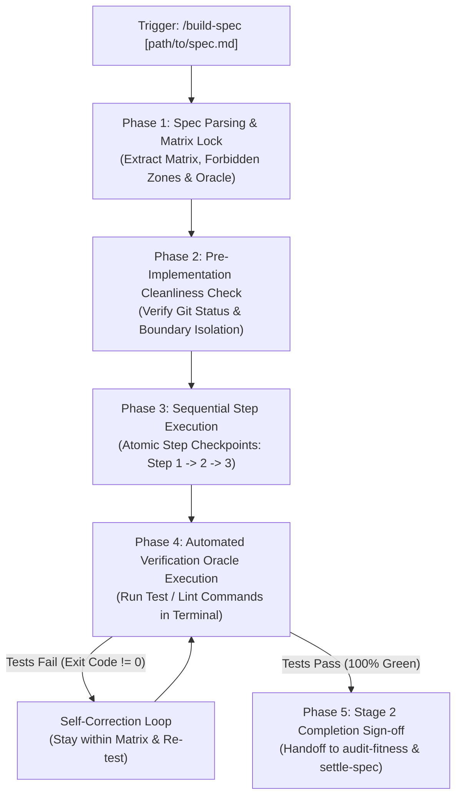

# Build Specification (`build-spec`)

A portable, pure-cognitive workflow for engineers and AI agents to execute **Stage 2: Implementation & Verification** across Blueprint-Driven Development (BDD) and universal software repositories.

Functioning as the execution engine between `craft-spec` (Stage 1 Specification Authoring) and `settle-spec` (Stage 3 Specification Settlement), `build-spec` takes an approved specification, locks implementation boundaries strictly to the declared **File Mutation Matrix**, advances through deterministic implementation steps with checkpointing, and mandates passing the **Verification Oracle** before declaring Stage 2 complete.



---

## When to Run This Skill

Activate this skill when:
- Executing Stage 2 code implementation from an approved specification in `docs/progress/` or `specs/`.
- Preventing AI agents from scope creep, editing forbidden files, or hallucinating unnecessary abstractions.
- Ensuring implementations strictly follow a deterministic sequence (types/interfaces $\to$ core logic $\to$ tests).
- Mandating automated test execution and green verification before code sign-off.
- Preparing verified changes for `audit-workflow-fitness`, `gen-commit-message`, and `settle-spec`.

---

## System Invariants & Guardrails

All operations within the `build-spec` skill must strictly adhere to the following invariants:

### 1. File Mutation Matrix Boundary Invariant
- The agent is **strictly locked** to the paths declared in the target specification's `File Mutation Matrix`.
- If an agent discovers during implementation that an unlisted file *must* be modified:
  - The agent **MUST NOT** silently edit the undeclared file.
  - It must pause, alert the user to the scope discrepancy, and propose an upstream amendment to the specification.
- Editing any path explicitly listed under `FORBIDDEN` is a fatal governance violation.

### 2. Verification Oracle Non-Negotiable Pass Invariant
- Stage 2 cannot be declared complete based on model self-assessment alone.
- The agent **MUST execute the terminal commands** specified under `Verification Oracle / Quality Gate` in the specification.
- If any command fails (exit code $\ne 0$):
  - Enter a bounded self-correction loop (maximum 3 attempts).
  - If tests still fail after 3 attempts, halt and present the raw error logs to the user for human guidance.

### 3. Pre-Implementation Cleanliness Guardrail
- Before modifying any file on disk, `build-spec` must run `git status --short`.
- If there are uncommitted changes colliding with the target File Mutation Matrix, warn the user and seek confirmation before proceeding.

### 4. Pure-Skill First Architecture
- Implemented strictly as a pure cognitive Markdown workflow without auxiliary script binaries, ensuring zero-runtime dependency and maximum cross-platform portability.

### 5. English-Only Maintenance Standard
- All generated code comments, test assertions, error descriptions, and commit message suggestions must be authored exclusively in English.

---

## Five-Phase Cognitive Execution Protocol

### Phase 1: Spec Parsing & Target Resolution
1. **Target Specification Resolution**:
   - If a path is provided (e.g., `/build-spec docs/progress/1.1/9-feature-craft-spec-skill.md`), verify the file exists.
   - If invoked without arguments:
     - Scan `docs/progress/` (Mode A: BDD) or `.agents/specs/` / `specs/` (Mode B: Universal).
     - Present an enumerated list of candidate active specifications for user selection.
2. **Contract Extraction**:
   - Parse and lock the **File Mutation Matrix** (`CREATE`, `MODIFY`, `DELETE`, `FORBIDDEN`).
   - Extract the **Sequential Execution Steps** (Section 3).
   - Extract the **Verification Oracle** commands and acceptance assertions (Section 6).

### Phase 2: Pre-Implementation Cleanliness Check
1. Execute `git status --short`.
2. Cross-reference dirty or untracked files with the declared File Mutation Matrix.
3. If a collision exists, prompt the user:
   - **Option A**: Proceed and incorporate existing changes.
   - **Option B**: Abort and allow user to stash/commit first.

### Phase 3: Sequential Implementation Execution
1. Follow the target spec's sequential execution plan step-by-step:
   - **Step 1: Types & Interfaces First**: Establish data models, schemas, and error types before logic.
   - **Step 2: Core Logic & Handlers**: Implement handlers, utilities, or workflows adhering to upstream contracts. Maintain unidirectional code navigation; avoid reverse pointers back to ephemeral specs.
   - **Step 3: Accompanying Tests**: Write unit, integration, or contract tests matching the feature slice.
2. **Boundary Enforcement**:
   - Verify every tool call (`write_to_file`, `replace_file_content`) targets only paths declared in the Matrix.

### Phase 4: Automated Verification Oracle Execution
1. Execute all verification commands declared in Section 6 of the target specification via `run_command` (e.g., `npm test`, `cargo test`, `npm run type-check`).
2. Evaluate exit codes and terminal outputs:
   - If exit code $== 0$: Verification PASSED.
   - If exit code $\ne 0$: Parse failure stack trace, formulate a localized patch strictly within the Matrix, and re-execute (max 3 loops).

### Phase 5: Stage 2 Completion Sign-off & Next-Stage Handoff
1. Display the **Stage 2 Completion Proof**:
   - List of modified/created files matching the Matrix.
   - Verification Oracle terminal output confirming passing tests.
2. Present the next-stage lifecycle commands:
   - `audit-workflow-fitness` (Workflow and spec linting)
   - `gen-commit-message` (Angular-style commit generation)
   - `settle-spec [path]` (Stage 3 reference settlement and WIP spec retirement)

---

## Output Format: Stage 2 Completion Proof

When Stage 2 is successfully completed, output this structured summary:

```markdown
> [!TIP]
> **Stage 2 Implementation Complete & Verified**
> All files strictly adhered to the File Mutation Matrix and passed the Verification Oracle.

### 📦 Implemented Files:
- `CREATE`: [path/to/file]
- `MODIFY`: [path/to/file]

### 🧪 Verification Oracle Results:
- Command: `[command]` ➔ Exit Code 0 (Passed)
- Command: `[command]` ➔ Exit Code 0 (Passed)

### 🚀 Next Steps:
1. Run `audit-workflow-fitness` to verify governance compliance.
2. Run `gen-commit-message` to stage and commit changes.
3. Run `/settle-spec [spec-path]` to settle living references and retire this progress spec.
```

---

## Additional References

- [Stage 2 Checkpointed Execution Checklist](./references/execution-checklist.md)
