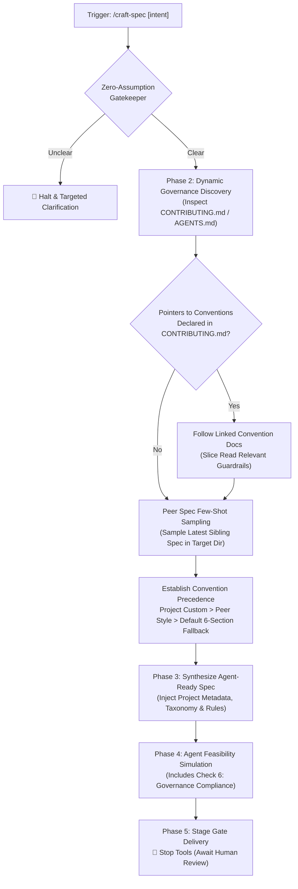
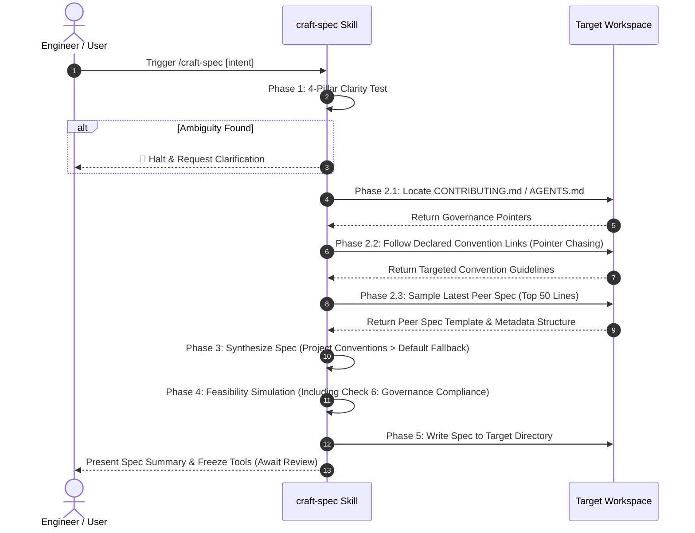

# Craft Specification (`craft-spec`)

A portable, pure-cognitive workflow for engineers and AI agents to execute **Stage 1: Specification Authoring** across Blueprint-Driven Development (BDD) and universal software repositories.

This skill introduces the **Zero-Assumption Gatekeeper** to fail-fast against ambiguous requirements, strictly enforces **Code Immunity** (zero changes to application code), and authors high-density, contract-driven specifications optimized for downstream AI coding agents to implement during Stage 2 without architectural drift or hallucination.



---

## When to Run This Skill

Activate this skill when:
- Starting a new feature, vertical slice, or architectural mechanism before writing any code.
- Formulating Stage 1 specifications in a BDD repository (`docs/progress/`).
- Authoring structured, machine-executable specifications in a non-BDD generic repository.
- Preventing AI agents from rushing into premature code implementation or making unverified assumptions.
- Establishing crisp execution guardrails, file mutation matrices, and automated verification oracles for downstream agents.

---

## System Invariants & Guardrails

> [!IMPORTANT]
> **Code Immunity Guardrail**: The `craft-spec` skill operates exclusively in **read-only mode** on codebase implementation files. It is strictly forbidden from creating, updating, or deleting application code, test implementations, package manifests, or tool configs (`src/**`, `lib/**`, `apps/**`, `packages/**`, etc.). The **only permitted persistent artifact** is the Stage 1 specification markdown file.

- **The Zero-Assumption Gatekeeper**: Never extrapolate or assume default technical choices. Evaluate the **4-Pillar Clarity Test** before drafting:
  1. *Scope & Intent (WHY)*: Core user problem, business goal, and out-of-scope boundaries defined.
  2. *Inputs & Dependencies (WHAT)*: Data models, configs, environment prerequisites, and APIs verified.
  3. *Architectural Invariants (CONSTRAINTS)*: Framework conventions, design systems, unidirectional code maps acknowledged.
  4. *Verification Oracle (ACCEPTANCE)*: Deterministic, automated CLI command and assertable pass/fail criteria identified.
  - If any pillar fails, **immediately halt** and execute the Targeted Clarification Protocol.
- **Adaptive Dual-Mode Operation**:
  - **Mode A (BDD Mode)**: Detected via `docs/progress/` or `docs/blueprint/`. Spec target: `docs/progress/[blueprint-code]/[Index]-feature-[slug].md`.
  - **Mode B (Universal Mode)**: Detected when BDD markers are absent. Target: discovered spec directory (`specs/`, `docs/specs/`, `docs/plans/`) or fallback to `.agents/specs/[feature-slug].md`.
- **Zero Hardcoded Paths Invariant**:
  The skill must not mandate or assume fixed convention directory paths (such as `docs/convention/*`). All convention discovery must dynamically resolve through `CONTRIBUTING.md`, `.github/CONTRIBUTING.md`, `AGENTS.md`, or peer spec sampling.
- **Convention Precedence Hierarchy**:
  $$\text{Project Governance (CONTRIBUTING.md / Linked Docs)} \succ \text{Peer Spec Patterns} \succ \text{Default 6-Section Fallback}$$
  Project-specific metadata, taxonomy, and schemas take precedence while strictly preserving non-negotiable core invariants (File Mutation Matrix, Verification Oracle, Stage Gate Isolation, and Path Portability).
- **Stage Gate Isolation (No Premature Implementation)**: The deliverable of Stage 1 is strictly the specification document. After writing the spec, stop tools immediately and await human review.
- **Pure-Skill First (Zero-Runtime Dependency)**: Implemented strictly as a cognitive Markdown workflow (`SKILL.md`) without auxiliary script binaries.
- **English-Only Maintenance**: All specifications, frontmatter, diagrams, and commit suggestions must be authored exclusively in English.
- **Path Portability & Zero-`file://` Invariant**:
  All file paths, symbol references, and markdown links inside the generated specification document MUST strictly use repository-relative paths (e.g., `docs/reference/...`, `libs/...`) or plain inline code backticks (e.g., `StartupChecklistItemView.tsx`).
  The `file://` URI scheme and machine-specific absolute workstation paths (e.g., `/Users/*`, `/home/*`, `C:\*`) are **STRICTLY FORBIDDEN** within any repository documents. `file://` links are exclusively reserved for interactive chat dialogue, never repository files.
- **Workspace Boundary & Context Isolation Invariant**:
  The specification MUST be anchored strictly within the active target repository workspace (`CWD` / Workspace Root).
  The agent MUST ignore any open editor documents or conversation history belonging to external directories or different repositories. All analyzed blueprints, living references, and File Mutation Matrix paths must reside 100% within the current workspace boundary.

---

## 5-Phase Execution Protocol



### Phase 1: Zero-Assumption Gatekeeper Evaluation
1. Parse user requirement or issue description.
2. Evaluate against the 4-Pillar Clarity Test (see [clarity-gatekeeper-checklist.md](./references/clarity-gatekeeper-checklist.md)).
3. If any requirement, boundary, or verification oracle is ambiguous:
   - **HALT IMMEDIATELY**. Do not write any file to disk.
   - Emit the structured clarification block (see below) with 2–4 targeted options or direct questions.
4. If the prompt is ambiguous and the active document belongs to an external project, halt and trigger clarification rather than guessing or borrowing foreign domain context.

### Phase 2: Archetype Profiling & Dynamic Governance Grounding
1. **Enforce Workspace Anchor**: Grounding MUST strictly resolve relative to the current workspace root (`CWD`). Explicitly disregard open editor tabs (`Active Document`, `Other open documents`) that reside outside the active repository root.
2. **Dynamic Governance Discovery**:
   - Inspect `CONTRIBUTING.md`, `.github/CONTRIBUTING.md`, or `AGENTS.md` for project-specific workflow rules, spec lifecycles, and architecture boundaries.
   - Follow declared markdown links to specific convention documents on-demand (Pointer Chasing).
3. **Detect Mode**:
   - `docs/progress/` or `docs/blueprint/` present in current workspace ➔ **Mode A (BDD)**.
   - Otherwise ➔ **Mode B (Universal)**.
4. **Context Grounding & Peer Spec Sampling (Read-Only)**:
   - *Mode A*: Ground from upstream blueprint (`docs/blueprint/[code]_*.md`) and living references (`docs/reference/`). Sample the top 50 lines of the latest sibling spec in `docs/progress/[code]/` to extract established metadata blocks, naming conventions, and type library choices.
   - *Mode B*: Ground from repository `README.md`, package manifests (`package.json`, `Cargo.toml`, etc.), and exported types. Resolve spec directory (`specs/`, `docs/specs/`, or `.agents/specs/`) and sample latest sibling spec.

### Phase 3: Agent-Ready Spec Synthesis
1. Apply the **Convention Precedence Rule**:
   $$\text{Project Governance (CONTRIBUTING.md / Linked Docs)} \succ \text{Peer Spec Patterns} \succ \text{Default 6-Section Fallback}$$
2. Inject project-specific metadata (e.g., `## 1. Metadata` with `Target Apps`, `Target Libs`, `Owner`, `Blueprint Code`) if mandated by project conventions.
3. When using the default schema, draft the specification using the mandatory 6-section schema (see [spec-template.md](./references/spec-template.md)):
   1. `## 1. Overview & Rationale` (Mermaid flowchart + problem statement)
   2. `## 2. System Invariants & Guardrails` (Explicit boundaries & Out-of-Scope list)
   3. `## 3. Cognitive / Execution Workflow Protocol` (Deterministic steps)
   4. `## 4. File Mutation Matrix` (`CREATE`, `MODIFY`, `DELETE`, `FORBIDDEN`)
   5. `## 5. Interface Contract & Schema Deltas` (Code as Truth)
   6. `## 6. Verification Oracle & Quality Gate` (Deterministic CLI commands)
4. Ensure Core Invariants (Mutation Matrix, Oracle, Boundaries, Path Portability) remain fully intact.

### Phase 4: Downstream Agent Feasibility Simulation
Execute a cognitive simulation before writing:
- *Check 1*: Can a fresh AI agent execute Stage 2 without guessing any file path or type signature?
- *Check 2*: Are all qualitative adjectives replaced with measurable invariants?
- *Check 3*: Is the Verification Oracle fully automated and executable in terminal?
- *Check 4 (Path Purity Check)*: Verify that the drafted specification markdown contains **ZERO occurrences** of `file://`, `/Users/`, `/home/`, or OS-specific absolute roots before invoking `write_to_file`. If found, convert them to repository-relative paths or inline backticks immediately.
- *Check 5 (Workspace Containment Check)*: Verify that all declared paths in the File Mutation Matrix reside 100% within the current target repository workspace.
- *Check 6 (Governance & Convention Compliance)*: Verify that the drafted spec adheres to the lifecycle, naming taxonomy, and architecture layers declared in the project's `CONTRIBUTING.md` and sampled peer specs.

### Phase 5: Delivery & Stage Gate Isolation
1. Write the completed spec to the resolved target path.
2. Present a concise summary (Mode, File link, Mutation Matrix summary, Verification command).
3. **STOP CALLING TOOLS**: Freeze execution immediately and await human approval.

---

## Clarification Output Format (When Gatekeeper Halts)

When requirements are ambiguous or incomplete, output this exact structure:

```markdown
> [!CAUTION]
> **Stage 1 Gatekeeper Blocker: Requirement Ambiguity Detected**
> Specification authoring has been halted to prevent architectural hallucination.

### 🔴 Blocking Ambiguities:
1. **[Dimension Name]**: [Explanation of why this cannot be drafted without user input]

### ❓ Clarification Needed:
- **Question 1**: [Specific question with 2-4 mutually exclusive options (A/B/C) or direct answer requirement]
- **Question 2**: [Scope / Out-of-Scope boundary confirmation]
```

---

## Additional References

- [Specification Template](./references/spec-template.md)
- [Clarity Gatekeeper Checklist](./references/clarity-gatekeeper-checklist.md)
