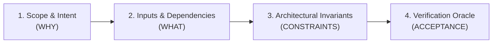

# Zero-Assumption Gatekeeper: 4-Pillar Clarity Checklist

The **Zero-Assumption Gatekeeper** protects against premature coding, scope drift, and downstream hallucination by rejecting underspecified requirements before any specification is drafted.

---

## The 4-Pillar Clarity Test

Before initiating specification drafting, evaluate the requirement against these four non-negotiable pillars:



### Pillar 1: Scope & Intent (WHY)
- [ ] Is the primary user problem or business requirement explicitly articulated?
- [ ] Is the expected user/system flow unambiguously defined from trigger to completion?
- [ ] Is there an explicit **Out-of-Scope** boundary declaring what will NOT be done?
- **Red Flags**:
  - Phrases like "improve performance", "clean up the code", or "add caching" without concrete targets.
  - Undefined triggers or unclear consumer identities.

### Pillar 2: Inputs & Dependencies (WHAT)
- [ ] Are all required data structures, fields, and types declared or discoverable in code?
- [ ] Are upstream APIs, database schemas, or external packages identified?
- [ ] Are failure modes, network timeouts, and invalid input states specified?
- **Red Flags**:
  - Missing field types (e.g. "accept user details" without listing fields).
  - Unclear source of truth for runtime configurations.

### Pillar 3: Architectural Invariants (CONSTRAINTS)
- [ ] Does the proposed change align with project directory topologies and naming conventions?
- [ ] Are project-specific governance and workflow directives in `CONTRIBUTING.md` or `AGENTS.md` (and linked convention files) identified and respected?
- [ ] Are domain state machines and fault-tolerance policies respected?
- [ ] Are unidirectional code navigation rules preserved (no reverse doc links)?
- [ ] Is the English-Only maintenance directive maintained?
- [ ] Are path portability rules respected (strictly repository-relative or backticked, zero file:// or local absolute workstation paths)?
- [ ] Is grounding strictly isolated to the current repository workspace (disregarding out-of-workspace tabs and external conversation history)?
- **Red Flags**:
  - Proposing modifications to protected core packages or forbidden shared libraries.
  - Introducing heavy runtime dependencies into zero-dependency pure skills.

### Pillar 4: Verification Oracle (ACCEPTANCE)
- [ ] Is there an exact automated command (e.g., `npm test`, `cargo test`, `go test`) to verify success?
- [ ] Are there deterministic pass/fail criteria that require zero subjective human interpretation?
- [ ] Are both happy path and failure/edge case assertions identified?
- **Red Flags**:
  - Acceptance criteria relying on "looks good", "feels intuitive", or manual verification only.
  - Absence of existing or planned test harness.

---

## Evaluation Outcomes & Protocol

### 1. Gatekeeper PASS
- All 4 pillars have clear, assertable answers.
- Proceed to **Phase 2: Archetype Profiling & Grounding**.

### 2. Gatekeeper FAIL (Halt & Clarify)
- If ANY pillar fails or remains ambiguous:
  - **HALT IMMEDIATELY**: Do not create or update any specification file on disk.
  - Structure a targeted clarification inquiry using the standard alert template:

```markdown
> [!CAUTION]
> **Stage 1 Gatekeeper Blocker: Requirement Ambiguity Detected**
> Specification authoring has been halted to prevent architectural hallucination.

### 🔴 Blocking Ambiguities:
1. **[Pillar / Dimension]**: [Concrete explanation of the ambiguity]

### ❓ Clarification Needed:
- **Question 1**: [Multiple-choice inquiry with 2-4 mutually exclusive options (A/B/C)]
- **Question 2**: [Confirmation of specific boundary or out-of-scope constraint]
```

---

## Inquiry Best Practices
1. **Prefer Multiple-Choice**: Presenting explicit options (e.g., "A: Redis in-memory cache, B: Local LRU memory cache") prevents endless back-and-forth prompts.
2. **Surface Architectural Trade-offs**: When presenting options, briefly state the trade-off (e.g., "Option A requires Docker dependency; Option B is zero-runtime").
3. **Keep Questions Targeted**: Ask only what is strictly necessary to unblock the 4 pillars. Avoid cosmetic or trivial inquiries.
