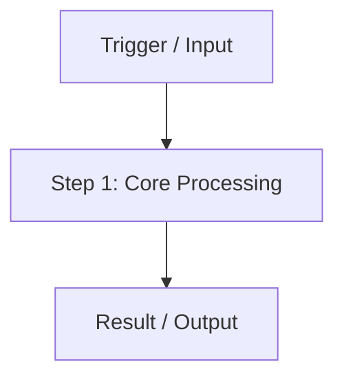
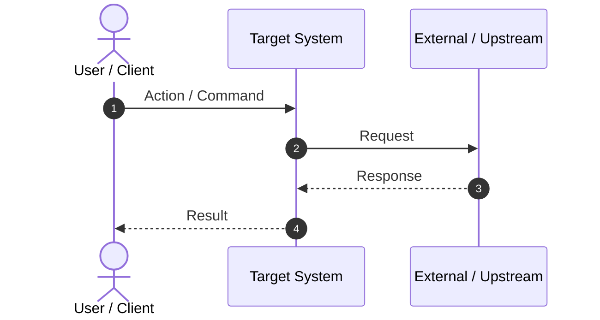

# Specification Template for Downstream AI Agents

This template provides the standard 6-section specification schema required by `craft-spec`. It is optimized for downstream autonomous AI coding agents to implement during Stage 2 without architectural drift or guesswork.

---

```markdown
# [Feature / Slice Title] (`[Index]-[type]-[slug]`)

<!-- Ref: [Upstream Blueprint / Requirement Link] -->

## 1. Overview & Rationale

[Provide a high-density summary of the feature, business goal, and primary user flow.]



### 1.1 Context & Problem Statement
- [Context point 1: Current architecture or behavior limitation]
- [Context point 2: Root cause of problem or engineering pain point]

### 1.2 Target Objectives
- [Objective 1: Measurable outcome or deliverable]
- [Objective 2: Architectural or performance invariant]

---

## 2. System Invariants & Guardrails

### 2.1 Core Invariants
- [Invariant 1: Non-negotiable architectural or domain rule]
- [Invariant 2: Data consistency, idempotency, or safety constraint]

### 2.2 Boundary Guardrails & Out-of-Scope (Forbidden Scope)
- ❌ **Out-of-Scope 1**: [Explicitly prohibited feature or module modification]
- ❌ **Out-of-Scope 2**: [Prohibited dependency or refactoring item]

---

## 3. Cognitive / Execution Workflow Protocol



### Phase 1: [Phase Name]
1. [Step 1: Actionable step with exact inputs and outputs]
2. [Step 2: Decision fork or validation rule]

### Phase 2: [Phase Name]
1. [Step 1: Actionable step]
2. [Step 2: State transition or side-effect]

---

## 4. File Mutation Matrix (Target Scope)

Downstream agents must restrict file operations strictly to the following declared paths:

| Operation | Target Path | Responsibility / Purpose |
| :--- | :--- | :--- |
| `CREATE` | `path/to/new-file.ext` | [Purpose and exported symbols] |
| `MODIFY` | `path/to/existing-file.ext` | [Targeted modification slice] |
| `DELETE` | `path/to/deprecated-file.ext` | [Removal justification] |
| `FORBIDDEN` | `path/to/protected/**` | [Explicitly protected areas] |

---

## 5. Interface Contract & Schema Deltas

> [!NOTE]
> Adheres to **Code as Truth**: declare exact type signatures, schemas, and error structures.

### 5.1 Public Interfaces / Types
```typescript
// Insert exact type definitions, DTOs, or schema contracts
export interface ExamplePayload {
  readonly id: string;
  readonly status: 'ACTIVE' | 'INACTIVE';
}
```

### 5.2 Error Codes & Failure Modes
| Error Code | HTTP / Exit Code | Trigger Condition | Remediation |
| :--- | :--- | :--- | :--- |
| `ERR_INVALID_INPUT` | 400 / 1 | Validation schema failure | Check required fields |

---

## 6. Verification Oracle & Quality Gate

Deterministic verification commands to assert completion without subjective human guessing:

### 6.1 Automated Verification Commands
```bash
# Linter / Type-check command
npm run lint

# Automated test suite command
npm run test:target
```

### 6.2 Acceptance Test Scenarios
- **Scenario A (Happy Path)**:
  - *Input*: [Specific input or action]
  - *Expected Result*: [Assertable output, exit code 0, state transition]
- **Scenario B (Edge / Failure Case)**:
  - *Input*: [Malformed input or boundary condition]
  - *Expected Result*: [Handled error, expected error code, zero side-effects]
```
