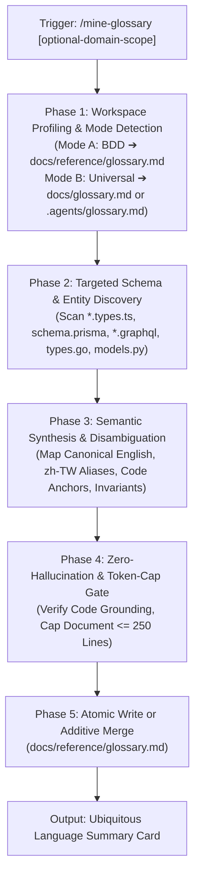

# Mine Glossary (`mine-glossary`)

A portable, pure-cognitive workflow for engineers and AI agents to extract, synthesize, and maintain an authoritative **Ubiquitous Language Glossary** across polyglot and multi-package software repositories.

By inspecting production schemas, typed contracts, lifecycle state machines, and product blueprints, `mine-glossary` resolves multilingual terminology drift, eliminates hallucinated domain concepts, and bridges colloquial user language (e.g., Traditional Chinese `zh-TW`) directly with active code symbols.



---

## When to Run This Skill

Activate this skill when:
- **Onboarding or Context Gathering**: Exploring a new repository, unfamiliar subsystem, or complex domain before drafting specifications or making architectural decisions.
- **Eliminating Terminology Drift**: Resolving discrepancies where different modules or team members use conflicting synonyms (e.g., `Void` vs `Refund`, `Modifier` vs `Addon`, `Discount` vs `Round-off`).
- **Bridging Multilingual Intent**: Connecting non-English stakeholder terminology (such as Traditional Chinese / `zh-TW` requirements) directly with concrete code symbols, preventing AI agents from inventing arbitrary translation aliases.
- **Grounding Specification Authoring**: Preparing domain terminology before running `craft-spec` to prevent ghost nouns or phantom fields in interface contracts and invariant guardrails.
- **Enriching Living References**: Establishing or updating the single source of truth for domain vocabulary in `docs/reference/glossary.md`.

---

## System Invariants & Guardrails

All operations within the `mine-glossary` skill must strictly adhere to the following invariants:

### 1. Non-Invasive Safety Guardrail (Read-Only Codebase)
- The skill operates in **strictly read-only mode** on application source code (`src/**`, `libs/**`, `packages/**`, `apps/**`, `internal/**`).
- It is strictly forbidden from editing, renaming, refactoring, or deleting business code, tests, or configuration files.

### 2. Single Permitted Output Target
- The only permitted file modifications are to the living glossary document:
  - **Mode A (BDD Mode)**: `docs/reference/glossary.md` (or domain slice `docs/reference/glossary-[domain].md`).
  - **Mode B (Universal Mode)**: `.agents/glossary.md` or `docs/glossary.md`.

### 3. Code as Truth & Symbol Grounding Invariant
- Every cataloged term must anchor directly to a verified code symbol (an interface, type alias, enum value, database model, or state transition) physically present in the workspace.
- Inventing speculative concepts or ungrounded business entities is strictly prohibited.

### 4. Incremental Preservation Rule (Additive Merge)
- When updating an existing glossary, perform an **additive merge**.
- Never overwrite or delete human-authored business context, existing custom explanations, or established disambiguation notes unless the underlying code symbol has been deleted or renamed in active code.

### 5. Agentic Documentation Formatting (No Markdown Tables)
- Glossaries must use hierarchical bullet lists (`- **Key**: ...`) rather than Markdown tables (`| ... |`).
- Bullet lists provide optimal token scannability for LLMs, prevent horizontal whitespace explosion, and ensure clean line-by-line Git diffs.

### 6. Language Standard (English-Only Maintenance with Localized Mapping)
- The canonical term name, bounded context definition, code anchors, and domain invariants must be authored and maintained in English.
- Multilingual colloquial terms and regional translations are cataloged under dedicated mapping keys (e.g., `- **Localized Synonyms (zh-TW)**: ...`).

### 7. Path Portability & Zero-`file://` Invariant
- All paths and file pointers must use repository-relative paths (`./` or relative to workspace root) or inline backticks.
- Machine-absolute paths (`/Users/*`, `/home/*`) and `file://` URIs are strictly forbidden in committed glossary files.

### 8. Token Discipline & Line-Count Cap ($\le 250$ Lines)
- A single glossary file must not exceed **250 lines** ($\approx 2,500$ tokens).
- If a domain grows beyond 250 lines, decompose the glossary into domain-scoped living specs (e.g., `docs/reference/glossary-[domain].md`).

---

## 5-Phase Cognitive Protocol

### Phase 1: Workspace Profiling & Mode Resolution

1. **Detect Workspace Archetype**:
   - Check if `docs/blueprint/` or `docs/progress/` exists ➔ **Mode A (BDD Mode)**. Target path: `docs/reference/glossary.md`.
   - Otherwise ➔ **Mode B (Universal Mode)**. Target path: `.agents/glossary.md` (or `docs/glossary.md` if `docs/` exists).
2. **Resolve Domain Scope**:
   - If an optional domain argument was provided (e.g., `/mine-glossary billing` or `/mine-glossary order`), restrict scanning to packages or directories matching that domain keyword.
   - If invoked without arguments, inspect top-level workspace layout (`packages/*`, `apps/*`, `libs/*`, `src/*`, `internal/*`) to identify active bounded contexts.
3. **Inspect Existing Glossary**:
   - Check if the target glossary file exists on disk.
   - If present, read the existing terms to ensure additive merge behavior in Phase 5.

### Phase 2: Targeted Schema & Entity Discovery

1. **Type & Schema Inspection (Code as Truth)**:
   - Execute targeted pattern searches (`grep_search`) across the scoped directories:
     - **TypeScript / JavaScript**: `export enum `, `export interface `, `export type `, `z.object(`, `Type.Object(`
     - **Database Schemas / Prisma**: `model ` in `schema.prisma`, `CREATE TABLE` in migrations/DDL
     - **GraphQL**: `type ` or `enum ` in `*.graphql`
     - **Go**: `type .* struct`, `type .* interface`
     - **Python**: `class .*(BaseModel):`, `class .*(Enum):`
2. **State Machine & Lifecycle Enumeration**:
   - Identify string literal unions and enum members representing entity lifecycles (e.g., `PENDING`, `COMMITTED`, `VOIDED`, `REFUNDED`, `SETTLED`).
3. **Intent & Blueprint Grounding**:
   - Read high-level overviews in `docs/blueprint/*.md`, `docs/reference/*.md`, or root `README.md` to extract business context, stakeholder terms, and colloquial synonyms.

### Phase 3: Semantic Synthesis & Disambiguation

1. **Synthesize Canonical Entries**:
   For each discovered concept, structure an entry conforming to the standard schema:
   - **Canonical English Term**: Standardized English name in Title Case or PascalCase.
   - **Bounded Context**: Owning subsystem, package, or business module.
   - **Code Anchor**: Exact type symbol and repository-relative file path (`[Symbol]` in `[path]`).
   - **Localized Synonyms (zh-TW)**: Traditional Chinese translations and regional business terms.
   - **Forbidden Aliases**: Deprecated, ambiguous, or colloquial terms that agents must avoid using in code and specs.
   - **Domain Invariant**: 1–2 concise sentences defining non-negotiable state machine rules, validation constraints, or financial implications.
2. **Disambiguation Pairing**:
   - For commonly conflated domain terms (e.g., `Void` vs `Refund`, `Modifier` vs `Add-on`, `Discount` vs `Round-off`), formulate explicit contrasting invariants highlighting boundary differences.

### Phase 4: Zero-Hallucination & Token-Cap Gate

1. **Symbol Grounding Assertion**:
   - Validate that 100% of declared `Code Anchor` symbols exist in active repository files.
   - Remove or mark any ungrounded terms.
2. **Token Discipline & Line Count Check**:
   - Calculate total line count of the synthesized glossary document.
   - If total lines $\le 250$: Proceed to Phase 5.
   - If total lines $> 250$: Prune low-frequency internal helper types or segment into domain-specific topic files (e.g., `docs/reference/glossary-[domain].md`).

### Phase 5: Atomic Write or Additive Merge

1. **Write or Merge Target File**:
   - If greenfield: Write the synthesized glossary conforming to the [glossary template](./references/glossary-template.md).
   - If updating existing glossary: Perform an additive merge, preserving all human notes and non-conflicting entries.
2. **Present Ubiquitous Language Summary Card**:
   - Display a concise report summarizing discovered terms, bounded contexts, and disambiguation pairs.

---

## Canonical Glossary Schema (`docs/reference/glossary.md`)

```markdown
# [Domain / Workspace] Domain Glossary & Ubiquitous Language

<!-- Invariant: All paths must be repository-relative or enclosed in inline code backticks. NEVER use file:// or workstation-absolute paths (/Users/*, /home/*). -->

## 1. [Bounded Context Name]

- **[Canonical English Term]**:
  - **Bounded Context**: [Subsystem / domain package]
  - **Code Anchor**: `[Symbol / Interface / Enum]` in `[path/to/types.ts]`
  - **Localized Synonyms (zh-TW)**: [Traditional Chinese terms, e.g., 作廢]
  - **Forbidden Aliases**: [Prohibited synonyms, e.g., cancel, delete]
  - **Domain Invariant**: [1-2 sentences on core state machine or business rule]
```

---

## Error Diagnostics & Handling Protocols

- **`ERR_NO_DOMAIN_SCHEMAS_FOUND`**:
  - *Trigger*: Discovery scanning failed to find any typed interfaces, enums, or schema definitions in the target scope.
  - *Action*: Inform the user, suggest broadening the search scope, or prompt for a specific schema directory path.
- **`ERR_GLOSSARY_TOKEN_OVERFLOW`**:
  - *Trigger*: Projected or synthesized glossary exceeds 250 lines ($\approx 2,500$ tokens).
  - *Action*: Advise splitting the glossary into domain slices (e.g., `docs/reference/glossary-[domain].md`) or filter out non-core utility types.

---

## Output Format: Ubiquitous Language Summary Card

Upon completing the mining process, present this structured summary to the user:

```markdown
### 📖 Ubiquitous Language Summary Card

- **Target Destination**: `[docs/reference/glossary.md | .agents/glossary.md]`
- **Domain Scope**: `[All Domains | Scoped Domain Name]`
- **Cataloged Terms**: `[N total (X new, Y updated, Z preserved)]`

#### 🧩 Discovered Bounded Contexts:
- **[Bounded Context 1]**: [Count] terms (e.g., `[Term A]`, `[Term B]`)
- **[Bounded Context 2]**: [Count] terms (e.g., `[Term C]`, `[Term D]`)

#### ⚖️ Key Disambiguations:
- **`[Term A]` vs `[Term B]`**: [1-sentence distinction]

👉 **Next Steps**:
- Reference these canonical terms in Stage 1 specifications via `/craft-spec`.
- Ground query strings during context gathering via `/progressive-context-loader`.
```

---

## Additional References

- [Glossary Agentic Markdown Template](./references/glossary-template.md)
- [E-Commerce & Subscription Domain Glossary Example](./examples/glossary-example.md)
